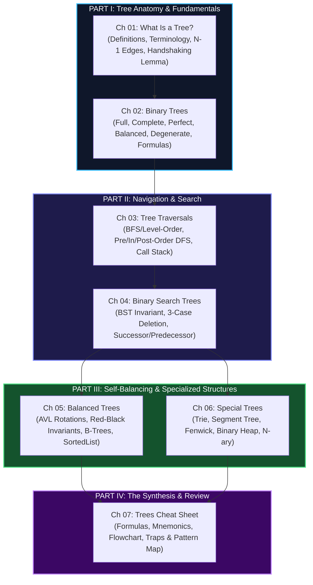

# 🌲 Trees: The Complete Guide

> *"Trees are the poetry of computer science — recursive structures where every branch whispers the same secret as the trunk."*  
> *"Master the tree, and you have mastered half of all technical interview questions."*

Welcome to **Trees (The Complete Guide)** — a comprehensive, from-first-principles treatise on hierarchical data structures. Designed to bridge pure academic theory with practical, high-velocity coding assessment patterns.

---

## 🧭 Why Trees Matter

Trees represent the foundational bridge between simple linear collections (Arrays, Linked Lists) and complex non-linear networks (Graphs):

```
┌─────────────────────────────────────────────────────────────────────────────┐
│ LINEAR (Arrays, Lists)        TREES (Hierarchical)        GRAPHS (General)  │
│ 1-to-1 relationships    ──►   1-to-Many hierarchy   ──►   Many-to-Many      │
│ O(N) search (unsorted)        O(log N) search (BST)       Variable runtime  │
│ Rigid layout                  Recursive subproblems       Cycles & meshes   │
└─────────────────────────────────────────────────────────────────────────────┘
```

In technical interviews and real-world infrastructure:
- **Hierarchical data**: DOM trees, file systems, JSON/XML ASTs, org charts.
- **Logarithmic access**: BSTs, AVL, Red-Black trees powering C++ `std::map` and Java `TreeMap`.
- **Database indexing**: B-Trees and B+ Trees storing terabytes of relational data on disk.
- **Prefix evaluation**: Tries providing instant autocomplete and IP routing tables.

---

## 🗺️ Master Curriculum Roadmap



---

## 📑 Complete Chapter Catalog

| # | Chapter Title | Core Topics | Key Theorems / Formulas |
|---|---|---|---|
| **01** | [What Is a Tree?](01_what_is_a_tree.md) | Formal $G=(V, E)$, Root/Leaf/Height/Depth, Recursive Subtrees | $E = V - 1$, Handshaking Lemma $\sum \deg(v) = 2E$, Tree Taxonomy |
| **02** | [Binary Trees](02_binary_trees.md) | 5 BT Types (Full, Complete, Perfect, Balanced, Degenerate) | Max nodes at level $i = 2^i$, Max nodes of height $h = 2^{h+1}-1$, Array indexing |
| **03** | [Tree Traversals](03_tree_traversals.md) | BFS Level-Order, Pre-Order, In-Order, Post-Order DFS | Call stack visualization, Iterative with Stack/Queue, Generator pattern |
| **04** | [Binary Search Trees](04_binary_search_trees.md) | BST Invariant (Left < Root < Right), Insertion, 3 Deletion Cases | In-order successor/predecessor, Skewed $O(N)$ vs Balanced $O(\log N)$ |
| **05** | [Balanced Trees](05_balanced_trees.md) | AVL Trees, Red-Black Trees, B-Trees, Python SortedList | Balance factor $\in \{-1,0,+1\}$, 4 Rotations (LL, RR, LR, RL), $h \le 2\log_2(n+1)$ |
| **06** | [Special Trees](06_special_trees.md) | Trie, Segment Tree, Fenwick (BIT), Binary Heap, N-ary Trees | Prefix search $O(L)$, Range query $O(\log N)$, Heapify $O(N)$ |
| **07** | [⚡ Trees Cheat Sheet](07_trees_cheat_sheet.md) | Rapid interview recall, Decision flowchart, Top 10 traps | All formulas, Traversal mnemonics, Pattern connection matrix |

---

## 🌉 Cross-Pillar Bridges: Connecting Theory to Tactics

### 🏛️ Upstream: Foundations in Theory (Pillar 0)
- **Recurrences & Master Theorem**: The runtime of tree algorithms is directly derived using [Ch 03: Recurrences & Master Theorem](../000%20-%20Theoretical%20Foundations%20%28The%20Complete%20Guide%29/03_recurrences_and_master_theorem.md). For divide-and-conquer on balanced trees, $T(N) = 2T(N/2) + O(1) \implies O(N)$.
- **Amortized Analysis**: Self-adjusting trees (like Splay Trees) and dynamic tree rebalancing are proven via the Potential Method in [Ch 04: Amortized Analysis](../000%20-%20Theoretical%20Foundations%20%28The%20Complete%20Guide%29/04_amortized_analysis.md).
- **Sorting Lower Bounds**: Comparison sorting $\Omega(N \log N)$ lower bounds are proven using decision trees in [Ch 05: Lower Bounds & Impossibility](../000%20-%20Theoretical%20Foundations%20%28The%20Complete%20Guide%29/05_lower_bounds_and_impossibility.md).

### ⚔️ Downstream: Algorithmic Patterns (Pillar 2)
Mastering this guide unlocks direct proficiency in these primary pattern modules:
- [11 - Tree Breadth First Search](../../11%20-%20Tree%20Breadth%20First%20Search/): Level-order, zigzag, and minimum depth.
- [12 - Tree Depth First Search](../../12%20-%20Tree%20Depth%20First%20Search/): Path sums, tree diameters, and lowest common ancestors (LCA).
- [15 - Two Heaps](../../15%20-%20Two%20Heaps/) & [19 - Top K Elements](../../19%20-%20Top%20K%20Elements/): Priority queues built on Complete Binary Trees.
- [26 - Trie](../../26%20-%20Trie/): Word search, autocomplete, and bitwise XOR problems.
- [41 - Segment Tree](../../41%20-%20Segment%20Tree/) & [42 - Binary Indexed Tree](../../42%20-%20Binary%20Indexed%20Tree/): Dynamic range queries and point updates.

---

## 👤 Persona Reading Matrix

| Your Current Goal | Recommended Chapters | Skip for Now |
|---|---|---|
| **Undergraduate Student** (Acing Midterms) | Ch 01, 02, 03, 04, 05 | Ch 06 (Segment/Fenwick) |
| **LeetCode Assessment Sprint (2–3 Days)** | Ch 03, 04, 07 | Ch 05 (AVL/Red-Black deep math) |
| **Senior / Staff Systems Engineer** | Ch 04, 05 (B-Trees / LSM), Ch 06 | Ch 01 |
| **PhD Researcher / Theoretical Purist** | Full end-to-end, with formal induction on height bounds | — |

---

## 🧭 Navigation

| ← Previous Pillar | ↑ Fundamentals Hub | Next Module → |
|:---|:---:|---:|
| [🏛️ 000 - Theoretical Foundations](../000%20-%20Theoretical%20Foundations%20%28The%20Complete%20Guide%29/) | [📚 Fundamentals Index](../README.md) | [🕸️ 010 - Graphs (The Complete Guide) →](../010%20-%20Graphs%20%28The%20Complete%20Guide%29/) |
