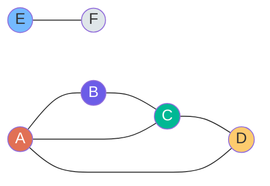
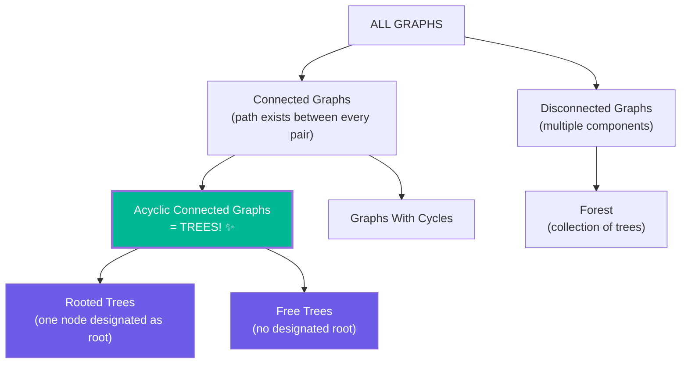
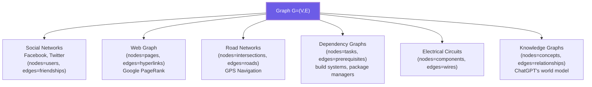

# Chapter 1: What Is a Graph? 🕸️

---

## 👶 Explain Like I'm 5

Imagine you're playing with a **map of your city**.

- Every **building** (airport, school, house) is a **dot**.
- Every **road** connecting two buildings is a **line**.

Now here's what makes a city map **different from a family tree**:

1. **Roads can go both ways** — you can drive from school to home AND from home to school.
2. **Some roads are one-way** — like a one-way street: you can go from A to B but not back.
3. **Some buildings are connected to many others** — a highway interchange connects dozens of roads.
4. **You can go in circles** — drive around the block and end up where you started!

That city map IS a **graph**. It's the most flexible and powerful data structure in computer science.

> **Trees are the "tidy" version of graphs** — no loops, everything flows neatly top-down. Real-world problems (social networks, roads, web pages, dependencies) are messy graphs.

---

## 🎯 Formal Definition

> **A Graph `G = (V, E)`** is a pair of:
> - **`V`** — a set of **vertices** (also called nodes)
> - **`E`** — a set of **edges**, where each edge connects a pair of vertices

**Example**: The graph of cities connected by flights.
```
V = {NYC, LAX, CHI, MIA, SEA}
E = {(NYC, LAX), (NYC, CHI), (CHI, MIA), (LAX, SEA), (CHI, SEA)}
```

---

## 📚 The Complete Terminology Bible



| Term | Definition | Example (above) |
|------|-----------|----------------|
| **Vertex (Node)** | A single entity in the graph | A, B, C, D, E, F |
| **Edge** | A connection between two vertices | A−B, B−C, C−D, D−A, A−C, E−F |
| **Degree** | Number of edges touching a vertex | `degree(A) = 3` (edges to B, D, C) |
| **In-degree** | (Directed only) edges coming *into* a node | — |
| **Out-degree** | (Directed only) edges going *out* of a node | — |
| **Path** | A sequence of vertices where each consecutive pair is connected | A → B → C → D |
| **Simple Path** | A path with **no repeated vertices** | A → B → C (simple). A → B → A (NOT simple) |
| **Cycle** | A path that starts and ends at the **same vertex** | A → B → C → A |
| **Walk** | Like a path but vertices CAN repeat | A → B → A → C |
| **Trail** | A walk where **edges** don't repeat (but vertices can) | A → B → C → A → D |
| **Connected** | There exists a path between **every pair** of vertices | {A,B,C,D} are connected. E,F are isolated. |
| **Connected Component** | A maximal connected subgraph | Component 1: {A,B,C,D}. Component 2: {E,F}. |
| **Isolated Vertex** | A vertex with **degree 0** | None in this example |
| **Adjacent** | Two vertices connected by an edge | A and B are adjacent |
| **Neighbor** | Same as adjacent | B is a neighbor of A |
| **Self-loop** | An edge from a vertex to **itself** | None above |
| **Multi-edge** | Two edges between the **same pair** of vertices | None above |
| **Simple Graph** | No self-loops, no multi-edges | This is a simple graph |

---

## 🤝 The Handshaking Lemma

> **For any undirected graph**: The sum of all vertex degrees equals **2 × |E|**.
> $$\sum_{v \in V} \deg(v) = 2|E|$$

**Intuition**: Every edge contributes exactly 2 to the total degree count — one for each of its two endpoints. When you shake hands, both people's "handshake count" goes up by 1.

**Corollary**: In any graph, the number of vertices with **odd degree** is always **even**. (Can you prove this? It follows directly from the lemma: if the sum is 2|E| — an even number — the odd-degree vertices must pair up.)

**Example verification** (from our diagram):
```
degree(A) = 3, degree(B) = 2, degree(C) = 3, degree(D) = 2, degree(E) = 1, degree(F) = 1
Sum = 3+2+3+2+1+1 = 12
|E| = 6 (edges: A-B, B-C, C-D, D-A, A-C, E-F)
2×|E| = 12 ✅
```

---

## 🔑 Tree Is a Special Graph

This is the most important relationship to internalize:



| Property | Tree | Graph |
|----------|------|-------|
| Connected | Always ✅ | Not required |
| Cycles | Never ❌ | Allowed |
| Edges | Exactly N−1 | 0 to N(N-1)/2 |
| Unique path between nodes | Always ✅ | Not guaranteed |
| Traversal needs visited set | ❌ Not needed | ✅ Mandatory |

**Key insight**: Because trees have no cycles, you never revisit a node during traversal. Graphs CAN have cycles — so without a `visited` set, you'll loop forever.

---

## 📐 Euler's Formula (Planar Graphs)

For a **connected planar graph** (a graph that can be drawn on a plane without edge crossings):

$$V - E + F = 2$$

Where:
- `V` = vertices
- `E` = edges
- `F` = faces (regions, including the outer infinite region)

**Example**: A cube has `V=8, E=12, F=6` → `8 - 12 + 6 = 2` ✅

**For trees**: Trees have no "enclosed" faces. F = 1 (just the outer region).
`N - (N-1) + 1 = 2` ✅ (confirms our earlier formula E = N−1)

---

## 📊 Graph Density

Two important classes:

| Class | Definition | |
|-------|-----------|--|
| **Sparse Graph** | `|E| ≈ |V|` — few edges | Road networks, social graphs |
| **Dense Graph** | `|E| ≈ |V|²` — many edges | Complete graphs, dense matrices |
| **Complete Graph K_n** | Every vertex connected to every other | `|E| = N(N-1)/2` |

This distinction matters for **choosing representations**:
- Sparse → **Adjacency List** (wastes no space)
- Dense → **Adjacency Matrix** (O(1) edge lookup pays off)

---

## 🗺️ The "Big Picture" — Where Graphs Show Up



---

## 🔗 Connections to Coding Patterns

| Coding pattern / problem type | Graph concept |
|-------------------------------|---------------|
| "Number of Islands/Provinces" | Connected components |
| "Course Prerequisites" | DAG + Topological Sort |
| "Clone Graph" | Graph traversal (BFS/DFS) |
| "Redundant Connection" | Cycle detection → Union-Find |
| "Shortest path in maze" | BFS on unweighted graph |
| "Cheapest flight with K stops" | Bellman-Ford / modified Dijkstra |
| "Critical connections" | Bridges in graph |
| "Bipartite check" | 2-coloring with BFS/DFS |

---

*[Chapter 2: Graph Types →](02_graph_types.md)*
