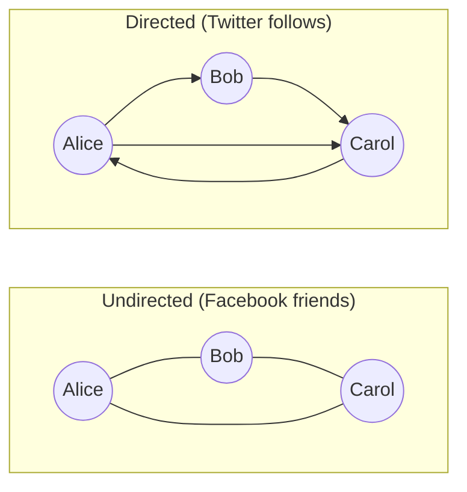
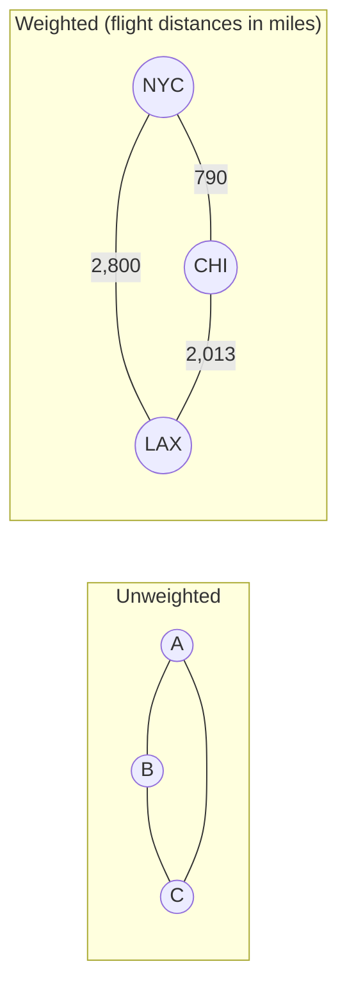
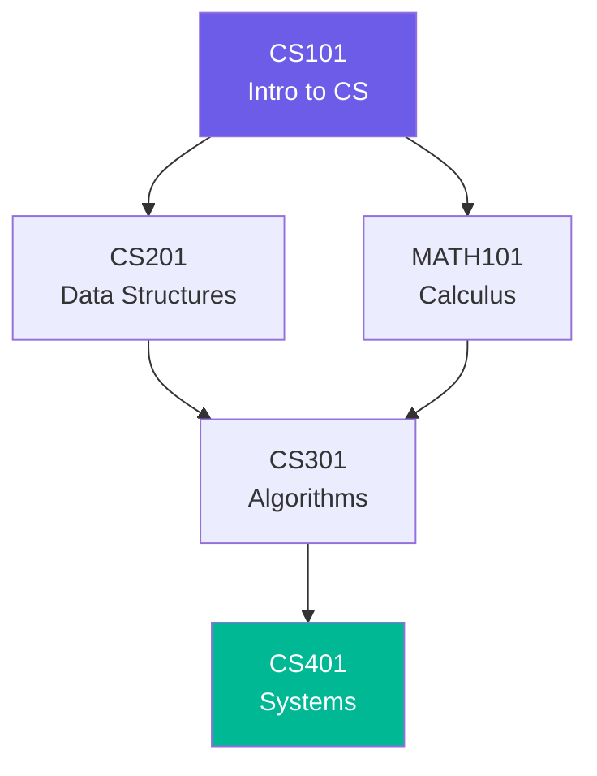
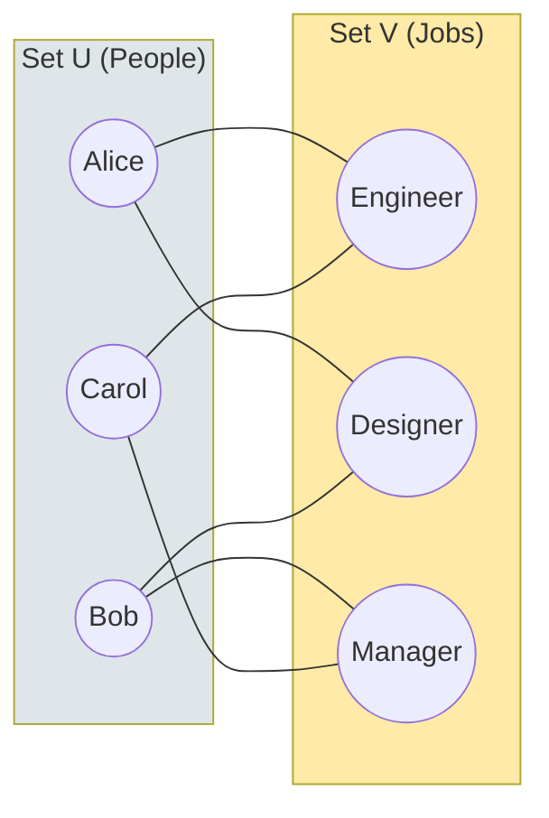
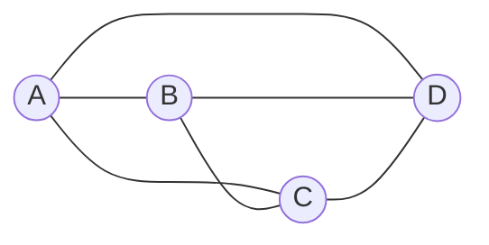
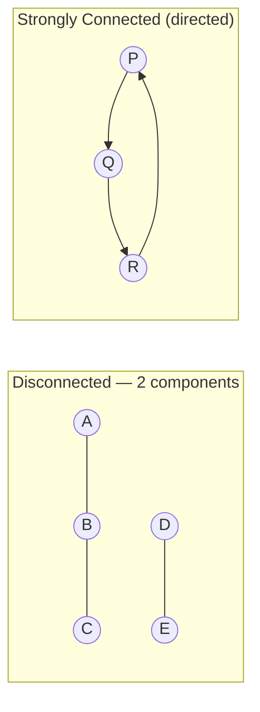
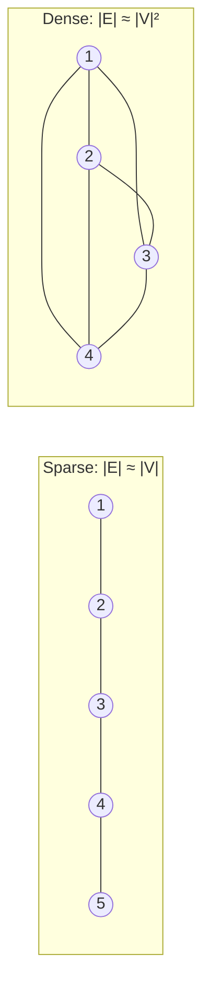
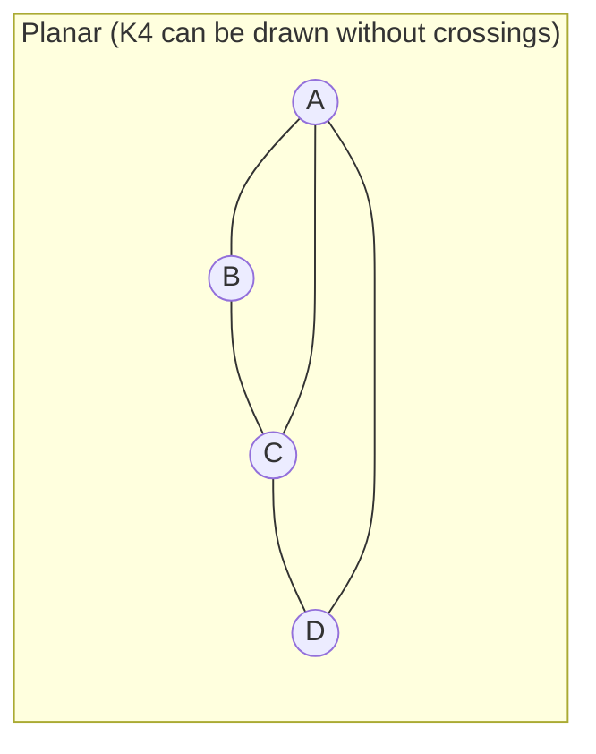
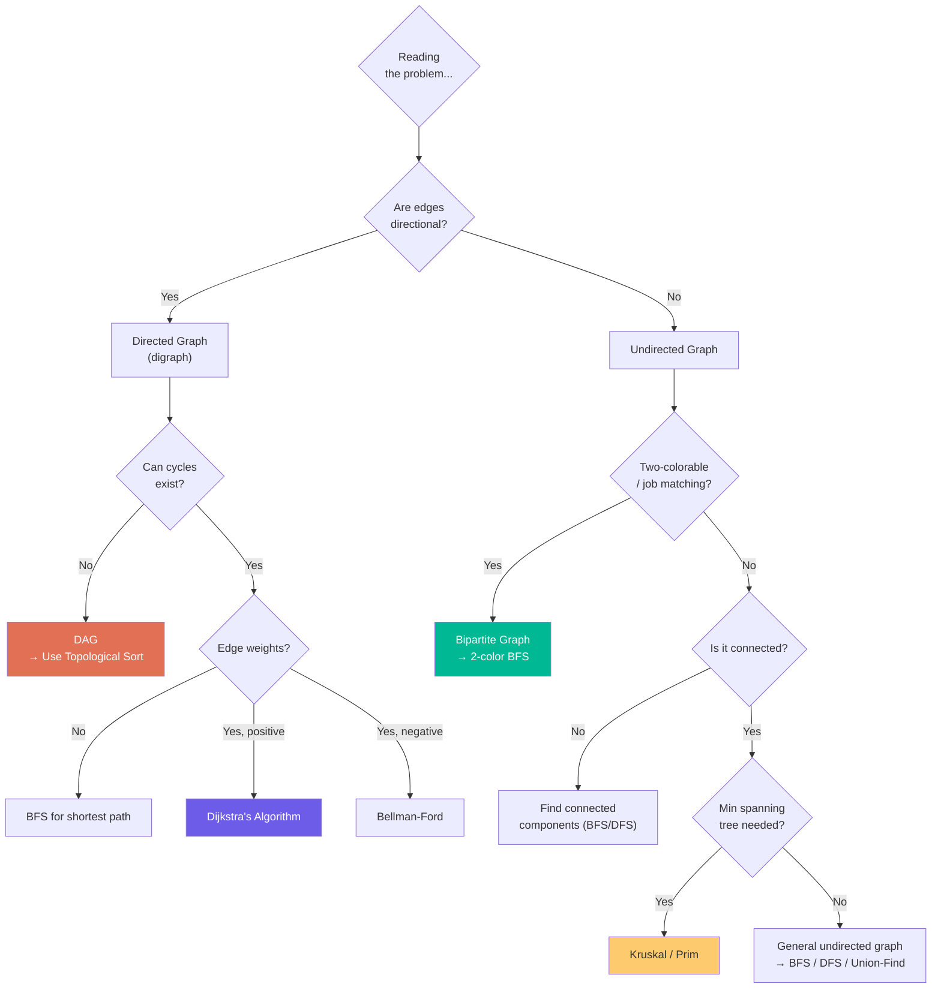

# Chapter 2: Graph Types 🗂️

---

## 👶 Explain Like I'm 5

Graphs come in many **flavors**. When you look at a real-world problem and ask "is this a graph?", the next question is always "what *kind* of graph?"

- **Twitter** → Directed: you can follow someone without them following back.
- **Facebook** → Undirected: friendships are mutual.
- **Google Maps** → Weighted: roads have distances/travel times.
- **University courses** → DAG: no circular prerequisites (you can't need a course that needs itself).
- **Checkerboard** → Bipartite: black squares only connect to white squares.

Knowing the *type* of graph immediately tells you which algorithms apply!

---

## 1. Directed vs Undirected

The most fundamental distinction.



| Property | Undirected | Directed (Digraph) |
|----------|-----------|-------------------|
| Edge `(u,v)` | Same as `(v,u)` | `(u,v)` ≠ `(v,u)` |
| Degree | One degree per vertex | Separate in-degree & out-degree |
| Max edges | `N(N-1)/2` | `N(N-1)` |
| Adjacency matrix | Symmetric | NOT symmetric |
| Cycle detection | Union-Find or DFS | DFS + coloring |
| Real-world examples | Roads, cables, social friends | Web links, dependencies, Twitter |

**In-degree vs Out-degree** (directed graphs):
- **In-degree** of `v` = number of edges pointing *into* `v`
- **Out-degree** of `v` = number of edges pointing *out* of `v`
- Handshaking lemma for directed: `Σ in-degree = Σ out-degree = |E|`

---

## 2. Weighted vs Unweighted



- **Unweighted**: All edges have equal "cost". Shortest path = fewest edges → **BFS**.
- **Weighted**: Edges have costs/distances/capacities. Shortest path ≠ fewest edges → **Dijkstra / Bellman-Ford**.

Weights can be:
- **Positive** (distances, costs) → Dijkstra's works
- **Negative** (profits, gains) → Need Bellman-Ford
- **Zero** (free to traverse) → 0-1 BFS or regular BFS

---

## 3. DAG — Directed Acyclic Graph

> A **DAG** is a directed graph with **no directed cycles**.



*Course prerequisites — a classic DAG. You can't take Algorithms without first taking both Data Structures and Calculus.*

**Key DAG properties**:
- Has at least one **topological ordering** (a valid processing order)
- Has at least one **source** (in-degree 0, e.g. CS101) and one **sink** (out-degree 0, e.g. CS401)
- Every tree is a DAG (trees are acyclic by definition)

**Real-world DAGs**:
- Build systems (Makefile, Bazel, Gradle)
- Package managers (pip, npm dependency resolution)
- Git commit history
- Excel spreadsheet formula dependencies
- Neural network computation graphs

**Pattern connection**: **Pattern 27** — Topological Sort

---

## 4. Bipartite Graph

> A graph where vertices can be split into **two disjoint sets** `U` and `V`, such that **every edge connects a vertex in `U` to a vertex in `V`** (no edges within the same set).



**2-colorable = Bipartite**: A graph is bipartite if and only if you can **2-color** it (color each vertex Red or Blue) such that no two adjacent vertices share a color.

**Detection**: BFS/DFS with 2-coloring. If you ever need to assign the same color to two adjacent vertices → NOT bipartite (has an odd-length cycle).

```python
def is_bipartite(graph):
    color = {}
    for start in range(len(graph)):
        if start in color: continue
        queue = deque([start])
        color[start] = 0
        while queue:
            node = queue.popleft()
            for neighbor in graph[node]:
                if neighbor not in color:
                    color[neighbor] = 1 - color[node]  # Flip color
                    queue.append(neighbor)
                elif color[neighbor] == color[node]:
                    return False  # Same color → not bipartite
    return True
```

**Real-world bipartite graphs**:
- Job assignments (people ↔ jobs)
- Movie recommendations (users ↔ movies)
- Course enrollment (students ↔ courses)
- Dating apps (users ↔ potential matches)

---

## 5. Complete Graph K_n

> Every vertex is connected to every other vertex. Maximum possible edges.



*K₄ — complete graph with 4 vertices: `4×3/2 = 6` edges.*

| Vertices (N) | Edges = N(N-1)/2 |
|-------------|-----------------|
| 2 | 1 |
| 4 | 6 |
| 10 | 45 |
| 100 | 4,950 |
| 1,000 | 499,500 |

**Interview implication**: If `|E| ≈ |V|²`, your graph is **dense** → consider adjacency matrix. Algorithms that are O(E) become O(V²) for complete graphs.

---

## 6. Connected vs Disconnected; Strongly Connected



| Concept | Undirected | Directed |
|---------|-----------|---------|
| **Connected** | Path between every pair | — |
| **Strongly Connected** | — | Directed path from EVERY vertex to EVERY other vertex |
| **Weakly Connected** | — | Connected if you ignore edge directions |
| **Connected Component** | Maximal connected subgraph | — |
| **Strongly Connected Component (SCC)** | — | Maximal strongly connected subgraph |

---

## 7. Sparse vs Dense

This distinction determines which **representation** and **algorithm** to use:



| Metric | Sparse | Dense |
|--------|-------|-------|
| Edge count | O(V) | O(V²) |
| Best representation | Adjacency List | Adjacency Matrix |
| BFS/DFS time | O(V+E) ≈ O(V) | O(V+E) ≈ O(V²) |
| Example | Road networks, trees | Social networks, complete graphs |

---

## 8. Planar Graphs

> A graph is **planar** if it can be drawn on a flat plane without any edges crossing.



**Kuratowski's Theorem**: A graph is planar if and only if it contains no subdivision of **K₅** (complete graph with 5 vertices) or **K₃,₃** (complete bipartite graph with 3+3 vertices).

**For planar graphs, Euler's formula holds**: `V − E + F = 2`

**Interview use**: Circuit board layout, geographic map coloring (4-Color Theorem: any planar map can be colored with 4 colors so no adjacent regions share a color).

---

## 🗺️ Graph Type Decision Flowchart



---

## ⚠️ Common Misconceptions

| Misconception | Reality |
|--------------|---------|
| "A DAG is a tree" | Not necessarily. A DAG can have multiple paths between nodes — it just can't have directed cycles. |
| "Bipartite = even number of nodes" | No. Bipartite means 2-colorable. K₃ (triangle) has 3 nodes and is NOT bipartite. K₄ (square minus one edge) can be bipartite. |
| "Strongly connected = connected" | Strongly connected is stricter — it requires directed paths in BOTH directions. |
| "A cycle means the graph isn't useful" | Cycles are essential — they model things like "returning home", circular dependencies to detect, and Hamiltonian paths. |

---

*← [Chapter 1: What Is a Graph?](01_what_is_a_graph.md) | [Chapter 3: Graph Representations →](03_graph_representations.md)*
