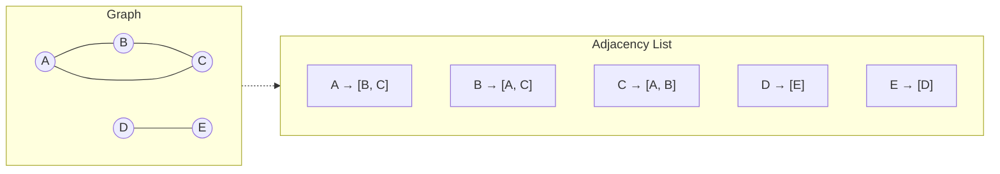
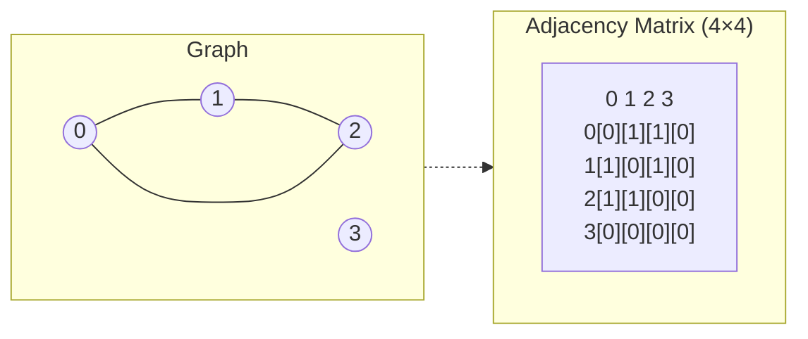
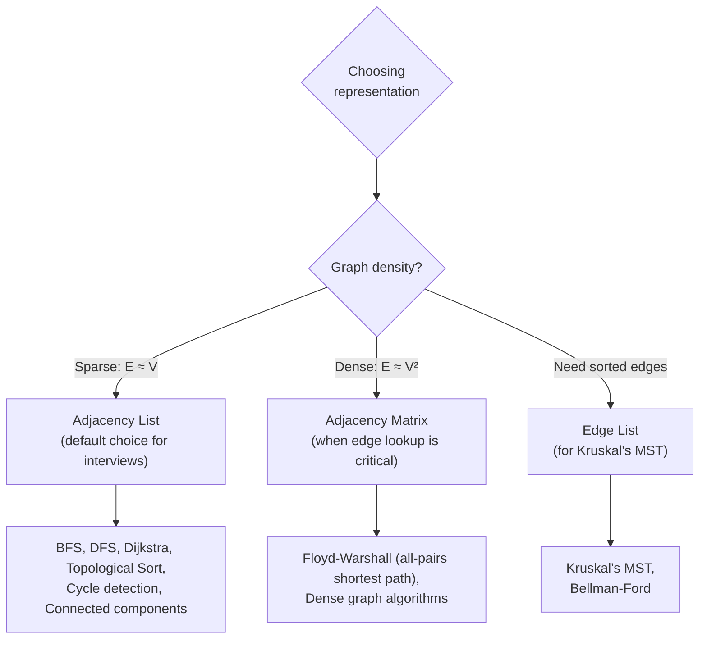

# Chapter 3: Graph Representations 🗄️

---

## 👶 Explain Like I'm 5

You want to remember who's friends with whom. You have a few options:

1. **A giant grid (matrix)** — Write everyone's name across the top and down the side. Put a ✓ where two people are friends. Fast to check "are Alice and Bob friends?" but wastes space for "is Alice friends with everyone?" No!

2. **A list of friend groups (adjacency list)** — For each person, write a short list of just their friends. Uses only as much space as there are actual friendships.

3. **A list of all friendships (edge list)** — Just write every pair of friends: `(Alice, Bob), (Bob, Carol), ...`. Simple but slow to answer "who are Alice's friends?"

These are the **3 ways to represent a graph**. Choosing the right one changes your algorithm's speed and memory usage dramatically.

---

## Representation 1: Adjacency List

```python
# Undirected graph: A-B, B-C, A-C, D-E
graph = {
    'A': ['B', 'C'],
    'B': ['A', 'C'],
    'C': ['A', 'B'],
    'D': ['E'],
    'E': ['D']
}
```



### Building an Adjacency List in Interviews

```python
from collections import defaultdict

# Pattern 1: From edge list — most common in interviews
def build_graph(n: int, edges: list[list[int]], directed=False) -> dict:
    graph = defaultdict(list)
    for u, v in edges:
        graph[u].append(v)
        if not directed:
            graph[v].append(u)  # Undirected: add both directions
    return graph

# Pattern 2: For weighted graphs
def build_weighted_graph(n, edges, directed=False):
    graph = defaultdict(list)
    for u, v, weight in edges:
        graph[u].append((v, weight))
        if not directed:
            graph[v].append((u, weight))
    return graph

# Usage:
edges = [[0,1],[1,2],[0,2]]
g = build_graph(3, edges)
# g = {0: [1, 2], 1: [0, 2], 2: [1, 0]}
```

**Complexity**:
- Space: `O(V + E)` — only stores actual edges
- Add vertex: `O(1)`
- Add edge: `O(1)`
- Remove edge: `O(degree(u))` — must find and remove
- Check if edge exists: `O(degree(u))` — must scan the list
- Iterate neighbors: `O(degree(u))` — ⚡ perfect for BFS/DFS

---

## Representation 2: Adjacency Matrix

```python
# 4 vertices, 0-indexed. matrix[i][j] = 1 means edge from i to j
graph = [
    [0, 1, 1, 0],  # Node 0 connects to 1 and 2
    [1, 0, 1, 0],  # Node 1 connects to 0 and 2
    [1, 1, 0, 0],  # Node 2 connects to 0 and 1
    [0, 0, 0, 0],  # Node 3 is isolated
]
```



**Complexity**:
- Space: `O(V²)` — regardless of how many actual edges exist
- Add vertex: `O(V²)` — must resize the entire matrix
- Add edge: `O(1)` — just set `matrix[u][v] = 1`
- Remove edge: `O(1)` — set `matrix[u][v] = 0`
- Check if edge exists: `O(1)` ⚡ — just read `matrix[u][v]`
- Iterate neighbors: `O(V)` — must scan the entire row

**For weighted graphs**: Store `matrix[u][v] = weight` instead of 0/1. Use `float('inf')` for no edge.

---

## Representation 3: Edge List

```python
# Just a list of (u, v) pairs (or (u, v, weight) for weighted)
edges = [(0,1), (0,2), (1,2)]

# For weighted:
edges = [(0, 1, 5), (0, 2, 3), (1, 2, 8)]
```

Simple but limited. Best for:
- **Kruskal's MST algorithm** — you need to sort all edges by weight
- **Reading input** — many graph problems give input as an edge list
- **Edge-centric algorithms** — where you process edges, not vertices

**Complexity**:
- Space: `O(E)`
- Check if edge exists: `O(E)` — must scan all edges
- Iterate neighbors: `O(E)` — must scan all edges

---

## The Big Trade-Off Table

| Operation | Adjacency List | Adjacency Matrix | Edge List |
|-----------|---------------|-----------------|-----------|
| **Space** | `O(V + E)` ✅ | `O(V²)` ❌ | `O(E)` |
| **Add vertex** | `O(1)` ✅ | `O(V²)` ❌ | `O(1)` |
| **Add edge** | `O(1)` ✅ | `O(1)` ✅ | `O(1)` ✅ |
| **Remove edge** | `O(degree)` | `O(1)` ✅ | `O(E)` ❌ |
| **Edge exists?** | `O(degree)` | `O(1)` ✅ | `O(E)` ❌ |
| **Iterate neighbors** | `O(degree)` ✅ | `O(V)` ❌ | `O(E)` ❌ |
| **Best for** | Sparse graphs, BFS/DFS | Dense graphs, Floyd-Warshall | Kruskal's MST |



> [!TIP]
> **In 95% of interview problems, use an adjacency list.** It's memory-efficient and supports BFS/DFS perfectly. Only reach for a matrix if the problem explicitly involves dense graphs or O(1) edge lookups.

---

## Grid as an Implicit Graph

Many interview problems present graphs as a **2D grid** (matrix of cells):

```python
# Grid:         Graph representation:
# [1, 0, 1]     Each cell (r, c) is a node
# [1, 1, 0]     Edges: to all 4 (or 8) adjacent cells
# [0, 1, 1]

DIRECTIONS = [(-1,0), (1,0), (0,-1), (0,1)]  # Up, Down, Left, Right

def get_neighbors(grid, r, c):
    rows, cols = len(grid), len(grid[0])
    for dr, dc in DIRECTIONS:
        nr, nc = r + dr, c + dc
        if 0 <= nr < rows and 0 <= nc < cols:
            yield nr, nc
```

The grid is an **implicit adjacency list** — you don't actually build the list, you compute neighbors on the fly.

**Pattern connections**: Pattern 14 (Island Matrix Traversal), Pattern 13 (Graph BFS)

---

## Python: `defaultdict` vs `dict` vs `list`

```python
from collections import defaultdict

# Option 1: defaultdict — safest, cleanest
graph = defaultdict(list)   # defaultdict(set) for deduplication

# Option 2: dict comprehension — when you know all vertices upfront
graph = {i: [] for i in range(n)}

# Option 3: list of lists — when vertices are 0..n-1 integers
graph = [[] for _ in range(n)]
# Access: graph[u] instead of graph['u']
```

> [!NOTE]
> In LeetCode problems, if nodes are numbered `0` to `n-1`, use `[[] for _ in range(n)]` — it's slightly faster than `defaultdict`. If nodes are arbitrary strings/integers, use `defaultdict(list)`.

---

*← [Chapter 2: Graph Types](02_graph_types.md) | [Chapter 4: Graph Traversals →](04_graph_traversals.md)*
