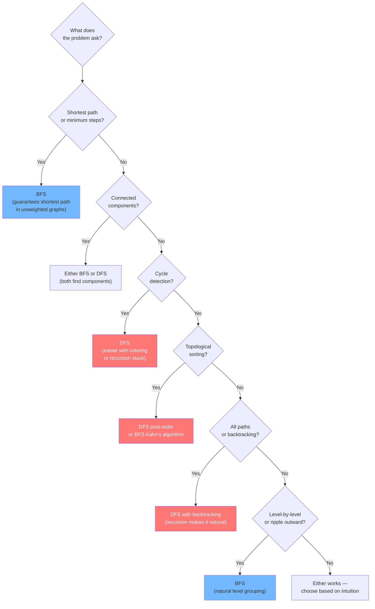

# Chapter 4: Graph Traversals 🗺️

---

## 👶 Explain Like I'm 5

You're in a city (graph) and want to visit **every building** exactly once.

**BFS** (Breadth-First Search) is like throwing a stone in a pond — the ripples spread out **level by level**, visiting all buildings 1 hop away, then 2 hops, then 3 hops...

**DFS** (Depth-First Search) is like exploring with a ball of yarn — you go **as deep as possible** down one street, leave the yarn behind as breadcrumbs, then reel it back and try the next street.

The **critical difference from tree traversal**: In a graph, you can arrive at the same building via multiple routes. Without marking buildings as "visited", you'd loop forever between A and B!

---

## 🚦 The Visited Set — Why It's Non-Negotiable

In a **tree**, there are no cycles. Every node has exactly one parent. You can never revisit.

In a **graph**, cycles can exist. Consider:

```
A -- B -- C
|         |
+---------+
```

BFS from A: Visit A → Add B and C to queue → Visit B → Add A and C → Visit A AGAIN → INFINITE LOOP! 😱

**The fix**: Before visiting any node, check if it's already visited. If yes, skip it.

```python
visited = set()
# OR a boolean array for integer nodes:
visited = [False] * n
```

> [!IMPORTANT]
> **Trees don't need `visited` sets** — no cycles possible.
> **Graphs always need `visited` sets** — cycles can and do exist.
> This is the single most important difference between tree and graph traversal code.

---

## Traversal 1: BFS on Graphs

**Algorithm**: Use a queue. Mark as visited when you **enqueue** (not when you dequeue — this avoids adding duplicates to the queue).

```python
from collections import deque

def bfs(graph: dict, start: int) -> list[int]:
    """Standard BFS. Returns all nodes reachable from start."""
    visited = {start}
    queue   = deque([start])
    order   = []

    while queue:
        node = queue.popleft()
        order.append(node)                     # Process the node

        for neighbor in graph[node]:
            if neighbor not in visited:
                visited.add(neighbor)          # Mark BEFORE enqueuing!
                queue.append(neighbor)

    return order
```

### BFS Step-by-Step

```mermaid
flowchart LR
    A((A)) --- B((B))
    A --- C((C))
    B --- D((D))
    B --- E((E))
    C --- F((F))

    BFS1["Step 1: Queue=[A], Visited={A}"]
    BFS2["Step 2: Process A. Enqueue B,C. Queue=[B,C], Visited={A,B,C}"]
    BFS3["Step 3: Process B. Enqueue D,E. Queue=[C,D,E], Visited={A,B,C,D,E}"]
    BFS4["Step 4: Process C. Enqueue F. Queue=[D,E,F], Visited={A,B,C,D,E,F}"]
    BFS5["Step 5: Process D,E,F. No new neighbors. Done!"]
    BFS6["Order: A → B → C → D → E → F"]

    F ~~~ BFS1
    F ~~~ BFS2
    F ~~~ BFS3
    F ~~~ BFS4
    F ~~~ BFS5
    F ~~~ BFS6

    classDef note fill:#FFEAA7,stroke:#FDCB6E,font-size:11px
    class BFS1,BFS2,BFS3,BFS4,BFS5,BFS6 note
```



**BFS gives shortest paths (in unweighted graphs)**: The first time you reach a node, you've taken the fewest possible edges to get there. BFS processes nodes in non-decreasing order of distance from the source.

```python
def bfs_shortest_path(graph, start, end):
    """Find shortest path from start to end (unweighted)."""
    if start == end: return [start]
    visited = {start}
    queue   = deque([(start, [start])])   # (node, path so far)

    while queue:
        node, path = queue.popleft()
        for neighbor in graph[node]:
            if neighbor == end:
                return path + [neighbor]  # Found!
            if neighbor not in visited:
                visited.add(neighbor)
                queue.append((neighbor, path + [neighbor]))

    return []  # No path exists
```

**Complexity**: `O(V + E)` — every vertex and edge is processed exactly once.

---

## Traversal 2: DFS on Graphs

**Algorithm**: Use recursion (or explicit stack). Mark as visited when you **enter**.

### Recursive DFS

```python
def dfs_recursive(graph: dict, node: int, visited: set, order: list):
    visited.add(node)
    order.append(node)                      # Pre-order: process before children

    for neighbor in graph[node]:
        if neighbor not in visited:
            dfs_recursive(graph, neighbor, visited, order)

# Usage:
visited = set()
order   = []
dfs_recursive(graph, start, visited, order)
```

### Iterative DFS (with explicit stack)

```python
def dfs_iterative(graph: dict, start: int) -> list[int]:
    visited = {start}
    stack   = [start]
    order   = []

    while stack:
        node = stack.pop()                  # LIFO — Last In First Out
        order.append(node)
        for neighbor in graph[node]:
            if neighbor not in visited:
                visited.add(neighbor)
                stack.append(neighbor)

    return order
```

> [!WARNING]
> The iterative DFS order may differ from recursive DFS if you're not careful about which neighbor gets pushed first (stack reverses order). For most problems, this doesn't matter — both are valid DFS.

### DFS Step-by-Step (same graph as BFS above)

```
Stack: [A], Visited: {A}
Pop A. Process A. Push C, B (neighbors). Stack: [C, B]
Pop B. Process B. Push E, D. Stack: [C, E, D]
Pop D. Process D. No unvisited neighbors. Stack: [C, E]
Pop E. Process E. No unvisited neighbors. Stack: [C]
Pop C. Process C. Push F. Stack: [F]
Pop F. Process F. Stack: []

DFS order: A → B → D → E → C → F
BFS order: A → B → C → D → E → F
```

**Complexity**: `O(V + E)` — same as BFS.

---

## BFS vs DFS: When to Use Which



| Problem Type | Preferred | Why |
|-------------|-----------|-----|
| Shortest path (unweighted) | **BFS** | BFS explores by distance |
| Level-by-level, ripple from source | **BFS** | Natural level grouping |
| Cycle detection | **DFS** | Back-edge detection is natural in DFS |
| Topological sort | **DFS** (post-order) or BFS (Kahn's) | DFS gives reverse post-order |
| All root-to-leaf paths | **DFS** | Recursion + backtracking |
| Connected components | **Either** | Both work equally well |
| Minimum spanning tree | **Neither** | Use Kruskal or Prim |

---

## Connected Components

```python
def count_components(n: int, edges: list[list[int]]) -> int:
    """Count connected components using DFS."""
    graph   = defaultdict(list)
    for u, v in edges:
        graph[u].append(v)
        graph[v].append(u)

    visited    = set()
    components = 0

    def dfs(node):
        visited.add(node)
        for neighbor in graph[node]:
            if neighbor not in visited:
                dfs(neighbor)

    for node in range(n):
        if node not in visited:
            dfs(node)               # Start a new component
            components += 1

    return components
```

This is the exact algorithm behind "Number of Provinces" (Pattern 13) and "Number of Islands" (Pattern 14 — with a grid-based implicit graph).

---

## Multi-Source BFS

Start BFS from **multiple sources simultaneously**. All sources are enqueued at the start. BFS then spreads outward from all of them in parallel.

**Classic problem: Rotten Oranges** — multiple rotten oranges spread rot simultaneously. Time to rot all = BFS levels from all rotten oranges at once.

```python
def multi_source_bfs(grid, sources):
    """BFS from multiple starting points simultaneously."""
    queue   = deque(sources)          # ← Enqueue ALL sources upfront
    visited = set(sources)
    steps   = 0

    while queue:
        for _ in range(len(queue)):   # Process one "wave" at a time
            r, c = queue.popleft()
            for dr, dc in [(-1,0),(1,0),(0,-1),(0,1)]:
                nr, nc = r+dr, c+dc
                if (nr, nc) not in visited and is_valid(grid, nr, nc):
                    visited.add((nr, nc))
                    queue.append((nr, nc))
        steps += 1

    return steps - 1  # Subtract 1 for the last empty iteration
```

---

## 0-1 BFS: When Edges Have Weights 0 or 1

Normal BFS for shortest paths only works on **unweighted graphs**. But if edge weights are exactly **0 or 1**, use a **deque** instead of a regular queue:

- Weight 0 edge → add neighbor to the **front** of deque (like it costs nothing)
- Weight 1 edge → add neighbor to the **back** of deque (like it costs something)

```python
def bfs_01(graph_01, start, n):
    """0-1 BFS. O(V+E) time."""
    dist  = [float('inf')] * n
    dist[start] = 0
    dq    = deque([start])

    while dq:
        node = dq.popleft()
        for neighbor, weight in graph_01[node]:
            if dist[node] + weight < dist[neighbor]:
                dist[neighbor] = dist[node] + weight
                if weight == 0:
                    dq.appendleft(neighbor)  # FREE — goes to front
                else:
                    dq.append(neighbor)      # COSTS 1 — goes to back

    return dist
```

---

## ⚠️ Common Pitfalls

| Pitfall | Fix |
|---------|-----|
| **Forgetting `visited` set** | Always initialize before traversal |
| **Marking visited when dequeued** (too late) | Mark when you **enqueue/push** to prevent duplicates |
| **DFS stack overflow on large graphs** | Switch to iterative DFS |
| **BFS for problems that need all paths** | BFS prunes paths. Use DFS + backtracking. |
| **Assuming the graph is connected** | Always loop over all nodes for components |

---

*← [Chapter 3: Graph Representations](03_graph_representations.md) | [Chapter 5: Shortest Paths →](05_shortest_paths.md)*
