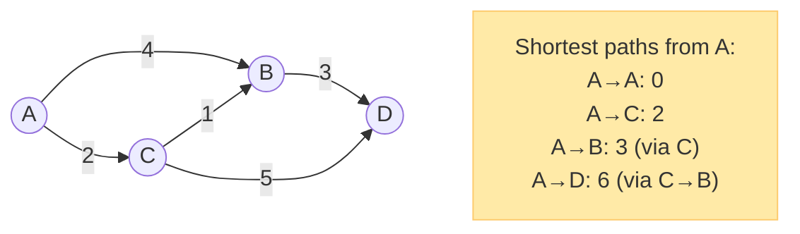
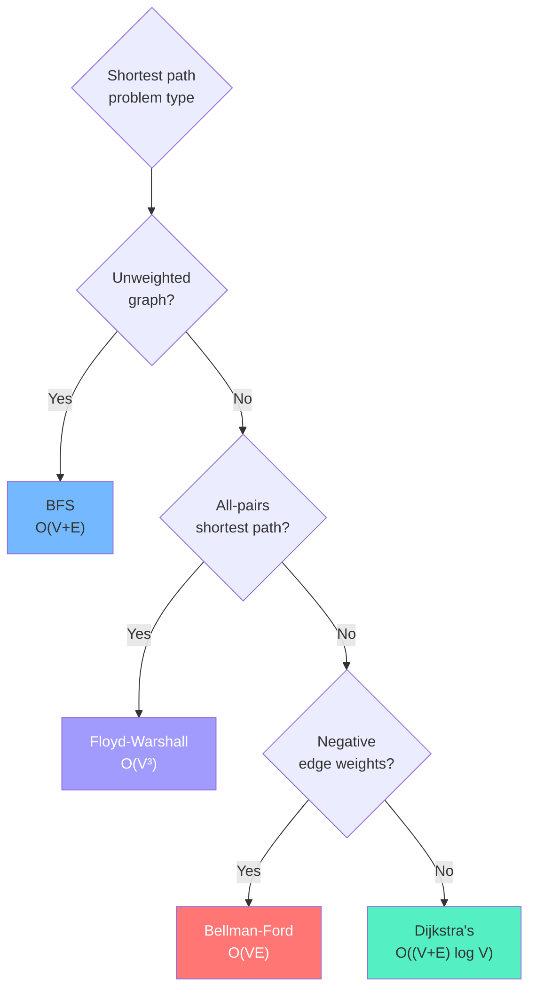

# Chapter 5: Shortest Paths ⚡

---

## 👶 Explain Like I'm 5

You're planning a road trip. You have a map of cities with driving times on each road. You want the **fastest route** from city A to city Z.

- If all roads take the **same amount of time** → just count fewest turns (BFS).
- If roads have **different times** → greedily always extend from the closest known city (Dijkstra's).
- If some roads have **negative time** (like a teleporter that saves you 2 hours) → need to be more careful (Bellman-Ford).
- If you need the fastest route between **every pair** of cities → try all intermediate cities as "hubs" (Floyd-Warshall).

---

## Algorithm 1: BFS (Unweighted Graphs)

**When**: All edges have equal weight (or weight 1).

**Why it works**: BFS explores in non-decreasing distance order. The first time you reach a node, it's via the shortest path.

```python
def bfs_shortest_dist(graph, start, n):
    """Returns distance from start to every reachable node."""
    dist = [-1] * n
    dist[start] = 0
    queue = deque([start])

    while queue:
        node = queue.popleft()
        for neighbor in graph[node]:
            if dist[neighbor] == -1:        # Not yet visited
                dist[neighbor] = dist[node] + 1
                queue.append(neighbor)

    return dist
```

**Complexity**: `O(V + E)`

---

## Algorithm 2: Dijkstra's Algorithm (Positive Weights)

**When**: Weighted graph with **all non-negative** edge weights.

**Core insight**: Greedily always process the vertex with the **smallest known distance** first. Once a node is "settled" (popped from the heap), its distance is finalized.

**Why greedy works**: Because all weights are non-negative, no future path can decrease the distance to an already-settled node.

### Step-by-Step

```
Graph: A→B(4), A→C(2), B→D(3), C→B(1), C→D(5)
Start from A.

Initial: dist = {A:0, B:∞, C:∞, D:∞}
Heap: [(0,A)]

Step 1: Pop (0,A).
  Process A's neighbors:
  - B: dist[B] = min(∞, 0+4) = 4. Push (4,B).
  - C: dist[C] = min(∞, 0+2) = 2. Push (2,C).
  Heap: [(2,C), (4,B)]

Step 2: Pop (2,C) — smallest!
  Process C's neighbors:
  - B: dist[B] = min(4, 2+1) = 3. Push (3,B).
  - D: dist[D] = min(∞, 2+5) = 7. Push (7,D).
  Heap: [(3,B), (4,B), (7,D)]

Step 3: Pop (3,B).
  Process B's neighbors:
  - D: dist[D] = min(7, 3+3) = 6. Push (6,D).
  Heap: [(4,B), (6,D), (7,D)]

Step 4: Pop (4,B). dist[B] = 3, but we popped 4. SKIP (stale).

Step 5: Pop (6,D). dist[D] = 6. Finalized!

Final: dist = {A:0, B:3, C:2, D:6}
Shortest path A→D: A→C→B→D with cost 6.
```



### Python Implementation

```python
import heapq
from collections import defaultdict

def dijkstra(graph: dict, start: int, n: int) -> list[int]:
    """
    Dijkstra's shortest path from start to all nodes.
    graph: {node: [(neighbor, weight), ...]}
    Returns dist array (dist[i] = min cost from start to i).
    """
    dist = [float('inf')] * n
    dist[start] = 0
    heap = [(0, start)]           # (cost, node)

    while heap:
        cost, node = heapq.heappop(heap)

        if cost > dist[node]:     # Stale entry — skip!
            continue

        for neighbor, weight in graph[node]:
            new_cost = dist[node] + weight
            if new_cost < dist[neighbor]:
                dist[neighbor] = new_cost
                heapq.heappush(heap, (new_cost, neighbor))

    return dist
```

> [!IMPORTANT]
> **The "stale entry" check** (`if cost > dist[node]: continue`) is critical. Without it, you'll re-process nodes that were already settled with a better distance. This happens because Python's `heapq` doesn't support decreasing a key — you just add a new entry with the updated cost and check staleness on pop.

**Complexity**: `O((V + E) log V)` — each edge processed once, each push/pop is `O(log V)`.

**Does NOT work with negative edge weights** — a negative weight could make a "settled" distance non-optimal.

---

## Algorithm 3: Bellman-Ford (Negative Weights)

**When**: Weighted graph that **may have negative edge weights**.

**Core insight**: The shortest path in a graph with `V` vertices has at most `V-1` edges. So relax ALL edges `V-1` times. After each round, the shortest paths with at most `k` edges are correct.

```python
def bellman_ford(n: int, edges: list[tuple], start: int):
    """
    Bellman-Ford. edges = list of (u, v, weight).
    Returns (dist, has_negative_cycle).
    """
    dist = [float('inf')] * n
    dist[start] = 0

    # Relax all edges V-1 times
    for _ in range(n - 1):
        updated = False
        for u, v, w in edges:
            if dist[u] != float('inf') and dist[u] + w < dist[v]:
                dist[v] = dist[u] + w
                updated = True
        if not updated:           # Early termination if no updates
            break

    # Check for negative cycles: if we can STILL relax, there's a cycle
    has_neg_cycle = False
    for u, v, w in edges:
        if dist[u] != float('inf') and dist[u] + w < dist[v]:
            has_neg_cycle = True
            break

    return dist, has_neg_cycle
```

**Complexity**: `O(V × E)` — much slower than Dijkstra's.

**Negative cycle detection**: A negative cycle means you can reduce cost infinitely by looping around it — there's no valid "shortest path". Bellman-Ford detects this by trying to relax one more time after the `V-1` rounds.

---

## Algorithm 4: Floyd-Warshall (All-Pairs)

**When**: You need the shortest path between **every pair** of vertices.

**Core insight**: For each possible "intermediate" vertex `k`, check if going through `k` improves the path from `i` to `j`: `dist[i][j] = min(dist[i][j], dist[i][k] + dist[k][j])`

```python
def floyd_warshall(n: int, edges: list[tuple]):
    """
    Floyd-Warshall all-pairs shortest path.
    Returns dist[i][j] = shortest path from i to j.
    """
    dist = [[float('inf')] * n for _ in range(n)]
    for i in range(n):
        dist[i][i] = 0             # Distance to self is 0

    for u, v, w in edges:
        dist[u][v] = w
        dist[v][u] = w             # Remove this line for directed graphs

    # Try every vertex k as an intermediate "hub"
    for k in range(n):
        for i in range(n):
            for j in range(n):
                if dist[i][k] + dist[k][j] < dist[i][j]:
                    dist[i][j] = dist[i][k] + dist[k][j]

    return dist
```

**Complexity**: `O(V³)` time, `O(V²)` space.

**Negative cycle detection**: `dist[i][i] < 0` after running means vertex `i` is in a negative cycle.

---

## Algorithm Comparison



| Algorithm | Works With | Time | Space | Detects Neg Cycle |
|-----------|-----------|------|-------|------------------|
| BFS | Unweighted | O(V+E) | O(V) | N/A |
| Dijkstra's | Non-negative weights | O((V+E) log V) | O(V) | ❌ |
| Bellman-Ford | Any weights | O(VE) | O(V) | ✅ |
| Floyd-Warshall | Any weights | O(V³) | O(V²) | ✅ (check diagonal) |

---

## Special Case: SSSP with Modified Dijkstra (K stops)

**"Cheapest Flight Within K Stops"** — Dijkstra's won't work directly because you have an additional constraint (max stops). Use Bellman-Ford relaxed exactly `K+1` times (each relaxation = one hop):

```python
def find_cheapest_price(n, flights, src, dst, k):
    """
    Bellman-Ford relaxed exactly k+1 times.
    k stops = k+1 edges.
    """
    dist = [float('inf')] * n
    dist[src] = 0

    for _ in range(k + 1):           # k stops = k+1 edges
        temp = dist[:]               # Snapshot — prevents using this round's updates
        for u, v, w in flights:
            if dist[u] != float('inf') and dist[u] + w < temp[v]:
                temp[v] = dist[u] + w
        dist = temp

    return dist[dst] if dist[dst] != float('inf') else -1
```

> [!NOTE]
> The `temp = dist[:]` snapshot is critical. Without it, you might propagate multiple hops in a single round, which would violate the "at most K stops" constraint.

---

*← [Chapter 4: Graph Traversals](04_graph_traversals.md) | [Chapter 6: Minimum Spanning Trees →](06_minimum_spanning_trees.md)*
