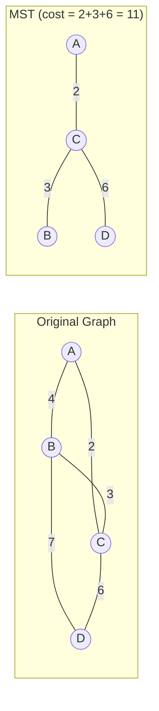
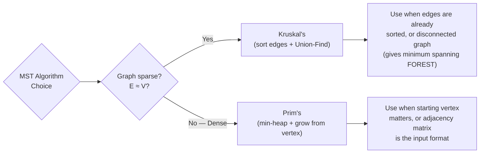

# Chapter 6: Minimum Spanning Trees 🌲

---

## 👶 Explain Like I'm 5

Imagine you need to connect 5 villages with roads so that you can travel between any two villages. You want to use the **fewest total miles of road possible** (to save construction costs).

You don't need direct roads between every pair — just enough roads that every village is reachable from every other.

A **Minimum Spanning Tree (MST)** is that minimal set of roads.

---

## What Is a Spanning Tree?

Given a connected graph `G = (V, E)`:

> A **Spanning Tree** is a subgraph that:
> 1. Contains **all V vertices** ("spans" the whole graph)
> 2. Is **connected** (you can reach any vertex from any other)
> 3. Is **acyclic** (no loops — removing any edge disconnects it)
> 4. Therefore has exactly **V − 1 edges**

A graph can have **many** different spanning trees. The **Minimum Spanning Tree (MST)** is the one where the **sum of edge weights** is minimized.



*We chose edges 2, 3, 6 — total 11. Not edges 4 or 7 — that would cost more.*

**Properties of MST**:
- An MST always has exactly `V − 1` edges
- A graph with all unique edge weights has exactly **one** MST
- Removing any MST edge disconnects the spanning tree

---

## The Cut Property (Theoretical Foundation)

Both MST algorithms rely on this fundamental theorem:

> **Cut Property**: Given any partition of the vertices into two non-empty sets `S` and `V−S` (called a "cut"), the **minimum-weight edge** crossing the cut belongs to some MST.

**Intuition**: If the cheapest way to bridge a division is a particular road, that road must be in the optimal road network.

---

## Algorithm 1: Kruskal's Algorithm

**Strategy**: **Sort all edges by weight**. Greedily add the cheapest edge that doesn't create a cycle.

**Data structure needed**: **Union-Find (DSU)** — to efficiently check if adding an edge creates a cycle (i.e., are both endpoints already in the same component?).

### Step-by-Step

```
Graph edges sorted by weight: (A,C,2), (B,C,3), (A,B,4), (C,D,6), (B,D,7)
MST edges: []
Components: {A},{B},{C},{D}

Step 1: Edge (A,C,2). A and C in different components. ADD. Union(A,C).
  MST: [(A,C,2)]. Components: {A,C},{B},{D}

Step 2: Edge (B,C,3). B and C in different components. ADD. Union(B,C).
  MST: [(A,C,2),(B,C,3)]. Components: {A,B,C},{D}

Step 3: Edge (A,B,4). A and B in SAME component! SKIP (would create cycle).

Step 4: Edge (C,D,6). C and D in different components. ADD. Union(C,D).
  MST: [(A,C,2),(B,C,3),(C,D,6)]. Components: {A,B,C,D}

V-1 = 3 edges added. DONE! MST cost = 2+3+6 = 11.
```

```mermaid
flowchart TD
    KSTART["Sort edges by weight"] --> KLOOP["For each edge (u,v,w)\nin sorted order:"]
    KLOOP --> KCHECK{find(u) == find(v)?}
    KCHECK -->|"Yes\n(same component → cycle)"| KSKIP["SKIP this edge"]
    KCHECK -->|"No\n(different components)"| KADD["ADD edge to MST\nunion(u, v)"]
    KADD --> KDONE{MST has\nV-1 edges?}
    KSKIP --> KDONE
    KDONE -->|Yes| KFINISH["MST complete!"]
    KDONE -->|No| KLOOP
```

### Python Implementation

```python
class UnionFind:
    def __init__(self, n):
        self.parent = list(range(n))
        self.rank   = [0] * n

    def find(self, x):
        if self.parent[x] != x:
            self.parent[x] = self.find(self.parent[x])  # Path compression
        return self.parent[x]

    def union(self, x, y):
        px, py = self.find(x), self.find(y)
        if px == py: return False              # Already in same component
        if self.rank[px] < self.rank[py]:      # Union by rank
            px, py = py, px
        self.parent[py] = px
        if self.rank[px] == self.rank[py]:
            self.rank[px] += 1
        return True

def kruskal_mst(n: int, edges: list[tuple]) -> tuple[int, list]:
    """
    Kruskal's MST.
    edges: list of (weight, u, v)
    Returns (total_cost, mst_edges).
    """
    edges.sort()                               # Sort by weight
    uf   = UnionFind(n)
    mst  = []
    cost = 0

    for w, u, v in edges:
        if uf.union(u, v):                     # Add if no cycle
            mst.append((u, v, w))
            cost += w
            if len(mst) == n - 1:
                break                          # MST complete

    return cost, mst
```

**Complexity**: `O(E log E)` for sorting + `O(E × α(V))` for Union-Find ≈ `O(E log E)` total.

---

## Algorithm 2: Prim's Algorithm

**Strategy**: Start from any vertex. Greedily always add the **cheapest edge** that connects the growing MST to a new vertex.

**Data structure needed**: **Min-Heap** — to efficiently find the minimum-weight edge crossing the cut.

### Step-by-Step

```
Same graph. Start from A.
In-MST: {A}. Heap: [(2,A,C), (4,A,B)]

Step 1: Pop (2,A,C). C not in MST. ADD edge A-C. Add C's edges.
  In-MST: {A,C}. Heap: [(3,C,B), (4,A,B), (6,C,D)]

Step 2: Pop (3,C,B). B not in MST. ADD edge C-B. Add B's edges.
  In-MST: {A,B,C}. Heap: [(4,A,B), (6,C,D), (7,B,D)]

Step 3: Pop (4,A,B). B already in MST. SKIP.

Step 4: Pop (6,C,D). D not in MST. ADD edge C-D. Done!
  In-MST: {A,B,C,D}. V-1=3 edges added.

MST cost = 2+3+6 = 11. ✅
```

### Python Implementation

```python
def prim_mst(n: int, graph: dict) -> tuple[int, list]:
    """
    Prim's MST using min-heap.
    graph: {node: [(neighbor, weight), ...]}
    Returns (total_cost, mst_edges).
    """
    in_mst = [False] * n
    heap   = [(0, 0, -1)]   # (weight, node, parent)
    cost   = 0
    mst    = []

    while heap:
        w, node, parent = heapq.heappop(heap)

        if in_mst[node]:    # Already in MST — skip
            continue

        in_mst[node] = True
        cost += w
        if parent != -1:
            mst.append((parent, node, w))

        for neighbor, weight in graph[node]:
            if not in_mst[neighbor]:
                heapq.heappush(heap, (weight, neighbor, node))

    return cost, mst
```

**Complexity**: `O((V + E) log V)` with a min-heap.

---

## Kruskal's vs Prim's: When to Use Which

| Criterion | Kruskal's | Prim's |
|-----------|-----------|--------|
| **Core data structure** | Union-Find | Min-Heap |
| **Approach** | Edge-centric (global sort) | Vertex-centric (grow from one node) |
| **Best for** | Sparse graphs (`E ≈ V`) | Dense graphs (`E ≈ V²`) |
| **Complexity** | O(E log E) | O((V+E) log V) |
| **Easier to implement** | ✅ Slightly simpler | More intuitive for dense |
| **Requires connected graph** | Yes (MST undefined otherwise) | Yes |
| **Handles disconnected** | Returns forest of MSTs | ❌ Stays in one component |



---

## Real-World Applications of MST

| Application | How MST Applies |
|------------|----------------|
| **Network cabling** | Connect all offices with minimum cable length |
| **Circuit design** | Minimize wiring between components |
| **Approximation algorithms** | MST is a 2-approximation for Traveling Salesman Problem |
| **Cluster analysis** | Remove the most expensive MST edges to create clusters |
| **Image segmentation** | Pixels as vertices, pixel difference as edge weight |

---

## Pattern Connection

- **Pattern 28**: Union-Find (Disjoint Set Union) — the key data structure for Kruskal's. Understanding Union-Find deeply (with path compression + union by rank) is essential. See [`28 - Union Find/`](../../28%20-%20Union%20Find/).

---

*← [Chapter 5: Shortest Paths](05_shortest_paths.md) | [Chapter 7: Advanced Graph Concepts →](07_advanced_graph_concepts.md)*
