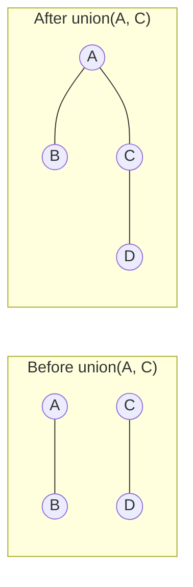
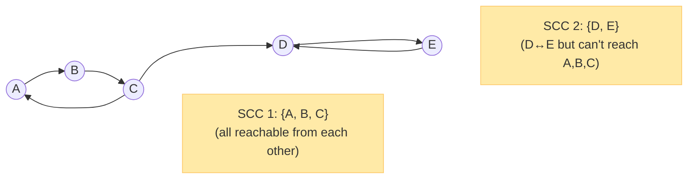
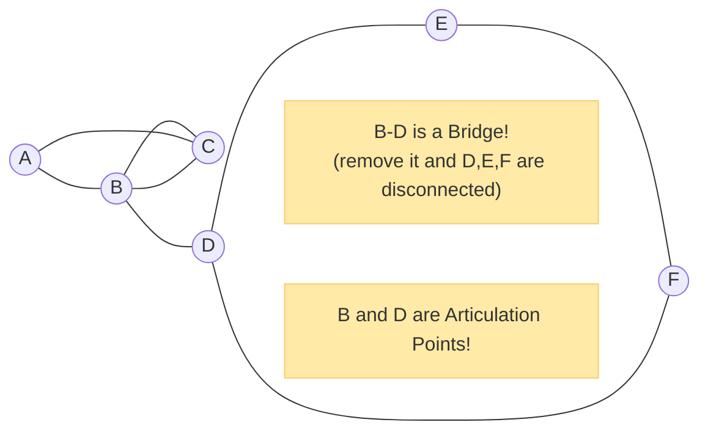
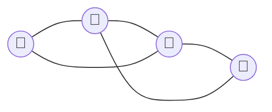
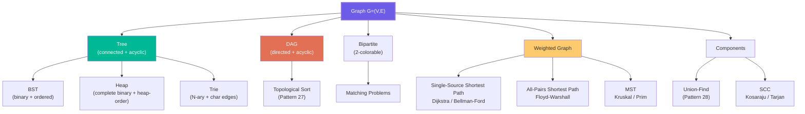

# Chapter 7: Advanced Graph Concepts 🔬

---

## 1. Cycle Detection

Detecting cycles is fundamental — it determines whether a graph is a DAG (safe for topological sort), whether a Union-Find edge is redundant, and whether a graph has valid paths.

### Cycle Detection in Undirected Graphs

**Method: DFS with parent tracking**

```python
def has_cycle_undirected(graph: dict, n: int) -> bool:
    visited = set()

    def dfs(node, parent):
        visited.add(node)
        for neighbor in graph[node]:
            if neighbor not in visited:
                if dfs(neighbor, node):
                    return True
            elif neighbor != parent:      # Back edge that isn't just the parent
                return True              # CYCLE DETECTED!
        return False

    for node in range(n):
        if node not in visited:
            if dfs(node, -1):
                return True
    return False
```

**Why `neighbor != parent`?** In an undirected graph, if you went A→B, then B sees A as a neighbor. That's not a cycle — it's just the edge you came from. Only flag a cycle when you see a *different* visited neighbor.

**Alternative: Union-Find**

```python
def has_cycle_union_find(n: int, edges: list) -> bool:
    uf = UnionFind(n)
    for u, v in edges:
        if not uf.union(u, v):    # Already in same component → cycle!
            return True
    return False
```

### Cycle Detection in Directed Graphs

**Method: DFS with 3-color marking (White/Gray/Black)**

In directed graphs, the parent-check trick doesn't work (edges have direction). Instead, track whether a node is "in the current DFS path" (gray = in recursion stack):

```
WHITE (0) = Not visited
GRAY  (1) = Currently being processed (in recursion stack)
BLACK (2) = Fully processed (all descendants explored)
```

```python
def has_cycle_directed(graph: dict, n: int) -> bool:
    color = [0] * n   # 0=white, 1=gray, 2=black

    def dfs(node):
        color[node] = 1           # Mark GRAY — in current path
        for neighbor in graph[node]:
            if color[neighbor] == 1:
                return True       # BACK EDGE → cycle!
            if color[neighbor] == 0:
                if dfs(neighbor):
                    return True
        color[node] = 2           # Mark BLACK — fully done
        return False

    for node in range(n):
        if color[node] == 0:
            if dfs(node):
                return True
    return False
```

**Why 3 colors?** White=unseen, Gray=in current exploration stack, Black=fully explored. A back edge (neighbor is GRAY) means we've found a node in our current path — that's a cycle.

---

## 2. Topological Sort

**What it is**: An ordering of all vertices in a DAG such that for every directed edge `u → v`, vertex `u` appears before vertex `v`.

**Only possible for DAGs** (Directed Acyclic Graphs) — if there's a cycle, no valid ordering exists!

**Real world**: If Course B requires Course A, then A must appear before B in the schedule.

### Method 1: DFS Post-Order (Reverse)

```python
def topological_sort_dfs(graph: dict, n: int) -> list[int]:
    """
    DFS-based topological sort.
    Post-order traversal reversed = topological order.
    """
    color  = [0] * n
    result = []
    has_cycle = [False]

    def dfs(node):
        color[node] = 1
        for neighbor in graph[node]:
            if color[neighbor] == 1:
                has_cycle[0] = True
                return
            if color[neighbor] == 0:
                dfs(neighbor)
        color[node] = 2
        result.append(node)        # POST-ORDER: add AFTER processing all children

    for node in range(n):
        if color[node] == 0:
            dfs(node)

    if has_cycle[0]: return []     # Invalid — cycle exists

    return result[::-1]            # Reverse post-order = topological order
```

### Method 2: Kahn's Algorithm (BFS-based)

**Idea**: Nodes with **in-degree 0** (no prerequisites) can be processed first. After processing them, decrement in-degrees of their neighbors. Repeat.

```python
from collections import deque

def topological_sort_kahn(graph: dict, n: int) -> list[int]:
    """
    Kahn's BFS-based topological sort.
    Also detects cycles: if result length < n, there's a cycle.
    """
    in_degree = [0] * n
    for node in range(n):
        for neighbor in graph[node]:
            in_degree[neighbor] += 1

    queue = deque([i for i in range(n) if in_degree[i] == 0])
    result = []

    while queue:
        node = queue.popleft()
        result.append(node)
        for neighbor in graph[node]:
            in_degree[neighbor] -= 1
            if in_degree[neighbor] == 0:
                queue.append(neighbor)

    return result if len(result) == n else []  # Empty = cycle detected
```

**Comparing the two methods**:

| | DFS Post-order | Kahn's (BFS) |
|--|---------------|-------------|
| **Cycle detection** | Color array | `len(result) < n` |
| **Multiple valid orderings** | Returns one valid | Returns one valid |
| **Intuition** | "Process when all descendants are done" | "Process when all prerequisites are done" |
| **Pattern use** | Pattern 27 DFS variant | Pattern 27 BFS variant |

**Pattern connection**: **Pattern 27** — Topological Sort (`27 - Topological Sort (Graph)/`)

---

## 3. Union-Find (Disjoint Set Union / DSU)

**What it is**: A data structure that tracks a collection of sets and supports two operations:
- `find(x)` — which group/component is `x` in?
- `union(x, y)` — merge the groups of `x` and `y`



### Full Implementation with Path Compression + Union by Rank

```python
class UnionFind:
    """
    Optimal DSU with path compression + union by rank.
    All operations: O(α(N)) ≈ O(1) amortized.
    """
    def __init__(self, n: int):
        self.parent = list(range(n))
        self.rank   = [0] * n
        self.size   = [1] * n
        self.components = n

    def find(self, x: int) -> int:
        """Path compression — makes all nodes on the path point directly to root."""
        if self.parent[x] != x:
            self.parent[x] = self.find(self.parent[x])
        return self.parent[x]

    def union(self, x: int, y: int) -> bool:
        """Union by rank. Returns True if they were in different components."""
        px, py = self.find(x), self.find(y)
        if px == py: return False     # Already connected
        if self.rank[px] < self.rank[py]:
            px, py = py, px           # Attach smaller to larger
        self.parent[py] = px
        self.size[px] += self.size[py]
        if self.rank[px] == self.rank[py]:
            self.rank[px] += 1
        self.components -= 1
        return True

    def connected(self, x: int, y: int) -> bool:
        return self.find(x) == self.find(y)

    def component_size(self, x: int) -> int:
        return self.size[self.find(x)]
```

**Path compression**: When calling `find(x)`, make every node on the path point directly to the root. Future `find` calls become O(1).

**Union by rank**: Always attach the smaller (shallower) tree under the larger (taller) tree. Keeps tree height bounded at `O(log N)`.

**Combined complexity**: `O(α(N))` per operation, where `α` is the inverse Ackermann function — essentially O(1) for all practical purposes.

**Pattern connection**: **Pattern 28** — Union Find (`28 - Union Find/`)

---

## 4. Strongly Connected Components (SCC)

**What it is**: A **Strongly Connected Component** (SCC) of a directed graph is a maximal subset of vertices `S` such that for every pair `(u, v)` in `S`, there exists both a path `u → ... → v` AND a path `v → ... → u`.



**Kosaraju's Algorithm** (two-pass DFS):
1. Run DFS on original graph, record finish times (post-order)
2. Transpose the graph (reverse all edges)
3. Run DFS on transposed graph in decreasing finish-time order
4. Each DFS tree in step 3 = one SCC

**Use cases**: Finding circular dependencies, analyzing web graph structure, compiler optimizations.

---

## 5. Articulation Points and Bridges

**Bridge**: An edge whose removal disconnects the graph.
**Articulation Point (Cut Vertex)**: A vertex whose removal disconnects the graph.



Tarjan's algorithm finds all bridges and articulation points in a single O(V+E) DFS pass using **discovery time** and **low values**.

**Use cases**: Network reliability, finding single points of failure, critical infrastructure analysis.

---

## 6. Graph Coloring

> A **graph coloring** assigns a color to each vertex such that no two adjacent vertices share the same color.

**Chromatic number χ(G)**: The minimum number of colors needed.



*This graph needs 2 colors (Red and Blue) — it's bipartite. χ(G) = 2.*

| Graph Type | Chromatic Number |
|-----------|-----------------|
| Complete graph K_n | n |
| Bipartite graph | 2 |
| Tree | 2 |
| Cycle C_n (even n) | 2 |
| Cycle C_n (odd n) | 3 |
| Planar graph | ≤ 4 (Four-Color Theorem) |

**Bipartite check = 2-colorable**: BFS with 2 colors. If you ever need to assign the same color to two adjacent vertices → not bipartite → chromatic number ≥ 3.

---

## 7. The Relationship Map: Everything Connected



---

*← [Chapter 6: Minimum Spanning Trees](06_minimum_spanning_trees.md) | [Chapter 8: Graphs Cheat Sheet →](08_graphs_cheat_sheet.md)*
