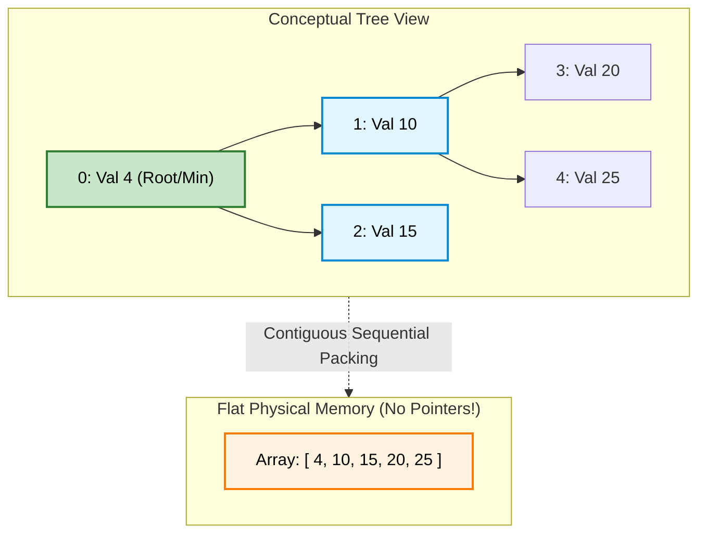
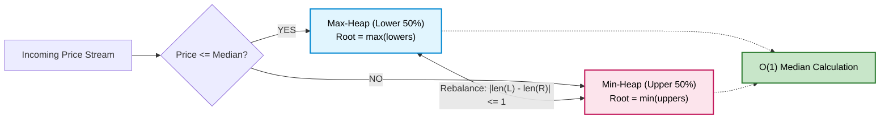

# 🚶‍♂️ Walkthrough: Min and Max Heap Implementation

> **Level**: Fundamentals 101 to Staff Architect & Research  
> **Prerequisites**: [001 - Array and String](../001%20-%20Array%20and%20String/array_and_string_walkthrough.md), [004 - Sorting Algorithms](../004%20-%20Sorting%20Algorithms/sorting_walkthrough.md)  
> **Source Code**: [heap.py](../010%20-%20Min%20and%20Max%20Heap/heap.py)

---

## 🧭 Executive Curriculum Roadmap

```
Level 100: The Napkin Sketch ──────► 30s physical analogy: The Hospital Triage Desk & Array Tree
Level 200: Street Fundamentals ────► Cheat card, Top-K Inversion Rule, Floyd's O(N) heapify
Level 300: Working Professional ───► Generic Min/Max heap in Python 3.14 with custom key extractors
Level 400: Staff & Senior Arch ────► Cache line alignment, D-ary Heaps, Dijkstra in OSPF routing
Level 500: Researcher's Corner ────► Summation proof of linear heapify, Fibonacci Heap amortized O(1)
```

---

## 🐣 Level 100: The Napkin Sketch

### The Hospital ER Triage Analogy
In a hospital Emergency Room, patients are not treated first-come, first-served. A patient with a paper cut who arrived at 8:00 AM does not get treated before a patient with a cardiac arrest who arrived at 8:05 AM. 

The triage nurse maintains a **Priority Queue**:
- The patient with the **highest medical urgency** (or lowest severity number in a Min-Heap) is always summoned next.
- When a new patient arrives, they do not need to be sorted against everyone in the hospital; they are quickly sifted into their correct priority bracket.

### The Array-as-a-Tree Magic Trick
A Binary Heap is a **Complete Binary Tree** stored inside a **flat contiguous array** without a single pointer!
Because the tree is strictly packed row-by-row from left to right, we compute parent and child relationships using simple arithmetic:

$$\text{Left Child of } i = 2i + 1$$
$$\text{Right Child of } i = 2i + 2$$
$$\text{Parent of } i = \left\lfloor \frac{i - 1}{2} \right\rfloor$$

```
Conceptual Complete Binary Tree:             Flat Array Representation:
               [ 0: (4) ]                     Index:  0   1   2   3   4
              /          \                    Value: [4 | 10| 15| 20| 25]
        [ 1: (10) ]    [ 2: (15) ]
       /          \
  [ 3: (20) ]   [ 4: (25) ]
```

### Visual Architecture



---

## ⚡ Level 200: Street Fundamentals (The Interview Cheat Card)

### Mental Model Card
```
Min-Heap Property: Parent <= Children  ===>  Root is ALWAYS the Global Minimum
Max-Heap Property: Parent >= Children  ===>  Root is ALWAYS the Global Maximum
```

### Operations & Complexity Matrix

| Operation | Time Complexity | Space Complexity | Description |
| :--- | :--- | :--- | :--- |
| **`peek()`** | **$O(1)$** | $O(1)$ | Return root element at `array[0]`. |
| **`push(x)`** | **$O(\log N)$** | $O(1)$ | Append to end of array, then `_sift_up`. |
| **`pop()`** | **$O(\log N)$** | $O(1)$ | Swap `array[0]` with `array[-1]`, pop last, then `_sift_down`. |
| **`heapify(arr)`** | **$O(N)$** | $O(1)$ | Floyd's bottom-up build algorithm (NOT $N \log N$!). |
| **`search(val)`** | $O(N)$ | $O(1)$ | Heaps are only partially ordered; linear scan required. |

---

### The Top-$K$ Inversion Rule (FAANG Triage Cardinal Rule)

This is one of the most common pitfalls in FAANG interviews:

```
┌─────────────────────────────────────────────────────────────────────────────┐
│  To find Top-K LARGEST elements  ════► Maintain a MIN-HEAP of size K!       │
│  To find Top-K SMALLEST elements ════► Maintain a MAX-HEAP of size K!       │
└─────────────────────────────────────────────────────────────────────────────┘
```

**Why?**
- In a Min-Heap of size $K$, the root is the **smallest member of the elite top $K$**.
- When a new candidate $X$ arrives:
  - If $X \le \text{root}$, $X$ has no chance of being in the top $K$. Discard it in $O(1)$!
  - If $X > \text{root}$, evict the root and insert $X$ in $O(\log K)$ time.
- Processing $N$ items takes **$O(N \log K)$** time and **$O(K)$** space, rather than $O(N \log N)$ sorting!

---

### Decision Matrix: When to Use a Heap

```
                           ┌────────────────────────┐
                           │ Need Extremum Element? │
                           │ (Min or Max repeatedly)│
                           └───────────┬────────────┘
                                       │
                          YES ─────────┴───────── NO
                           │                       │
                 ┌───────────────────┐    ┌─────────────────┐
                 │ Need Total Order  │    │ Hash Table or   │
                 │ or Range Queries? │    │ Balanced Tree   │
                 └─────────┬─────────┘    └─────────────────┘
                           │
              YES ─────────┴───────── NO
               │                       │
      ┌─────────────────┐    ┌────────────────────┐
      │ Balanced BST    │    │ Binary Heap / PQ   │
      │ (e.g. TreeMap)  │    │ O(1) peek, O(logN) │
      │ O(log N) all    │    │ O(N) array storage │
      └─────────────────┘    └────────────────────┘
```

---

### FAANG Pattern Recognition & Triage Rules
1. **Find Median from Data Stream (LeetCode 295)**:
   - Partition numbers into two halves:
     - `small_half`: Max-Heap (stores smaller half, top is largest of smalls).
     - `large_half`: Min-Heap (stores larger half, top is smallest of larges).
   - Balance sizes so $|len(small) - len(large)| \le 1$.
   - Median is the top of the larger heap, or the average of both tops!
2. **Merge K Sorted Lists (LeetCode 23)**:
   - Seed a Min-Heap with the head node of each of the $K$ lists.
   - Pop minimum, append to result, push `min_node.next`. Time: $O(N \log K)$.
3. **Dijkstra's Shortest Path & Prim's MST**:
   - Priority queue storing `(distance, node_id)`. Pop minimum unvisited edge.

---

### Common Interview Trapdoors
- ❌ **Assuming a Heap is Fully Sorted**: Traversing array indices $0, 1, 2, \dots$ does **not** give sorted output! Only repeated `pop()` operations yield sorted data (Heapsort).
- ❌ **Building a Heap via $N$ Pushes ($O(N \log N)$) instead of Floyd's Heapify ($O(N)$)**: Always use `heapify()` when starting with a pre-existing array.
- ❌ **Python's `heapq` is Min-Heap Only**: To implement a Max-Heap in standard Python, either invert values with $-x$, wrap in a custom comparison object, or use our general `Heap(is_min_heap=False)` class.

---

## 🛠️ Level 300: Working Professional (Clean Architecture & Code)

### Production-Grade Min/Max Heap Implementation
From [heap.py](../010%20-%20Min%20and%20Max%20Heap/heap.py):

```python
"""
Enterprise Generic Min/Max Heap Implementation
Python 3.14 Compatible
"""
from typing import List, Optional, Callable, Any, Generic, TypeVar

T = TypeVar("T")

class Heap(Generic[T]):
    """
    Highly optimized Array-backed Binary Heap supporting both Min and Max configurations
    with optional custom key extractors.
    """
    __slots__ = ("_data", "_is_min", "_key")

    def __init__(
        self,
        is_min_heap: bool = True,
        key: Optional[Callable[[T], Any]] = None,
        initial_data: Optional[List[T]] = None,
    ) -> None:
        self._is_min = is_min_heap
        self._key = key if key is not None else lambda x: x
        self._data: List[T] = []

        if initial_data:
            self._data = list(initial_data)
            self._build_heap()

    def __len__(self) -> int:
        return len(self._data)

    def is_empty(self) -> bool:
        return len(self._data) == 0

    def peek(self) -> T:
        """Returns the extreme element in O(1) time without removing it."""
        if not self._data:
            raise IndexError("peek from empty heap")
        return self._data[0]

    def push(self, val: T) -> None:
        """Pushes a new value into the heap in O(log N) time."""
        self._data.append(val)
        self._sift_up(len(self._data) - 1)

    def pop(self) -> T:
        """Extracts and returns the extreme element in O(log N) time."""
        if not self._data:
            raise IndexError("pop from empty heap")

        root = self._data[0]
        last_val = self._data.pop()

        if self._data:
            self._data[0] = last_val
            self._sift_down(0)

        return root

    def _compare(self, idx1: int, idx2: int) -> bool:
        """Returns True if idx1 has higher priority than idx2."""
        val1 = self._key(self._data[idx1])
        val2 = self._key(self._data[idx2])
        return val1 < val2 if self._is_min else val1 > val2

    def _sift_up(self, idx: int) -> None:
        """Bubbles an element up to restore the heap property in O(log N)."""
        curr = idx
        while curr > 0:
            parent = (curr - 1) // 2
            if self._compare(curr, parent):
                self._data[curr], self._data[parent] = self._data[parent], self._data[curr]
                curr = parent
            else:
                break

    def _sift_down(self, idx: int) -> None:
        """Bubbles an element down to restore the heap property in O(log N)."""
        curr = idx
        n = len(self._data)

        while True:
            left = 2 * curr + 1
            right = 2 * curr + 2
            priority_idx = curr

            if left < n and self._compare(left, priority_idx):
                priority_idx = left
            if right < n and self._compare(right, priority_idx):
                priority_idx = right

            if priority_idx != curr:
                self._data[curr], self._data[priority_idx] = (
                    self._data[priority_idx],
                    self._data[curr],
                )
                curr = priority_idx
            else:
                break

    def _build_heap(self) -> None:
        """Floyd's Algorithm: Builds a heap in linear O(N) time bottom-up."""
        # Start from last non-leaf node down to root
        for i in reversed(range(len(self._data) // 2)):
            self._sift_down(i)
```

---

### Step-by-Step Dry Run: Push and Pop

Let's observe `push(4)` into Min-Heap `[10, 15]`:
```
1. Append to end:
   Array: [10, 15, 4]
   Tree:      10 (idx 0)
             /   \
      15 (idx 1)  4 (idx 2)

2. _sift_up(2):
   Parent of idx 2 is (2 - 1) // 2 = 0 (Val 10).
   Compare: 4 < 10 -> Priority violation! Swap!
   Array: [4, 15, 10]
   Tree:       4 (idx 0)
             /   \
      15 (idx 1)  10 (idx 2)
   idx 0 is root -> Complete!
```

---

## 🏛️ Level 400: Staff & Senior Engineer (Systems Architecture)

### 1. Hardware Locality: Array vs Pointer-Based Trees
Why do binary heaps outperform linked trees in real systems?
- **Zero Pointer Overhead**: Storing $10^7$ 64-bit integers in a binary heap takes $10^7 \times 8\text{ bytes} \approx 80\,\text{MB}$. A linked binary search tree requires 2 pointers per node ($16\text{ bytes}$) plus object headers ($16\text{ bytes}$), consuming $\approx 320\,\text{MB}$ ($4\times$ memory!).
- **Cache Pre-fetching**: Because a heap is stored contiguously in memory, sequential root-to-child traversals during `sift_up` stay within active CPU cache pages.

---

### 2. D-ary Heaps ($d = 4$ or $d = 8$) in Production Kernels
In high-performance systems (e.g., database query priority queues or network packet schedulers), engineers replace standard binary heaps ($d = 2$) with **4-ary or 8-ary heaps**:

$$\text{Tree Height} = \log_d(N)$$
For $d = 4$:
- Tree height is **cut in half**!
- `push` takes half as many swaps ($\log_4 N = \frac{1}{2} \log_2 N$).
- During `sift_down`, finding the minimum among 4 contiguous child elements fits within a single $64$-byte CPU cache line, enabling SIMD vector comparisons!

---

### 3. Production Architecture: The Two-Heap Median Engine
In financial algorithmic trading, computing the rolling median of bids/asks with zero latency jitter is accomplished via paired heaps:



---

## 🔬 Level 500: Researcher's Corner

<details>
<summary><strong>1. Mathematical Proof: Floyd's Algorithm Runs in Linear $O(N)$ Time</strong></summary>

Why does `_build_heap()` take $O(N)$ time instead of $O(N \log N)$?

In an array of $N$ elements:
- The bottom level (leaves) contains $\approx \frac{N}{2}$ nodes. Each leaf has height $h = 0$, requiring **0 swaps**.
- The level above contains $\approx \frac{N}{4}$ nodes. Each has height $h = 1$, requiring at most **1 swap**.
- In general, at height $h$, there are at most $\left\lceil \frac{N}{2^{h+1}} \right\rceil$ nodes, each requiring at most $h$ comparisons.

The total work $T(N)$ is:
$$T(N) = \sum_{h=0}^{\lfloor \log_2 N \rfloor} \left\lceil \frac{N}{2^{h+1}} \right\rceil O(h) \le \frac{N}{2} \sum_{h=0}^{\infty} \frac{h}{2^h}$$

Let $S = \sum_{h=0}^{\infty} \frac{h}{2^h}$:
$$S = \frac{1}{2} + \frac{2}{4} + \frac{3}{8} + \frac{4}{16} + \dots$$
$$\frac{1}{2} S = \frac{1}{4} + \frac{2}{8} + \frac{3}{16} + \dots$$
Subtracting the two equations:
$$S - \frac{1}{2}S = \frac{1}{2} + \frac{1}{4} + \frac{1}{8} + \frac{1}{16} + \dots = 1 \implies S = 2$$

Substituting $S = 2$ back into the summation:
$$T(N) \le \frac{N}{2} \cdot 2 = O(N)$$

**Conclusion**: Because the vast majority of nodes reside near the bottom of the tree where height $h$ is tiny, bottom-up heapification is **strictly linear $O(N)$**.
</details>

<details>
<summary><strong>2. Advanced Priority Queues: Fibonacci Heaps & Brodal Queues</strong></summary>

| Heap Type | `insert` | `find_min` | `delete_min` | `decrease_key` | `merge` |
| :--- | :--- | :--- | :--- | :--- | :--- |
| **Binary Heap** | $O(\log N)$ | $O(1)$ | $O(\log N)$ | $O(\log N)$ | $O(N)$ |
| **Binomial Heap** | $O(\log N)$ | $O(\log N)$ | $O(\log N)$ | $O(\log N)$ | $O(\log N)$ |
| **Fibonacci Heap** | **$O(1)$** (amort.) | $O(1)$ | $O(\log N)$ (amort.) | **$O(1)$** (amort.) | **$O(1)$** |
| **Brodal Queue** | **$O(1)$** (worst) | $O(1)$ | $O(\log N)$ (worst) | **$O(1)$** (worst) | **$O(1)$** |

Fibonacci heaps achieve **$O(1)$ amortized `decrease_key`** by lazily postponing tree consolidations until `delete_min`. This reduces Dijkstra's algorithm time complexity from $O(E \log V)$ to $O(E + V \log V)$, which is theoretically optimal for dense graphs.
</details>

