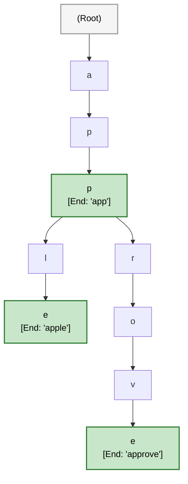
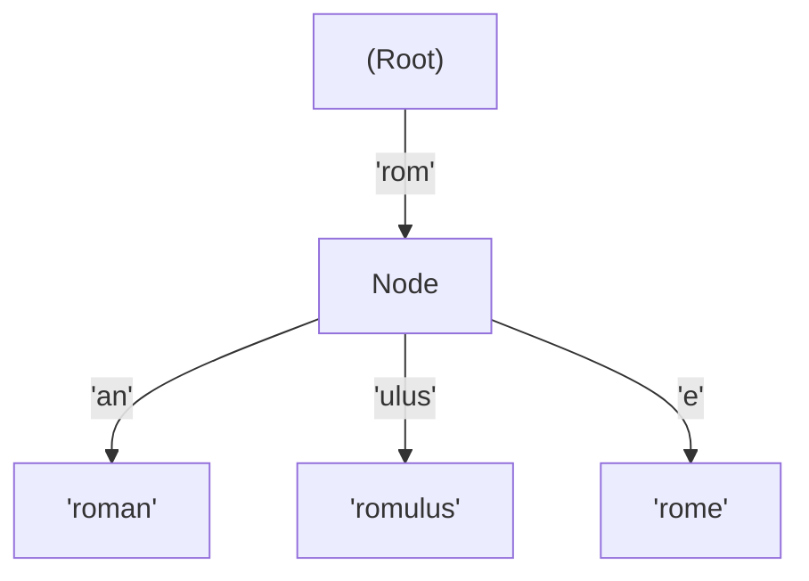

# 🚶‍♂️ Walkthrough: Trie (Prefix Tree) Implementation

> **Level**: Fundamentals 101 to Staff Architect & Research  
> **Prerequisites**: [001 - Array and String](file:///Users/aparv/Library/CloudStorage/OneDrive-Personal/G-Drive/Interviews/knowledge/DSA/00%20-%20Fundamentals/001%20-%20Array%20and%20String/array_and_string_walkthrough.md), [002 - Hash Table](file:///Users/aparv/Library/CloudStorage/OneDrive-Personal/G-Drive/Interviews/knowledge/DSA/00%20-%20Fundamentals/002%20-%20Hash%20Table/hash_table_walkthrough.md), [003 - Recursion and the Call Stack](file:///Users/aparv/Library/CloudStorage/OneDrive-Personal/G-Drive/Interviews/knowledge/DSA/00%20-%20Fundamentals/003%20-%20Recursion%20and%20the%20Call%20Stack/recursion_walkthrough.md)  
> **Source Code**: [trie.py](file:///Users/aparv/Library/CloudStorage/OneDrive-Personal/G-Drive/Interviews/knowledge/DSA/00%20-%20Fundamentals/011%20-%20Trie/trie.py)

---

## 🧭 Executive Curriculum Roadmap

```
Level 100: The Napkin Sketch ──────► 30s physical analogy: The Autocomplete Funnel & Letter Tree
Level 200: Street Fundamentals ────► Cheat card, 4 FAANG patterns, Word Search II triage rules
Level 300: Working Professional ───► Clean typed Trie with wildcard search and prefix retrieval
Level 400: Staff & Senior Arch ────► Radix Trees (Patricia), Aho-Corasick multi-pattern matching
Level 500: Researcher's Corner ────► Suffix Trees, Ukkonen's O(N) linear time, BWT in Genomics
```

---

## 🐣 Level 100: The Napkin Sketch

### The Search Engine Autocomplete Analogy
When you type **"app"** into Google or iOS Safari, the search bar instantly predicts:
- **"apple"**
- **"application"**
- **"appetizer"**

How does the search engine look through 500,000,000 English words in less than 2 milliseconds?
If words were stored in a standard Hash Table or List, the computer would have to examine every single word to check: `if word.startswith("app")`. That requires an exhaustive $O(N)$ scan.

A **Trie** (derived from re**TRIE**val, pronounced "try") organizes words by their shared letters:
- All words starting with `"a"` share a single root branch.
- Following `"a" \to "p" \to "p"` places you at the precise junction of all words beginning with `"app"`.
- Instant lookup depends **only on the length of the prefix**, completely independent of whether the dictionary has 10 words or 10 billion!

```
                       (Root)
                         │ 'a'
                        [ a ]
                         │ 'p'
                        [ p ]
                         │ 'p'
                     [ p (End: "app") ]
                     /       \
               'l'  /         \  'e'
                  [ l ]       [ e ]
                   │ 'e'       │ 't'
           [ e (End: "apple") ] [ t (End: "appetizer"...) ]
```

### Visual Architecture



---

## ⚡ Level 200: Street Fundamentals (The Interview Cheat Card)

### Mental Model Card
```
TrieNode:
  - children: dict[str, TrieNode]  (or fixed array [None] * 26)
  - is_end_of_word: bool           (Distinguishes prefix from complete word)
  - pass_count: int                (Tracks how many words share this prefix)
```

### Operations & Complexity Matrix

| Operation | Time Complexity | Space Complexity | Notes |
| :--- | :--- | :--- | :--- |
| **`insert(word)`** | **$O(L)$** | $O(L)$ worst | $L$ is word length. Reuses existing shared prefix nodes. |
| **`search(word)`** | **$O(L)$** | $O(1)$ | Steps down character links. Returns `True` if `is_end_of_word`. |
| **`starts_with(prefix)`** | **$O(L)$** | $O(1)$ | Steps down prefix links. Returns `True` if path exists. |
| **`delete(word)`** | **$O(L)$** | $O(L)$ call stack | Unmarks `is_end_of_word`; prunes dead branches bottom-up. |
| **`find_all_with_prefix(p)`** | **$O(L + K)$** | $O(K)$ | $L$ to reach prefix node; DFS collects $K$ characters. |

---

### Decision Matrix: When to Pick a Trie

| Data Structure | Exact Search | Prefix Search (`starts_with`) | Wildcard Search (`b.d`) | Memory Footprint |
| :--- | :--- | :--- | :--- | :--- |
| **Hash Set** | **$O(L)$** | $O(N \cdot L)$ (exhaustive scan) | Impossible without scan | **Compact** ($O(N \cdot L)$) |
| **Sorted Array** | $O(L \log N)$ | $O(L \log N)$ (binary search) | $O(N \cdot L)$ scan | **Optimal** (flat memory) |
| **Trie** | **$O(L)$** | **$O(L)$** (independent of $N$!) | **$O(26^D)$** (DFS branch) | High node/pointer overhead |
| **Radix Tree** | **$O(L)$** | **$O(L)$** | $O(26^D)$ | Compressed pointers |

---

### FAANG Pattern Recognition & Triage Rules
1. **Implement Trie (LeetCode 208)**: Core baseline. Must memorize `TrieNode` structure and traversal pattern.
2. **Word Search II (LeetCode 212)**:
   - *Naive*: Run DFS from each cell for each of the $10,000$ dictionary words $\implies$ TLE ($O(W \cdot M \cdot N \cdot 4^L)$).
   - *Optimal*: Build a single Trie containing all $10,000$ words. Step through the 2D grid with DFS while simultaneously walking down the Trie! If the current grid letter is not in `curr_trie_node.children`, **prune the search branch immediately**!
3. **Design Add and Search Words (LeetCode 211)**:
   - If character is `.` (dot wildcard), iterate through all keys in `curr.children` and recursively branch down.
4. **Maximum XOR of Two Numbers in an Array (LeetCode 421)**:
   - Treat each 32-bit integer as a 32-character binary string (`"0"` and `"1"`).
   - Insert numbers into a **Binary Bitwise Trie**.
   - To maximize XOR with number $X$, greedily take the branch with opposite bit ($1 \text{ if bit is } 0$, else $0$).

---

### Common Interview Trapdoors
- ❌ **The Prefix vs Complete Word Bug**: Searching for `"app"` returns `True` even though only `"apple"` was inserted. Always check: `return curr.is_end_of_word`.
- ❌ **Memory Bloat in Unicode / Sparse Text**: Initializing an array of size 26 or 128 for every node when storing sparse alphabets. Use a hash map `dict` or initialize children lazily.
- ❌ **Orphan Nodes on Deletion**: Setting `curr.is_end_of_word = False` without pruning unused leaf nodes leaves dead memory that inflates future operations.

---

## 🛠️ Level 300: Working Professional (Clean Architecture & Code)

### Production-Grade Trie Implementation
From [trie.py](file:///Users/aparv/Library/CloudStorage/OneDrive-Personal/G-Drive/Interviews/knowledge/DSA/00%20-%20Fundamentals/011%20-%20Trie/trie.py), extended with wildcard search and prefix autocompletion:

```python
"""
Enterprise Trie (Prefix Tree) Implementation
Python 3.14 Compatible
"""
from typing import Dict, List, Optional

class TrieNode:
    __slots__ = ("children", "is_end_of_word")

    def __init__(self) -> None:
        self.children: Dict[str, TrieNode] = {}
        self.is_end_of_word: bool = False

    def __repr__(self) -> str:
        return f"TrieNode(is_end={self.is_end_of_word}, children={list(self.children.keys())})"


class Trie:
    """
    Prefix Tree supporting insertion, exact search, prefix matching,
    wildcard queries, and autocomplete suggestion retrieval.
    """
    __slots__ = ("root",)

    def __init__(self) -> None:
        self.root: TrieNode = TrieNode()

    def insert(self, word: str) -> None:
        """Inserts a word into the Trie in O(L) time."""
        curr = self.root
        for char in word:
            if char not in curr.children:
                curr.children[char] = TrieNode()
            curr = curr.children[char]
        curr.is_end_of_word = True

    def search(self, word: str) -> bool:
        """Returns True if the exact word exists in O(L) time."""
        curr = self.root
        for char in word:
            if char not in curr.children:
                return False
            curr = curr.children[char]
        return curr.is_end_of_word

    def starts_with(self, prefix: str) -> bool:
        """Returns True if there is any word that begins with prefix in O(L) time."""
        curr = self.root
        for char in prefix:
            if char not in curr.children:
                return False
            curr = curr.children[char]
        return True

    def autocomplete(self, prefix: str, limit: int = 5) -> List[str]:
        """Returns up to `limit` words starting with the given prefix."""
        curr = self.root
        for char in prefix:
            if char not in curr.children:
                return []
            curr = curr.children[char]

        results: List[str] = []

        def _dfs(node: TrieNode, path: List[str]) -> None:
            if len(results) >= limit:
                return
            if node.is_end_of_word:
                results.append(prefix + "".join(path))
            for char, child_node in sorted(node.children.items()):
                path.append(char)
                _dfs(child_node, path)
                path.pop()

        _dfs(curr, [])
        return results
```

---

### Step-by-Step Dry Run: Word Search II Pruning
Consider a $4 \times 4$ Boggle board searching for `["oath", "pea", "eat", "rain"]`.

```
Board:
  [ 'o', 'a', 'a', 'n' ]
  [ 'e', 't', 'a', 'e' ]
  [ 'i', 'h', 'k', 'r' ]
  [ 'i', 'f', 'l', 'v' ]

1. Load all words into Trie:
   Root -> 'o' -> 'a' -> 't' -> 'h' (End)
   Root -> 'p' -> 'e' -> 'a' (End)
   ...

2. DFS starts at cell (0, 0) = 'o':
   - 'o' exists in Root.children! Step into TrieNode('o').
   - Move to neighbor (0, 1) = 'a':
     - 'a' exists in TrieNode('o').children! Step into TrieNode('a').
   - Move to neighbor (1, 1) = 't':
     - 't' exists in TrieNode('a').children! Step into TrieNode('t').
   - Move to neighbor (2, 1) = 'h':
     - 'h' exists in TrieNode('t').children! Step into TrieNode('h').
     - TrieNode('h').is_end_of_word == True! ===> FOUND "oath"! ✅

3. DFS starts at cell (2, 2) = 'k':
   - 'k' NOT in Root.children.
   - PRUNE ENTIRE SUBTREE IMMEDIATELY! 0 wasted recursive steps!
```

---

## 🏛️ Level 400: Staff & Senior Engineer (Systems Architecture)

### 1. The Radix Tree (Patricia Trie): Path Compression
In standard Tries, single-child paths consume an entire node object per character:
$$\text{Root} \xrightarrow{\text{'r'}} \text{Node} \xrightarrow{\text{'o'}} \text{Node} \xrightarrow{\text{'m'}} \text{Node} \xrightarrow{\text{'a'}} \text{Node}$$
This produces excessive heap fragmentation and pointer dereferences.

A **Radix Tree (Compressed Trie)** compresses linear chains of single-child nodes into a single edge holding a string slice:



**Where Staff Engineers Encounter This**:
- **Linux Kernel Page Cache**: Uses `radix_tree` to map file offsets to memory pages.
- **IP Routing Tables**: Longest Prefix Match (CIDR IP lookup like `192.168.1.0/24`) uses binary Radix trees for line-rate packet forwarding.

---

### 2. Multi-Pattern String Matching: The Aho-Corasick Automaton
When building high-speed packet inspection (Snort, Suricata) or content moderation systems searching for 50,000 banned keywords in a live streaming text feed:
- Running 50,000 independent searches takes $O(50,000 \times \text{TextLength})$.
- **Aho-Corasick** compiles the Trie into a **Deterministic Finite Automaton (DFA)** by adding **Failure Links** (identical to the failure function in KMP).
- Processing incoming text matches **all 50,000 keywords simultaneously in a single linear pass**:
  $$\text{Time} = O(\text{TextLength} + \text{TotalMatches})$$

---

## 🔬 Level 500: Researcher's Corner

<details>
<summary><strong>1. Suffix Trees & Ukkonen's Linear-Time Algorithm</strong></summary>

A **Suffix Tree** is a compressed Trie containing all suffixes of a string $S$ of length $N$.
- Trivial construction by inserting all $N$ suffixes takes $O(N^2)$ time.
- **Esko Ukkonen (1995)** proved that a Suffix Tree can be constructed in strictly online, **linear $O(N)$ time and $O(N)$ space**!
- Ukkonen's algorithm uses three key algorithmic mechanisms:
  1. **Suffix Links**: Shortcut pointers between internal nodes.
  2. **Implicit Suffix Trees**: Postponing path extensions via open-ended edge pointers `(start, #)`.
  3. **Skip/Count Trick**: Traversing down compressed edges in $O(1)$ time by comparing string lengths.

Suffix Trees and their space-efficient cousin, the **Burrows-Wheeler Transform (FM-Index)**, form the computational bedrock of modern bioinformatics and human genome alignment (e.g., Bowtie, BWA).
</details>

<details>
<summary><strong>2. Formal Trie Structural Invariant</strong></summary>

Let $T = (V, E)$ be a Trie over alphabet $\Sigma$ with root $r \in V$.
1. Every edge $e = (u, v) \in E$ is labeled with a symbol $\sigma(e) \in \Sigma$.
2. For every vertex $u \in V$, the outgoing edge labels are distinct:
   $$\forall (u, v_1), (u, v_2) \in E \implies \sigma(u, v_1) \ne \sigma(u, v_2)$$
3. Every vertex $v \in V$ corresponds to a unique string $S(v)$ formed by concatenating edge labels along the unique simple path from $r$ to $v$.
4. A string $W$ is present in the dictionary iff there exists $v \in V$ such that $S(v) = W$ and $\text{is\_end}(v) = \text{True}$.
</details>

---

## 🔗 Cross-Pillar Linkage & Navigation
- **Previous**: [010 - Min and Max Heap](file:///Users/aparv/Library/CloudStorage/OneDrive-Personal/G-Drive/Interviews/knowledge/DSA/00%20-%20Fundamentals/010%20-%20Min%20and%20Max%20Heap/heap_walkthrough.md)
- **Next**: [012 - Graph](file:///Users/aparv/Library/CloudStorage/OneDrive-Personal/G-Drive/Interviews/knowledge/DSA/00%20-%20Fundamentals/012%20-%20Graph/graph_walkthrough.md)
- **Theory Grounding**: [000 - Theoretical Foundations/010 - Information Theory and Entropy](file:///Users/aparv/Library/CloudStorage/OneDrive-Personal/G-Drive/Interviews/knowledge/DSA/00%20-%20Fundamentals/000%20-%20Theoretical%20Foundations/010%20-%20Information%20Theory%20and%20Entropy/information_theory_walkthrough.md)
- **Pattern Application**: [017 - The Pattern Cracker/017 - Trie](file:///Users/aparv/Library/CloudStorage/OneDrive-Personal/G-Drive/Interviews/knowledge/DSA/00%20-%20Fundamentals/017%20-%20The%20Pattern%20Cracker/017%20-%20Trie/017_trie.md)
