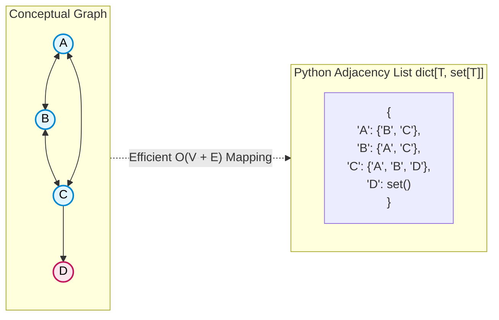

# 🚶‍♂️ Walkthrough: Graph Data Structure Implementation

> **Level**: Fundamentals 101 to Staff Architect & Research  
> **Prerequisites**: [001 - Array and String](file:///Users/aparv/Library/CloudStorage/OneDrive-Personal/G-Drive/Interviews/knowledge/DSA/00%20-%20Fundamentals/001%20-%20Array%20and%20String/array_and_string_walkthrough.md), [002 - Hash Table](file:///Users/aparv/Library/CloudStorage/OneDrive-Personal/G-Drive/Interviews/knowledge/DSA/00%20-%20Fundamentals/002%20-%20Hash%20Table/hash_table_walkthrough.md), [005 - Queue and Stack](file:///Users/aparv/Library/CloudStorage/OneDrive-Personal/G-Drive/Interviews/knowledge/DSA/00%20-%20Fundamentals/005%20-%20Queue%20and%20Stack/queue_and_stack_walkthrough.md)  
> **Source Code**: [graph.py](file:///Users/aparv/Library/CloudStorage/OneDrive-Personal/G-Drive/Interviews/knowledge/DSA/00%20-%20Fundamentals/012%20-%20Graph/graph.py)

---

## 🧭 Executive Curriculum Roadmap

```
Level 100: The Napkin Sketch ──────► 30s physical analogy: The Airline Route Map & Friendship Web
Level 200: Street Fundamentals ────► Cheat card, Adjacency List vs Matrix, 5 FAANG graph archetypes
Level 300: Working Professional ───► Generic Graph class with BFS/DFS generators and cycle detection
Level 400: Staff & Senior Arch ────► Scale limits (Billions of edges), CSR memory format, Pregel BSP
Level 500: Researcher's Corner ────► Handshaking Lemma, Graph Laplacian L = D - A & Cheeger's Bound
```

---

## 🐣 Level 100: The Napkin Sketch

### The Airline Flight Map Analogy
Think of an airline route network:
- Cities (New York, London, Tokyo) are **Vertices** (Nodes).
- Non-stop flight routes connecting them are **Edges**.
- Some routes are **Directed** (winds blow one way, or a ferry only travels downstream).
- Some routes are **Weighted** (flight duration in minutes or ticket cost in dollars).

```
         (New York) ────── 7h ──────► (London)
              │                           │
             14h                         12h
              ▼                           ▼
           (Tokyo) ◄────── 9h ──────── (Dubai)
```

### The Core Dilemma: List vs Matrix
How should we store this map in computer memory?
1. **Adjacency Matrix ($V \times V$ Grid)**:
   - A gigantic grid of every city against every other city.
   - Fast $O(1)$ query: *"Is there a flight from NYC to Tokyo?"*
   - **Disaster for memory**: If Earth has 10,000 airports, the matrix requires $10,000 \times 10,000 = 100,000,000$ cells. Because most airports only fly to $\approx 30$ destinations, $99.7\%$ of the grid contains empty zeros!
2. **Adjacency List (Dictionary of Sets)**:
   - Only store actual existing connections:
     $$\text{NYC} \to \{\text{London}, \text{Tokyo}\}$$
   - Memory footprint is strictly proportional to reality: $O(V + E)$.

### Visual Architecture



---

## ⚡ Level 200: Street Fundamentals (The Interview Cheat Card)

### Mental Model Card
```
Graph Invariants:
- Undirected: Edge (u, v) implies (v, u) exists. Degree = number of incident edges.
- Directed (DAG): Edges have arrowheads. In-degree != Out-degree.
- Dense Graph: E ≈ V²   ===> Use Adjacency Matrix
- Sparse Graph: E ≪ V²  ===> Use Adjacency List (99.9% of FAANG problems!)
```

### Operations & Complexity Matrix

| Operation | Adjacency List (`dict[T, set]`) | Adjacency Matrix (`list[list[int]]`) | Space Complexity |
| :--- | :--- | :--- | :--- |
| **Space** | **$O(V + E)$** (Optimal for sparse) | $O(V^2)$ (Heavy waste if sparse) | — |
| **`add_edge(u, v)`** | **$O(1)$** | $O(1)$ | $O(1)$ |
| **`has_edge(u, v)`** | **$O(1)$** (with hash set) | **$O(1)$** | $O(1)$ |
| **`remove_edge(u, v)`** | **$O(1)$** | $O(1)$ | $O(1)$ |
| **`get_neighbors(u)`** | **$O(\text{deg}(u))$** | $O(V)$ (must scan entire row) | $O(\text{deg}(u))$ |
| **`remove_vertex(u)`** | $O(V + \text{deg}(u))$ | $O(V^2)$ (or $O(V)$ if zeroed) | $O(1)$ |
| **Full Traversal (BFS/DFS)**| **$O(V + E)$** | $O(V^2)$ | $O(V)$ auxiliary |

---

### The 5 FAANG Graph Archetypes & Triage Rules

```
                             ┌────────────────────────┐
                             │ What is the problem?   │
                             └───────────┬────────────┘
                                         │
         ┌───────────────────┬───────────┴───────────┬───────────────────┐
         ▼                   ▼                       ▼                   ▼
   Shortest Path?       Cycle in DAG /          Connected Components?   Explore All Paths?
         │             Course Prereqs?               │                   │
         │                   │                       │                   │
   Weighted?           Topological Sort        BFS / DFS / Union-Find   Backtracking DFS
   ┌─────┴─────┐      (Kahn's In-Degree)      (Number of Islands)      (All Paths to Dest)
   ▼           ▼
Unweighted:  Weighted:
  BFS        Dijkstra
(O(V+E))   (O(E log V))
```

1. **Shortest Path in Unweighted Graph**: Always **BFS** (`collections.deque`). The first time BFS hits the destination, that path is mathematically guaranteed to be the shortest.
2. **Shortest Path in Weighted Graph (Non-negative)**: Always **Dijkstra** (Min-Heap Priority Queue).
3. **Course Schedule / Dependency Resolution**: Always **Topological Sort** (Kahn's Algorithm with in-degrees or DFS with 3-state coloring).
4. **Number of Islands / Flood Fill**: Implicit grid graph traversal using DFS/BFS with boundary validation.
5. **Redundant Connection / Dynamic Connectivity**: **Union-Find (Disjoint Set Union)**.

---

### Common Interview Trapdoors
- ❌ **The Infinite Loop Trap (Cycles)**: Forgetting a `visited` set! In any cyclic graph, an algorithm without a visited set will loop infinitely until Python crashes with `RecursionError`.
- ❌ **The Disconnected Component Trap**: Starting BFS/DFS only from node `0`. If the graph has 3 disconnected islands, nodes on islands 2 and 3 are never visited! Always wrap in an outer loop:
  ```python
  visited = set()
  for node in graph:
      if node not in visited:
          bfs(node, visited)
  ```
- ❌ **One-Way Undirected Edge**: Adding an edge to $u$'s neighbor set but forgetting to add $u$ to $v$'s neighbor set.

---

## 🛠️ Level 300: Working Professional (Clean Architecture & Code)

### Production-Grade Graph Implementation
From [graph.py](file:///Users/aparv/Library/CloudStorage/OneDrive-Personal/G-Drive/Interviews/knowledge/DSA/00%20-%20Fundamentals/012%20-%20Graph/graph.py), enhanced with BFS, DFS, and cycle detection:

```python
"""
Enterprise Generic Graph Implementation (Adjacency List)
Python 3.14 Compatible
"""
from typing import Dict, Set, List, Optional, Generic, TypeVar, Iterator
from collections import deque

T = TypeVar("T")

class Graph(Generic[T]):
    """
    Adjacency list graph supporting directed and undirected configurations,
    vertex/edge management, and BFS/DFS traversals.
    """
    __slots__ = ("_adj", "_is_directed")

    def __init__(self, is_directed: bool = False) -> None:
        self._adj: Dict[T, Set[T]] = {}
        self._is_directed: bool = is_directed

    def add_vertex(self, vertex: T) -> None:
        """Adds a vertex to the graph if not already present."""
        if vertex not in self._adj:
            self._adj[vertex] = set()

    def add_edge(self, u: T, v: T) -> None:
        """Adds an edge from u to v. In undirected mode, adds v to u as well."""
        self.add_vertex(u)
        self.add_vertex(v)
        self._adj[u].add(v)
        if not self._is_directed:
            self._adj[v].add(u)

    def remove_edge(self, u: T, v: T) -> None:
        """Removes the edge between u and v."""
        if u in self._adj and v in self._adj[u]:
            self._adj[u].remove(v)
        if not self._is_directed and v in self._adj and u in self._adj[v]:
            self._adj[v].remove(u)

    def remove_vertex(self, vertex: T) -> None:
        """Removes a vertex and all incident edges across the graph."""
        if vertex not in self._adj:
            return
        del self._adj[vertex]
        for neighbors in self._adj.values():
            neighbors.discard(vertex)

    def get_neighbors(self, vertex: T) -> Set[T]:
        """Returns the set of neighbors for a vertex."""
        return self._adj.get(vertex, set())

    def bfs(self, start: T) -> Iterator[T]:
        """Breadth-First Search traversal yielding visited vertices in level order."""
        if start not in self._adj:
            return
        visited: Set[T] = {start}
        queue: deque[T] = deque([start])

        while queue:
            curr = queue.popleft()
            yield curr
            for neighbor in sorted(self._adj[curr], key=lambda x: str(x)):
                if neighbor not in visited:
                    visited.add(neighbor)
                    queue.append(neighbor)

    def dfs(self, start: T) -> Iterator[T]:
        """Depth-First Search traversal yielding visited vertices."""
        if start not in self._adj:
            return
        visited: Set[T] = set()

        def _dfs_helper(node: T) -> Iterator[T]:
            visited.add(node)
            yield node
            for neighbor in sorted(self._adj[node], key=lambda x: str(x)):
                if neighbor not in visited:
                    yield from _dfs_helper(neighbor)

        yield from _dfs_helper(start)
```

---

### Step-by-Step Dry Run: Kahn's Algorithm for Topological Sort
Given dependencies: $1 \to 0$, $2 \to 0$, $3 \to 1$, $3 \to 2$.

```
1. Compute in-degrees:
   in_degree = {0: 2, 1: 1, 2: 1, 3: 0}

2. Initialize queue with vertices having in_degree == 0:
   Queue: [ 3 ]

3. Process Queue:
   - Pop 3: Result = [ 3 ]
     - Decrement neighbors: in_degree[1] -> 0, in_degree[2] -> 0
     - Enqueue 1 and 2: Queue = [ 1, 2 ]
   - Pop 1: Result = [ 3, 1 ]
     - Decrement neighbor: in_degree[0] -> 1
   - Pop 2: Result = [ 3, 1, 2 ]
     - Decrement neighbor: in_degree[0] -> 0
     - Enqueue 0: Queue = [ 0 ]
   - Pop 0: Result = [ 3, 1, 2, 0 ]

4. Verification: len(Result) == V (4 == 4).
   Valid Topological Ordering: [ 3, 1, 2, 0 ] ✅
```

---

## 🏛️ Level 400: Staff & Senior Engineer (Systems Architecture)

### 1. Scale Limits: Big Data Graphs at Meta & Google
Consider Meta's social graph:
- $3\text{ billion}$ users ($V$).
- Each user has $\approx 500$ friends ($E = 1.5\text{ trillion edges}$).
- Storing this in Python dictionaries would require $\approx 50\text{ TB}$ of RAM—impossible for a single machine!

**Production Architecture Solutions**:
1. **Graph Partitioning**: Distributed across 1,000 servers.
   - *Vertex Partitioning*: Split vertices across shards via `hash(user_id) % num_shards`.
   - *Edge Partitioning*: Replicate high-degree vertices across shards to avoid cross-network hops.
2. **The "Celebrity Node" Hotspot Problem**:
   - Accounts like `@cristiano` have $600\text{M}$ followers.
   - Traversing his neighbors floods a single server with network I/O.
   - *Fix*: Fan-out limits and read-replicated edge shards.

---

### 2. High-Performance Hardware Representation: CSR (Compressed Sparse Row)
In high-performance graph compute engines (GraphBLAS, PyTorch Geometric, CUDA graph solvers), Python dictionaries are avoided entirely because pointer chasing stalls the memory bus.
Instead, graphs are stored in **Compressed Sparse Row (CSR)** format using two flat contiguous 1D integer arrays:

```
Graph:
Node 0 -> Neighbors: [ 1, 2 ]
Node 1 -> Neighbors: [ 2 ]
Node 2 -> Neighbors: [ 0, 3 ]
Node 3 -> Neighbors: [ ]

CSR Representation:
col_idx:  [ 1, 2,  2,  0, 3 ]   <--- Contiguous flat array of all target edges
row_ptr:  [ 0,     2,  3,     5, 5 ] <--- Offsets into col_idx for each vertex
```
To find neighbors of vertex $u$:
$$\text{Neighbors}(u) = \text{col\_idx}[\text{row\_ptr}[u] : \text{row\_ptr}[u+1]]$$
- **Cache Miss Rate**: Near $0\%$ (sequential memory streaming!).
- **SIMD Vectorization**: CPUs and GPUs can parallel-scan edges at memory bandwidth speeds ($\approx 100\text{--}900\,\text{GB/s}$).

---

## 🔬 Level 500: Researcher's Corner

<details>
<summary><strong>1. The Handshaking Lemma & Degree Sum Formula</strong></summary>

**Theorem (Euler, 1736)**: In any finite undirected graph $G = (V, E)$, the sum of the degrees of all vertices equals twice the number of edges:
$$\sum_{v \in V} \deg(v) = 2|E|$$

**Proof**:
Each edge $e = (u, v)$ contributes exactly $1$ to the degree count of $u$ and exactly $1$ to the degree count of $v$. Summing across all vertices counts each edge endpoint exactly twice. $\blacksquare$

**Corollary (Odd-Degree Parity)**:
In every undirected graph, the number of vertices with odd degree is **always even**.
</details>

<details>
<summary><strong>2. Spectral Graph Theory & The Graph Laplacian</strong></summary>

Let $A$ be the $V \times V$ adjacency matrix and $D$ be the diagonal degree matrix ($D_{ii} = \deg(i)$).
The **Graph Laplacian Matrix** is defined as:
$$L = D - A$$

#### Key Spectral Properties:
1. $L$ is symmetric and positive semi-definite.
2. The smallest eigenvalue $\lambda_1 = 0$, with eigenvector $\mathbf{1} = [1, 1, \dots, 1]^T$.
3. The multiplicity of eigenvalue $0$ equals the **number of connected components** in the graph!
4. **The Fiedler Value ($\lambda_2$)**: The second smallest eigenvalue measures **Algebraic Connectivity**.
   - By **Cheeger's Inequality**, $\lambda_2$ provides tight theoretical bounds on graph expansion and the minimum cut cost required to partition the graph:
     $$\frac{\lambda_2}{2} \le h(G) \le \sqrt{2 \lambda_2 \max_{v} \deg(v)}$$
   This forms the mathematical foundation of Spectral Clustering in Machine Learning and Image Segmentation.
</details>

---

## 🔗 Cross-Pillar Linkage & Navigation
- **Previous**: [011 - Trie](file:///Users/aparv/Library/CloudStorage/OneDrive-Personal/G-Drive/Interviews/knowledge/DSA/00%20-%20Fundamentals/011%20-%20Trie/trie_walkthrough.md)
- **Next**: [013 - Union-Find (Disjoint Set)](file:///Users/aparv/Library/CloudStorage/OneDrive-Personal/G-Drive/Interviews/knowledge/DSA/00%20-%20Fundamentals/013%20-%20Union-Find%20%28Disjoint%20Set%29/union_find_walkthrough.md)
- **Comprehensive Pillar**: [016 - Graphs (The Complete Guide)](file:///Users/aparv/Library/CloudStorage/OneDrive-Personal/G-Drive/Interviews/knowledge/DSA/00%20-%20Fundamentals/016%20-%20Graphs%20%28The%20Complete%20Guide%29/README.md)
- **Theory Grounding**: [000 - Theoretical Foundations/006 - Graph Theory and Network Flows](file:///Users/aparv/Library/CloudStorage/OneDrive-Personal/G-Drive/Interviews/knowledge/DSA/00%20-%20Fundamentals/000%20-%20Theoretical%20Foundations/006%20-%20Graph%20Theory%20and%20Network%20Flows/graph_theory_walkthrough.md)
- **Pattern Application**: [017 - The Pattern Cracker/019 - Topological Sort](file:///Users/aparv/Library/CloudStorage/OneDrive-Personal/G-Drive/Interviews/knowledge/DSA/00%20-%20Fundamentals/017%20-%20The%20Pattern%20Cracker/019%20-%20Topological%20Sort/019_topological_sort.md)
