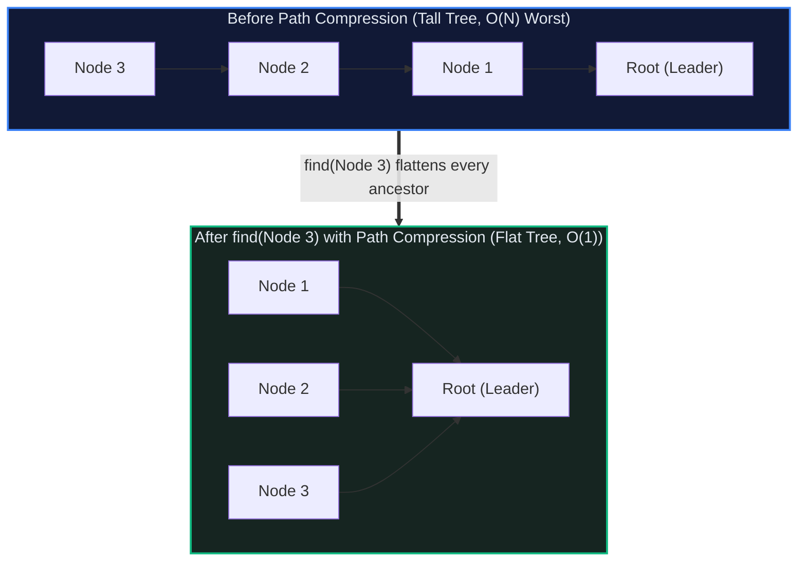

# 🌲 Union-Find (Disjoint-Set Union): The Dynamic Connectivity Engine

> *"Union-Find answers the fundamental question of network topology: 'Are these two entities connected?' in near-instantaneous $O(\alpha(N))$ time — practically indistinguishable from $O(1)$ across the entire known universe."*

---

## 📍 Level 100 — The Napkin Sketch (30 Seconds)

### The Real-World Analogy: Feudal Kingdoms & Paved Highways
Imagine a continent of 1,000 independent villages. Each village starts as its own tiny kingdom with its own Mayor:

```
[ Village A ] (Mayor A)       [ Village B ] (Mayor B)
```

1. **The Alliance (`union(A, B)`)**:
   Village A and Village B sign a mutual defense pact. They do not hold a chaotic election among all 500 citizens. Mayor A simply pledges allegiance to Mayor B. Now, Mayor B is the Supreme Leader of both villages.
2. **The Verification (`connected(X, Y)`)**:
   To check if Citizen X and Citizen Y are allies, you ask both: *"Who is your Supreme Leader?"* If both answer "Mayor B", they belong to the same alliance. This is `find(X) == find(Y)`.
3. **The Paved Highway (`Path Compression`)**:
   When Citizen X travels across 5 intermediate villages to visit the Supreme Leader, she lays down a paved highway directly from her home to the capital:

```
Before Path Compression (Winding path):
X ──> Village 1 ──> Village 2 ──> Village 3 ──> Supreme Leader

After Path Compression (Flattened):
X ──────────────────────────────────────────> Supreme Leader
```

The next time Citizen X needs the Supreme Leader, the trip takes **1 step instead of 4**. The tree permanently flattens!

### The Core Invariant
> **The Canonical Root Invariant:** Every set is represented by a rooted, directed tree where each node points to its parent. The set's canonical representative is the unique root whose parent pointer points to itself (`parent[root] == root`). Two elements $x$ and $y$ belong to the same set if and only if `find(x) == find(y)`.

---

## 🎯 Level 200 — Street Fundamentals (5 Minutes)

> 🧠 **Mental Model Card**
> - **Core Superpower:** Dynamic connectivity in $O(\alpha(N)) \approx O(1)$ time per operation.
> - **The Kryptonite:** Does **not** support directed edges, edge weights, edge deletions, or finding the *actual path* between nodes.
> - **When to Reach for It:**
>   - "Do these two nodes share a connected component?"
>   - Cycle detection in an undirected graph (if `find(u) == find(v)` before adding edge $(u, v)$, a cycle exists!).
>   - Kruskal's Minimum Spanning Tree (MST).
>   - Number of connected components after dynamic edge additions.
> - **When to Run Away:**
>   - Directed graphs $\to$ Reach for **Tarjan's or Kosaraju's SCC algorithm**.
>   - Finding the shortest path $\to$ Reach for **BFS** or **Dijkstra**.
>   - Edge deletions $\to$ Reach for **Euler Tour Trees** or **Link-Cut Trees**.
> - **Complexity Budget:** Find: $O(\alpha(N))$ | Union: $O(\alpha(N))$ | Space: $O(N)$.

### Tree Flattening Visualized (Path Compression)



### Street Code Snippet: The 15-Line FAANG Interview DSU

```python
class DSU:
    def __init__(self, n: int) -> None:
        self.parent = list(range(n))
        self.rank = [1] * n

    def find(self, i: int) -> int:
        if self.parent[i] != i:
            self.parent[i] = self.find(self.parent[i])  # Path compression
        return self.parent[i]

    def union(self, i: int, j: int) -> bool:
        root_i, root_j = self.find(i), self.find(j)
        if root_i == root_j:
            return False  # Already connected (Detected a cycle!)
        # Union by rank: attach smaller tree under taller tree
        if self.rank[root_i] < self.rank[root_j]:
            self.parent[root_i] = root_j
        elif self.rank[root_i] > self.rank[root_j]:
            self.parent[root_j] = root_i
        else:
            self.parent[root_j] = root_i
            self.rank[root_i] += 1
        return True
```

---

## ⚙️ Level 300 — Working Professional (15 Minutes)

### Real-System Architecture: Production Applications
1. **Kruskal's Minimum Spanning Tree**:
   Sort all $E$ edges by weight. Iterate through edges: if `dsu.union(u, v)` returns `True`, include the edge in the MST. Stop when $V - 1$ edges are selected. Total time: $O(E \log E)$ (dominated by the initial sort; DSU operations take total $O(E \alpha(V))$).
2. **Computer Vision (Connected Component Labeling)**:
   In binary images (e.g. medical MRI scans, OCR text recognition), Union-Find connects adjacent foreground pixels in a single streaming pass to identify distinct tumors or letter glyphs.
3. **Hex & Percolation Games**:
   Simulating fluid percolation through porous materials: DSU tracks if top surface fluid connects to bottom floor cells.

### Complete Implementation: Production Union-Find with Component Tracking

```python
"""
Production Union-Find (Disjoint-Set Union) Implementation.
Includes path compression, union-by-size, component counting, and maximum cluster size.
"""

from typing import List, Tuple

class UnionFind:
    """Disjoint-Set Union supporting O(alpha(N)) operations."""

    def __init__(self, n: int) -> None:
        self._n = n
        self.parent: List[int] = list(range(n))
        self.size: List[int] = [1] * n  # Union by size
        self.num_components: int = n
        self.max_component_size: int = 1 if n > 0 else 0

    def find(self, x: int) -> int:
        """Finds representative with two-pass full path compression."""
        root = x
        while root != self.parent[root]:
            root = self.parent[root]

        # Path compression: point all ancestors directly to root
        curr = x
        while curr != root:
            nxt = self.parent[curr]
            self.parent[curr] = root
            curr = nxt

        return root

    def union(self, x: int, y: int) -> bool:
        """Merges sets containing x and y. Returns True if merged, False if already connected."""
        root_x = self.find(x)
        root_y = self.find(y)

        if root_x == root_y:
            return False

        # Union by size: attach smaller tree under larger tree
        if self.size[root_x] < self.size[root_y]:
            root_x, root_y = root_y, root_x

        self.parent[root_y] = root_x
        self.size[root_x] += self.size[root_y]
        self.num_components -= 1

        if self.size[root_x] > self.max_component_size:
            self.max_component_size = self.size[root_x]

        return True

    def connected(self, x: int, y: int) -> bool:
        """Checks if x and y belong to the same component."""
        return self.find(x) == self.find(y)

    def get_component_size(self, x: int) -> int:
        """Returns the number of elements in x's component."""
        return self.size[self.find(x)]
```

### Critical Edge Cases & Failure Modes
1. **Recursion Limit on Path Compression**:
   If you implement `find` with recursion on a skewed tree of size $N = 50,000$ *without* union-by-rank, the first `find` call will exceed Python's recursion limit. **The iterative two-pass implementation above is 100% immune to recursion limit errors.**
2. **Forgetting Path Compression**: If you implement Union-by-Rank without Path Compression, operations take $O(\log N)$ instead of $O(\alpha(N))$. If you omit both, trees degrade to linked lists taking $O(N)$ per operation!

---

## 🔬 Level 400 — Staff & Senior Engineer (30 Minutes)

### Tarjan's Proof & The Inverse Ackermann Function $\alpha(n)$
Why is the complexity $O(\alpha(N))$ rather than $O(1)$?
Robert Tarjan (1975) analyzed the exact behavior of Union-Find:
- The **Ackermann Function** $A(i, j)$ grows unimaginably fast:
  $$A(0, n) = n + 1$$
  $$A(1, n) = n + 2$$
  $$A(2, n) = 2n + 3$$
  $$A(3, n) = 2^{n+3} - 3$$
  $$A(4, n) = 2^{2^{\cdot^{\cdot^2}}} - 3 \quad (n+3 \text{ towers of 2})$$
- $A(4, 2) = 2^{65536} - 3$, which has over **19,728 decimal digits** (far exceeding the number of atoms in the observable universe $\approx 10^{80}$).
- The **Inverse Ackermann Function** $\alpha(N)$ is defined as:
  $$\alpha(N) = \min \{ k : A(k, 1) \ge N \}$$
- For all practical values $N \le 10^{80}$, $\alpha(N) \le 4$.
- Therefore, for any physical computer system, $\alpha(N)$ is effectively a small constant $\le 4$.

*(For the potential function $\Phi$ amortized proof breakdown, see [Ch 04: Amortized Analysis](../000%20-%20Theoretical%20Foundations%20%28The%20Complete%20Guide%29/04_amortized_analysis.md)).*

---

## 🎓 Level 500 — Researcher's Corner (Collapsible)

<details>
<summary><b>📜 Fredman & Saks Cell-Probe Lower Bound (Click to expand)</b></summary>

### The Impossibility of Strict $O(1)$ Dynamic Connectivity
Could a brilliant engineer invent an alternative disjoint-set data structure that runs in strict $O(1)$ worst-case time without Ackermann's function?
**No. It is mathematically impossible.**

In 1989, Michael Fredman and Michael Saks proved the **Cell-Probe Lower Bound**:
On a Word RAM model with cell size $W = O(\log N)$, any data structure maintaining disjoint sets under arbitrary union and find operations must satisfy:
$$\text{Average Time per Operation} = \Omega(\alpha(M, N))$$
Tarjan's Union-Find algorithm with path compression and union-by-rank achieves this lower bound with zero waste. **It is universally optimal.**
</details>

---

## 🧭 Navigation & Cross-Pillar Bridges

| ← Previous Module | ↑ Fundamentals Hub | Next Module → |
|:---|:---:|---:|
| [🕸️ 012 - Graph](../012%20-%20Graph/) | [📚 Fundamentals Index](../README.md) | [⚡ 014 - Bit Manipulation →](../014%20-%20Bit%20Manipulation/) |

> ### ⚔️ Algorithmic Patterns Powered by Union-Find:
> - **[Pattern 28: Union Find](../../28%20-%20Union%20Find/)** — Redundant connection cycle detection, accounts merge.
> - **[Pattern 13: Graphs](../../13%20-%20Graphs/)** — Dynamic connected components and island clustering.
> - **[016 - Chapter 6: Minimum Spanning Trees](../016%20-%20Graphs%20%28The%20Complete%20Guide%29/06_minimum_spanning_trees.md)** — Kruskal's greedy MST algorithm.
