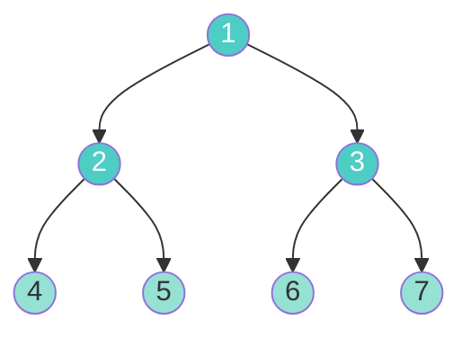
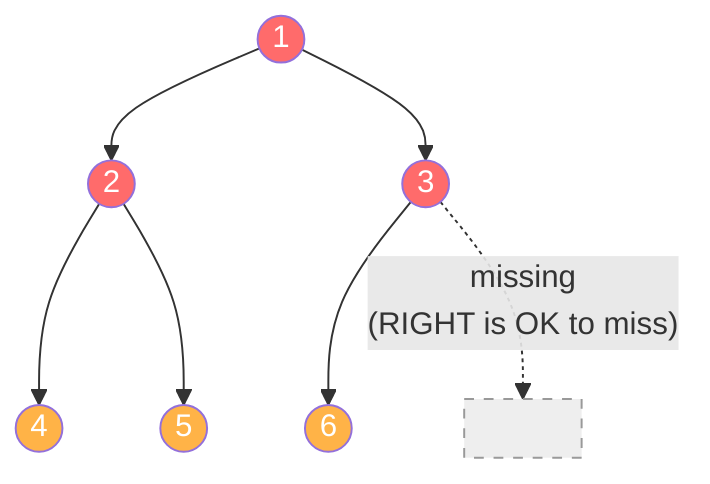
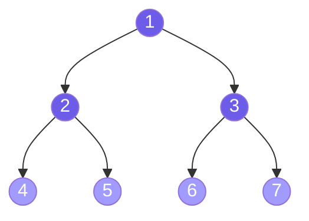
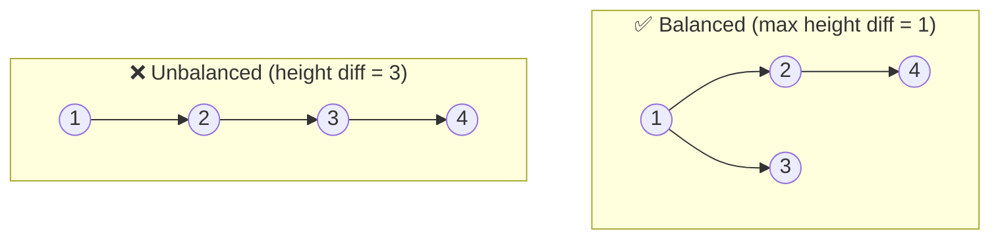
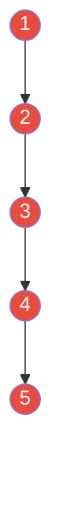
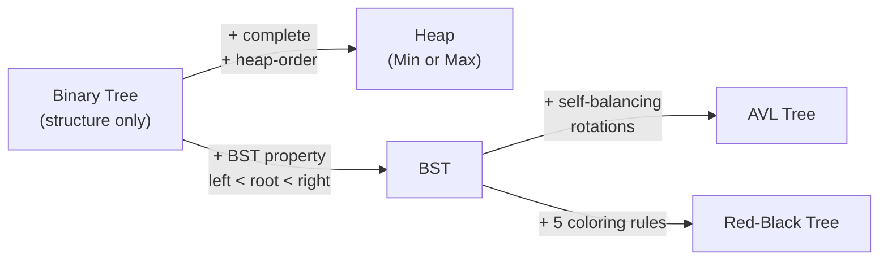

# Chapter 2: Binary Trees 🌲

---

## 👶 Explain Like I'm 5

A **Binary Tree** is a tree where every single parent can have **at most 2 children** — a left child and a right child.

Think of it like a family of decisions. Every day you flip a coin:
- **Heads → Left**
- **Tails → Right**

After 3 flips, you've made 8 possible journeys through the tree, each ending at a different leaf. That branching structure — 2 choices at every step — is exactly what makes binary trees so powerful and so mathematically tractable.

> ⚠️ **A Binary Tree is NOT a Binary Search Tree.** A Binary Tree is just a structural constraint (≤2 children). A BST has an additional *ordering property* (left < root < right). Chapter 4 covers BSTs. This chapter is purely about the **structure**.

---

## 🏷️ Types of Binary Trees

These definitions appear constantly in interview problems. Know every single one.

### 1. Full Binary Tree (Proper / Strictly Binary Tree)
> Every node has **0 or 2 children**. Never exactly 1.



**Mathematical property**: If a full binary tree has `L` leaves, it has exactly `L − 1` internal nodes. Total nodes = `2L − 1`.

### 2. Complete Binary Tree
> All levels are **fully filled**, except possibly the **last level**, which must be filled **from left to right**.



**Critical property**: A Complete Binary Tree with `N` nodes has height `⌊log₂N⌋`.

**Why this matters**: Heaps use this structure — storing a complete binary tree in an **array** is both memory-efficient and elegant.

### 3. Perfect Binary Tree
> Every internal node has **exactly 2 children** AND all leaves are at the **same level**.

This is the "ideal" tree — maximum nodes for a given height.



**Mathematical properties** (for height `h`, where root is at height 0):
- Total nodes: `2^(h+1) − 1`
- Leaves: `2^h`
- Internal nodes: `2^h − 1`
- Nodes at level `k`: `2^k`

A perfect binary tree is simultaneously a **full** and a **complete** binary tree. The reverse is not always true.

### 4. Balanced Binary Tree
> The height of the left and right subtrees of **every** node differs by **at most 1**.



**Why it matters**: A balanced tree guarantees `O(log N)` height. An unbalanced tree can degenerate to `O(N)` height (a linked list!), making all operations O(N).

> [!IMPORTANT]
> A "balanced" binary tree is **NOT** necessarily a "complete" or "perfect" tree. It just means no subtree is dramatically taller than its sibling.

### 5. Degenerate (Skewed) Binary Tree
> Every node has only **one child** — the tree has become a **linked list**.

This is the **worst case** for binary trees.



This happens when you insert already-sorted data into a BST: `[1, 2, 3, 4, 5]` → the BST becomes a right-skewed degenerate tree. Height = N−1 instead of log N. This is **why balanced BSTs (AVL, Red-Black) were invented**.

---

## 📐 Essential Mathematical Formulas

These formulas appear in complexity proofs and interview problems. Understand them, don't just memorize them.

| Property | Formula | Intuition |
|----------|---------|-----------|
| Height of perfect tree with N nodes | `h = ⌊log₂N⌋` | Each level doubles the count |
| Max nodes in perfect tree of height h | `N = 2^(h+1) − 1` | Sum of geometric series: 1+2+4+...+2^h |
| Leaves in perfect tree of height h | `L = 2^h` | Bottom level only |
| Internal nodes in perfect tree | `N - L = 2^h - 1` | Everything except leaves |
| Height of complete tree with N nodes | `⌊log₂N⌋` | Same as perfect — within one level |
| Min nodes for tree of height h | `h + 1` | Degenerate/skewed tree |
| Max nodes at level k | `2^k` | Branching factor of 2 |
| Full binary tree: leaves vs internals | `L = I + 1` | Each internal node adds one more leaf than it "consumes" |

### Worked Example

> **Q**: A perfect binary tree has 7 nodes. What is its height? How many leaves?
>
> `7 = 2^(h+1) − 1` → `2^(h+1) = 8` → `h+1 = 3` → **h = 2**
> Leaves = `2^h = 2^2 = 4`
> Internal nodes = `7 − 4 = 3`
> Check: Full binary tree property → `L = I + 1` → `4 = 3 + 1` ✅

---

## 🗄️ Array Representation of Binary Trees

Complete binary trees have a beautiful property: they can be stored in a **flat array** with no pointers!

If a node is at **index `i`** (1-indexed):
- **Parent** is at index `⌊i/2⌋`
- **Left child** is at index `2i`
- **Right child** is at index `2i + 1`

Or with **0-indexed** arrays (more common in Python):
- **Parent** of node at `i` → `⌊(i−1)/2⌋`
- **Left child** of node at `i` → `2i + 1`
- **Right child** of node at `i` → `2i + 2`

```
Tree:          Array (0-indexed):
     1          [1, 2, 3, 4, 5, 6, 7]
   /   \         0  1  2  3  4  5  6
  2     3
 / \ / \
4  5 6  7

Parent of index 3 (value=4): ⌊(3-1)/2⌋ = 1 → value=2 ✅
Left child of index 1 (value=2): 2(1)+1 = 3 → value=4 ✅
Right child of index 1 (value=2): 2(1)+2 = 4 → value=5 ✅
```

**This is exactly how Min-Heaps and Max-Heaps work.** See [Fundamentals 010 - Min and Max Heap](../010%20-%20Min%20and%20Max%20Heap/heap_walkthrough.md).

```python
# Heap array navigation in Python
def parent(i):     return (i - 1) // 2
def left_child(i): return 2 * i + 1
def right_child(i):return 2 * i + 2
```

---

## 🐍 Python Representation: The Node Class

The standard way to represent a binary tree in Python interview problems:

```python
from __future__ import annotations
from typing import Optional

class TreeNode:
    """Standard LeetCode-style binary tree node."""
    def __init__(self, val: int = 0,
                 left: Optional[TreeNode] = None,
                 right: Optional[TreeNode] = None):
        self.val   = val
        self.left  = left
        self.right = right

    def __repr__(self) -> str:
        return f"TreeNode({self.val})"


# Build the tree:   1
#                  / \
#                 2   3
#                / \
#               4   5
root = TreeNode(1,
    left=TreeNode(2,
        left=TreeNode(4),
        right=TreeNode(5)),
    right=TreeNode(3))
```

**Important helpers** used across many problems:

```python
def height(node: Optional[TreeNode]) -> int:
    """Recursive height. O(N) time, O(H) space."""
    if not node:
        return -1  # Convention: empty tree has height -1; leaf has height 0
    return 1 + max(height(node.left), height(node.right))

def count_nodes(node: Optional[TreeNode]) -> int:
    """Count all nodes. O(N) time."""
    if not node:
        return 0
    return 1 + count_nodes(node.left) + count_nodes(node.right)

def is_leaf(node: TreeNode) -> bool:
    return node.left is None and node.right is None
```

---

## 🔑 The Heap Connection



A **Heap** IS a **Complete Binary Tree** with one additional constraint: the **heap-order property**.
- Min-Heap: every parent ≤ its children (root = minimum)
- Max-Heap: every parent ≥ its children (root = maximum)

Because it's a complete binary tree, it stores perfectly in an array — no pointers needed.

---

## ⚠️ Common Pitfalls & Interview Traps

| Trap | Reality |
|------|---------|
| **"Complete = Full"** | No! Complete = filled left-to-right. Full = every node has 0 or 2 children. |
| **"Perfect = Complete"** | Perfect IS complete (and full). But complete is NOT necessarily perfect. |
| **"Balanced = height log N"** | Yes — if balanced by the formal definition. But "visually balanced-looking" doesn't prove it. |
| **"BST = Binary Tree"** | BST is a special binary tree. Not all binary trees are BSTs! |
| **"Deleting from a complete tree is easy"** | No — you must maintain the "left-to-right" property. This requires finding the rightmost node at the last level. |

---

## 🔗 Connections to Coding Patterns

| Problem type | Tree type needed |
|-------------|-----------------|
| Priority Queue (heapq) | Complete Binary Tree (Heap) |
| Sorted data, range queries | BST / Balanced BST |
| Prefix search, autocomplete | Trie (N-ary tree) |
| Range sum/min/max queries | Segment Tree |
| Level-by-level problems | Any binary tree + BFS (Pattern 11) |
| Root-to-leaf path problems | Any binary tree + DFS (Pattern 12) |

---

*← [Chapter 1: What Is a Tree?](01_what_is_a_tree.md) | [Chapter 3: Tree Traversals →](03_tree_traversals.md)*
