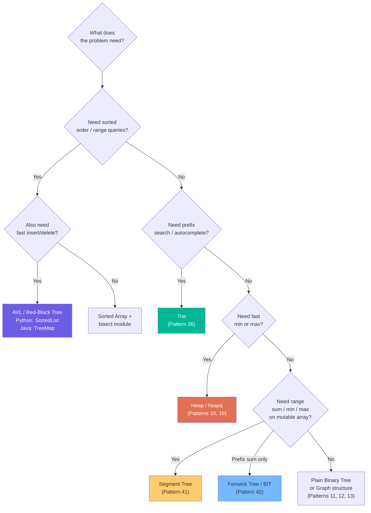
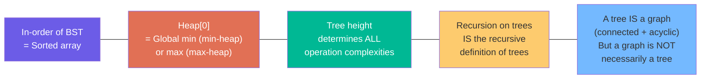

# Chapter 7: Trees Cheat Sheet ⚡

*Everything you need — one quick reference. Formulas, mnemonics, complexity tables, decision flowcharts.*

---

## 📐 Essential Formulas

| Property | Formula | Example |
|----------|---------|---------|
| Tree edges | `E = N − 1` | 10 nodes → 9 edges |
| Perfect tree nodes (height h) | `N = 2^(h+1) − 1` | h=3 → N=15 |
| Perfect tree height (N nodes) | `h = ⌊log₂N⌋` | N=15 → h=3 |
| Leaves in perfect tree | `L = 2^h` | h=3 → L=8 |
| Nodes at level k | `count = 2^k` | Level 2 → 4 nodes |
| Full binary tree: leaves vs internals | `L = I + 1` | 7 leaves → 6 internals |
| Complete tree height | `⌊log₂N⌋` | N=100 → h=6 |
| Skewed tree height | `N − 1` | N=100 → h=99 |
| Parent in 0-indexed array | `⌊(i−1)/2⌋` | Node at 5 → parent at 2 |
| Left child in 0-indexed array | `2i + 1` | Node at 2 → left at 5 |
| Right child in 0-indexed array | `2i + 2` | Node at 2 → right at 6 |

---

## 🗺️ Traversal Quick Reference

| Traversal | Order | Mnemonic | Result for tree `{1→2,3; 2→4,5; 3→6,7}` | Best For |
|-----------|-------|---------|------------------------------------------|----------|
| **Pre-order** | Root → L → R | **N**LR — "Now Left Right" | `1 2 4 5 3 6 7` | Serialize, copy, prefix expr |
| **In-order** | L → Root → R | **L**N**R** — "Left Now Right" | `4 2 5 1 6 3 7` | BST sorted order |
| **Post-order** | L → R → Root | **LR**N — "Left Right Now" | `4 5 2 6 7 3 1` | Delete tree, postfix expr, height |
| **Level-order** | Level by level | "Floor by floor" | `1 2 3 4 5 6 7` | Shortest path, level queries |

> **Mnemonics**: Think of Pre/In/Post as where you put the **Root** relative to children:
> - **Pre**: Root → Left → Right (root is BEFORE)
> - **In**: Left → Root → Right (root is IN the middle)
> - **Post**: Left → Right → Root (root is AFTER)

---

## ⚡ Complexity Table

| Data Structure | Search | Insert | Delete | Space |
|---------------|--------|--------|--------|-------|
| Unsorted Array | O(N) | O(1) | O(N) | O(N) |
| Sorted Array | O(log N) | O(N) | O(N) | O(N) |
| Binary Tree (random) | O(N) | O(N) | O(N) | O(N) |
| BST (balanced) | O(log N) | O(log N) | O(log N) | O(N) |
| BST (skewed) | O(N) | O(N) | O(N) | O(N) |
| AVL Tree | O(log N) | O(log N) | O(log N) | O(N) |
| Red-Black Tree | O(log N) | O(log N) | O(log N) | O(N) |
| Heap (min/max access) | O(N) | O(log N) | O(log N) | O(N) |
| Trie | — | O(L) | O(L) | O(A×N×L) |
| Segment Tree (range) | O(log N) | O(log N) | O(log N) | O(N) |
| Fenwick Tree (prefix) | O(log N) | O(log N) | — | O(N) |

*L = string length, A = alphabet size*

---

## 🤔 "Which Tree Do I Use?" — Decision Flowchart

---

## 🔗 Pattern Connection Map

| DSA Pattern | Tree Concept Used | Key Chapter |
|------------|------------------|-------------|
| **Pattern 11** — Tree BFS | Level-order traversal, queue | Ch 3 |
| **Pattern 12** — Tree DFS | Pre/post-order traversal, recursion, backtracking | Ch 3, Ch 4 |
| **Pattern 13** — Graphs | Trees are a subset of graphs | Ch 1 |
| **Pattern 15** — Two Heaps | Heap = complete binary tree | Ch 6 |
| **Pattern 17** — Modified Binary Search | BST property, divide-and-conquer | Ch 4 |
| **Pattern 19** — Top K Elements | Heap operations | Ch 6 |
| **Pattern 26** — Trie | Trie = N-ary char-edge tree | Ch 6 |
| **Pattern 27** — Topological Sort | DAG = directed acyclic graph (close cousin of tree) | Ch 1 |
| **Pattern 28** — Union Find | Forest of inverted trees | Graph Ch 7 |
| **Pattern 38** — Serialize/Deserialize | Pre-order traversal, null markers | Ch 3 |
| **Pattern 41** — Segment Tree | Binary tree for range queries | Ch 6 |
| **Pattern 42** — Binary Indexed Tree | Implicit binary tree via bit-tricks | Ch 6 |

---

## 🧠 Key Insights to Never Forget

---

## ⚠️ Top 10 Tree Interview Traps

| # | Trap | Correct Knowledge |
|---|------|------------------|
| 1 | "Complete = Full" | Complete = left-to-right filled. Full = 0 or 2 children. |
| 2 | "BST = Binary Tree" | BST is a special binary tree with ordering. |
| 3 | Validating BST only by parent-child comparison | Pass `(min_bound, max_bound)` down the recursion. |
| 4 | Forgetting to backtrack when building path lists | Always `path.pop()` after recursive calls. |
| 5 | "Balanced = log N height" | Only if formally balanced (AVL property). |
| 6 | "BFS needs a visited set for trees" | Trees have no cycles. Only graphs need visited sets. |
| 7 | "Inserting sorted data into BST is O(log N)" | Sorted insertion → skewed tree → O(N)! |
| 8 | "Height and depth are the same" | Depth: top-down from root. Height: bottom-up from leaves. |
| 9 | "Post-order for height, pre-order for everything else" | Understand WHY: post-order = bottom-up computation. |
| 10 | "A heap gives O(log N) search" | Heap gives O(1) min/max but O(N) search for arbitrary elements! |

---

## 🏃 Interview Warm-Up Checklist

Before a tree problem, quickly ask yourself:

- [ ] Is this a **binary tree** or **BST** or **N-ary tree**?
- [ ] What traversal fits? (**BFS** for levels/shortest path, **DFS** for root-to-leaf, **post-order** for bottom-up)
- [ ] Do I need to **modify** the tree? (Careful about mutating while traversing)
- [ ] What's the **base case**? (`if not node: return ...`)
- [ ] Am I building a **path**? (Need to backtrack — `append` before, `pop` after)
- [ ] Is the tree **balanced**? (Affects space complexity of my recursive call stack)
- [ ] Does the problem use a **BST property**? (Can I use it to eliminate half the tree?)

---

*← [Chapter 6: Special Trees](06_special_trees.md) | Start Graphs: [Chapter 1: What Is a Graph? →](../016%20-%20Graphs%20%28The%20Complete%20Guide%29/01_what_is_a_graph.md)*
