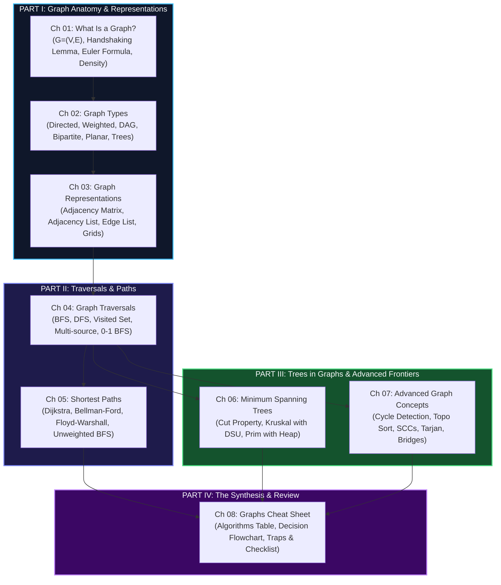

# 🕸️ Graphs: The Complete Guide

> *"A graph is the most versatile data structure in computer science. If the universe has a shape, it is a graph."*  
> *"When in doubt, draw the nodes, connect the edges, and run BFS."*

Welcome to **Graphs (The Complete Guide)** — a comprehensive, from-first-principles treatise on graph theory, algorithms, and practical interview patterns.

---

## 🧭 Why Graphs Matter

While arrays and trees enforce strict structural constraints (linear order or acyclic hierarchy), graphs model **arbitrary relationships**:

```
┌──────────────────────────────────────────────────────────────────────────────┐
│ TREES (Specialized Subgraph)             GRAPHS (General Topology)           │
│ • Exactly 1 connected component          • Multiple components allowed       │
│ • No cycles (Acyclic)                    • Cycles are common                 │
│ • N nodes ⟹ exactly N - 1 edges          • 0 to N(N-1)/2 edges (undirected) │
│ • Unique path between any two nodes      • Multiple alternative paths        │
│ • Natural root-child hierarchy           • Symmetric or asymmetric relations │
└──────────────────────────────────────────────────────────────────────────────┘
```

In technical interviews and production distributed systems:
- **Social networks**: Friend graphs, recommendation engines, bidirectional links.
- **Routing & navigation**: Road networks, shortest path engines (Google Maps, OSRM), transit routing.
- **Build systems**: DAGs of task dependencies (Make, Bazel, Airflow, Gradle).
- **Network infrastructure**: Packet routing (OSPF, BGP), minimum spanning trees (Ethernet STP).
- **State spaces**: Game trees, puzzle solvers (Rubik's cube, 8-puzzle), AI planning.

---

## 🗺️ Master Curriculum Roadmap



---

## 📑 Complete Chapter Catalog

| # | Chapter Title | Core Topics | Key Algorithms & Complexity |
|---|---|---|---|
| **01** | [What Is a Graph?](01_what_is_a_graph.md) | Formal $G=(V, E)$, Degrees, Handshaking Lemma, Density | Handshaking $\sum \deg(v) = 2E$, Euler's formula $V - E + F = 2$ |
| **02** | [Graph Types](02_graph_types.md) | Directed/Undirected, Weighted, DAG, Bipartite, Complete, Planar | 2-Colorability test, Kuratowski's theorem, Planar $E \le 3V - 6$ |
| **03** | [Graph Representations](03_graph_representations.md) | Adjacency List vs Matrix vs Edge List, Implicit Grid graphs | List $O(V+E)$ space vs Matrix $O(V^2)$ space, Edge lookup trade-offs |
| **04** | [Graph Traversals](04_graph_traversals.md) | BFS, DFS, Connected Components, Multi-source BFS, 0-1 BFS | BFS/DFS $O(V+E)$, Double-ended queue for 0-1 BFS $O(V+E)$ |
| **05** | [Shortest Paths](05_shortest_paths.md) | Unweighted BFS, Dijkstra, Bellman-Ford, Floyd-Warshall | Dijkstra $O((V+E)\log V)$, Bellman-Ford $O(VE)$, Floyd $O(V^3)$ |
| **06** | [Minimum Spanning Trees](06_minimum_spanning_trees.md) | Cut Property, Kruskal's (Union-Find), Prim's (Min-Heap) | Kruskal $O(E \log E)$, Prim $O((V+E)\log V)$ |
| **07** | [Advanced Graph Concepts](07_advanced_graph_concepts.md) | Cycle Detection, Topological Sort (DFS & Kahn's), DSU, Tarjan SCCs | Kahn's $O(V+E)$, Tarjan Bridges $O(V+E)$, DSU $\alpha(V)$ |
| **08** | [⚡ Graphs Cheat Sheet](08_graphs_cheat_sheet.md) | Master Decision Flowchart, Algorithm Matrix, Top 10 Traps | Rapid interview recall, Complexity cheat sheet, Bug checklist |

---

## 🌉 Cross-Pillar Bridges: Connecting Theory to Tactics

### 🏛️ Upstream: Foundations in Theory (Pillar 0)
- **The Complexity Zoo**: Many fundamental boundary problems between $P$ and $NP$-Complete are graph problems, explored in [Ch 01: The Complexity Zoo](../000%20-%20Theoretical%20Foundations%20%28The%20Complete%20Guide%29/01_complexity_classes_zoo.md). For example:
  - Shortest Path $\in P$ vs Longest Simple Path is $NP$-Hard.
  - Eulerian Circuit $\in P$ ($O(E)$) vs Hamiltonian Cycle is $NP$-Complete.
  - 2-SAT $\in P$ (via SCCs) vs 3-SAT is $NP$-Complete.
- **Reductions Web**: Karp's seminal 21 $NP$-complete reductions rely heavily on graph transformations (3-SAT $\to$ Clique $\to$ Vertex Cover $\to$ Hamiltonian Cycle $\to$ TSP), detailed in [Ch 06: NP-Completeness & Reductions](../000%20-%20Theoretical%20Foundations%20%28The%20Complete%20Guide%29/06_np_completeness_and_reductions.md).
- **Approximations**: When graph problems are $NP$-Hard, Christofides Metric TSP and 2-Approximation Vertex Cover provide provable bounds, explained in [Ch 07: Approximation Algorithms](../000%20-%20Theoretical%20Foundations%20%28The%20Complete%20Guide%29/07_approximation_algorithms.md).

### ⚔️ Downstream: Algorithmic Patterns (Pillar 2)
Mastering this guide unlocks direct proficiency in these primary pattern modules:
- [13 - Graphs](../../13%20-%20Graphs/): General graph traversal, clone graph, connected components.
- [14 - Island (Matrix Traversal)](../../14%20-%20Island%20%28Matrix%20Traversal%29/): Grids as implicit graphs, flood-fill, perimeter counting.
- [27 - Topological Sort (Graph)](../../27%20-%20Topological%20Sort%20%28Graph%29/): Course Schedule, build dependency ordering, alien dictionary.
- [28 - Union Find](../../28%20-%20Union%20Find/): Redundant connections, dynamic connectivity, Kruskal's MST.

---

## 👤 Persona Reading Matrix

| Your Current Goal | Recommended Chapters | Skip for Now |
|---|---|---|
| **Undergraduate Student** (Algorithms Course) | Ch 01, 02, 03, 04, 05, 06 | Ch 07 (Bridges / SCCs) |
| **LeetCode Assessment Sprint (3–5 Days)** | Ch 03, 04, 05 (BFS/Dijkstra), Ch 07 (Topo Sort), Ch 08 | Ch 06 (MSTs rarely asked in initial screens) |
| **Senior / Staff Infrastructure Engineer** | Ch 03, 05 (Bellman-Ford / Floyd), Ch 06 (Network topology), Ch 07 | Ch 01 |
| **PhD Researcher / Competitive Programmer** | Full end-to-end, including Tarjan's bridge algorithms and planar duals | — |

---

## 🧭 Navigation

| ← Previous Module | ↑ Fundamentals Hub | Next Pillar → |
|:---|:---:|---:|
| [🌲 015 - Trees (The Complete Guide)](../015%20-%20Trees%20%28The%20Complete%20Guide%29/) | [📚 Fundamentals Index](../README.md) | [⚔️ 017 - The Pattern Cracker →](../017%20-%20The%20Pattern%20Cracker/) |
