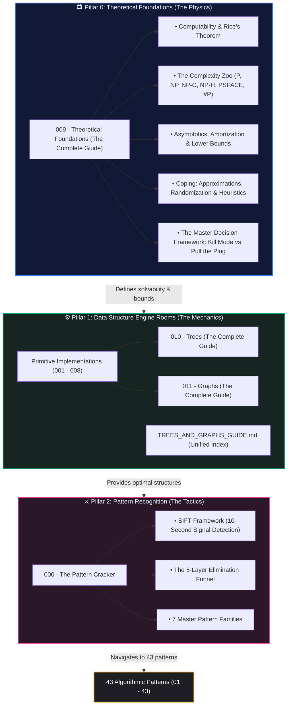

# 🏛️ Fundamentals of Computer Science & Data Structures

> *"Before you master the art of combat, you must master the laws of physics that govern the sword."*

Welcome to the **Engine Room** of the Data Structures & Algorithms curriculum. While patterns teach you the tactics to solve specific interview problems, **Fundamentals** provide the immutable theoretical limits, data structure mechanics, and mental models required to reason from first principles.

---

## 🗺️ The Architecture of Fundamentals

The foundational curriculum is organized into **Three Core Pillars**:

---

## 📚 Master Directory & Curriculum Index

### 🏛️ Pillar 0: Theoretical Foundations (The Physics of Computation)

[📂 **`009 - Theoretical Foundations (The Complete Guide)/`**](./009%20-%20Theoretical%20Foundations%20(The%20Complete%20Guide)/)

The comprehensive, 13-chapter reference taking you from Kindergarten analogies all the way to PhD-level formal proofs, impossibility theorems, and engineering triage:

| Chapter | Title | Key Concepts |
|---|---|---|
| **Ch 00** | [Computation & Computability](./009%20-%20Theoretical%20Foundations%20(The%20Complete%20Guide)/00_computation_and_computability.md) | Turing Machines, Church-Turing Thesis, Halting Problem, Rice's Theorem, Gödel |
| **Ch 01** | [The Complexity Zoo](./009%20-%20Theoretical%20Foundations%20(The%20Complete%20Guide)/01_complexity_classes_zoo.md) | P, NP, NP-Complete, NP-Hard, co-NP, PSPACE, BPP, #P, Parameterized FPT |
| **Ch 02** | [Asymptotic Analysis Deep Cuts](./009%20-%20Theoretical%20Foundations%20(The%20Complete%20Guide)/02_asymptotic_analysis_deep.md) | The Big-5 ($\Theta, \Omega, O, o, \omega$), Galactic Algorithms, Cache Locality, Input-Sensitivity |
| **Ch 03** | [Recurrences & Master Theorem](./009%20-%20Theoretical%20Foundations%20(The%20Complete%20Guide)/03_recurrences_and_master_theorem.md) | Induction, Recursion Trees, 3 Master Cases, Akra-Bazzi, Recurrence Catalog |
| **Ch 04** | [Amortized Analysis](./009%20-%20Theoretical%20Foundations%20(The%20Complete%20Guide)/04_amortized_analysis.md) | Aggregate, Banker's (Accounting), Physicist's (Potential), Dynamic Arrays, DSU $\alpha(n)$ |
| **Ch 05** | [Lower Bounds & Impossibility](./009%20-%20Theoretical%20Foundations%20(The%20Complete%20Guide)/05_lower_bounds_and_impossibility.md) | Comparison Sorting $\Omega(n \log n)$, Adversary Arguments, Cell Probe Model |
| **Ch 06** | [NP-Completeness & Reductions](./009%20-%20Theoretical%20Foundations%20(The%20Complete%20Guide)/06_np_completeness_and_reductions.md) | Karp vs Cook Reductions, Cook-Levin, Karp's 21 Web, Reduction Proving Recipe |
| **Ch 07** | [Approximation Algorithms](./009%20-%20Theoretical%20Foundations%20(The%20Complete%20Guide)/07_approximation_algorithms.md) | $\rho$-Approximations, Christofides Metric TSP, Greedy Set Cover, PTAS/FPTAS, PCP |
| **Ch 08** | [Randomized Algorithms](./009%20-%20Theoretical%20Foundations%20(The%20Complete%20Guide)/08_randomized_algorithms.md) | Las Vegas vs Monte Carlo, Chernoff/Markov/Chebyshev, Bloom Filters, Skip Lists |
| **Ch 09** | [Heuristics & Metaheuristics](./009%20-%20Theoretical%20Foundations%20(The%20Complete%20Guide)/09_heuristics_and_metaheuristics.md) | Simulated Annealing, Genetic Algorithms, Tabu Search, No Free Lunch (NFL) Theorem |
| **Ch 10** | [Information Theory & Entropy](./009%20-%20Theoretical%20Foundations%20(The%20Complete%20Guide)/10_information_theory_and_entropy.md) | Shannon Entropy, Huffman Codes, Kolmogorov Complexity, Fundamental Sorting Bounds |
| **Ch 11** | [Metatheorems & Folklore](./009%20-%20Theoretical%20Foundations%20(The%20Complete%20Guide)/11_metatheorems_and_folklore.md) | Amdahl vs Gustafson, Little's Law, CAP, Pigeonhole, ETH, Curse of Dimensionality |
| **Ch 12** | [Kill Mode vs Pull the Plug](./009%20-%20Theoretical%20Foundations%20(The%20Complete%20Guide)/12_kill_mode_vs_pull_plug.md) | Master Decision Flowchart, Constraint Limits, Triage Matrix, Pattern Complexity Map |

---

### ⚙️ Pillar 1: Data Structure Engine Rooms (The Concrete Mechanics)

The underlying containers that power every algorithmic pattern:

#### 1. Primitive Engines
- [**`001 - Queue and Stack`**](./001%20-%20Queue%20and%20Stack/): LIFO and FIFO primitives, array-backed vs pointer-backed queues, ring buffers.
- [**`002 - Linked List`**](./002%20-%20Linked%20List/): Singly-linked list node mechanics, sentinel dummy heads, pointer manipulations.
- [**`003 - Doubly Linked List`**](./003%20-%20Doubly%20Linked%20List/): Bidirectional node links, $O(1)$ arbitrary deletions, foundation for LRU Cache.
- [**`004 - Circular Linked List`**](./004%20-%20Circular%20Linked%20List/): Cycle mechanics, round-robin scheduling, split and merge operations.
- [**`005 - Binary Search Tree`**](./005%20-%20Binary%20Search%20Tree/): Node insertion, recursive and iterative deletion, in-order predecessor/successor.
- [**`006 - Min and Max Heap`**](./006%20-%20Min%20and%20Max%20Heap/): Array representation of binary heaps, sift-up, sift-down, Floyd's $O(n)$ heapify.
- [**`007 - Trie`**](./007%20-%20Trie/): Prefix tree nodes, character dictionary transitions, prefix search, end-of-word markers.
- [**`008 - Graph`**](./008%20-%20Graph/): Adjacency list and matrix implementations, directed/undirected edge management.

#### 2. Deep-Dive Guides
- [**`010 - Trees (The Complete Guide)`**](./010%20-%20Trees%20(The%20Complete%20Guide)/): 7-chapter book covering binary trees, traversals, AVL, Red-Black, B-Trees, and cheat sheets.
- [**`011 - Graphs (The Complete Guide)`**](./011%20-%20Graphs%20(The%20Complete%20Guide)/): 8-chapter book covering representations, Dijkstra, Bellman-Ford, Floyd-Warshall, Kruskal, Prim, and topological ordering.
- [**`TREES_AND_GRAPHS_GUIDE.md`**](./TREES_AND_GRAPHS_GUIDE.md): Quick-reference hub mapping trees and graphs to their underlying patterns.

---

### ⚔️ Pillar 2: Pattern Recognition & Tactics

- [**`000 - The Pattern Cracker`**](./000%20-%20The%20Pattern%20Cracker/): The universal mental model for cracking technical interview problems in under 10 seconds.
  - **The 5-Question Funnel**: Input type $\to$ Output expectation $\to$ Exploitable constraints $\to$ Memory requirements $\to$ Problem shrinkage.
  - **Trigger Word Matrix**: Direct keywords to instant patterns.
  - **Pattern DNA Skeletons**: Minimal, muscle-memory templates for all primary patterns.

---

## 🎓 Recommended Reading Pathways

Choose your pathway based on your immediate goals and background:

### 🟢 Path A: The Coding Assessment Sprint (2–4 Days)
*Goal: Fast interview readiness for senior/staff engineer candidates with solid CS foundations.*
1. Read [000 - The Pattern Cracker](./000%20-%20The%20Pattern%20Cracker/pattern_cracker_mental_model.md)
2. Skim [009 - Chapter 12: Kill Mode vs Pull the Plug](./009%20-%20Theoretical%20Foundations%20(The%20Complete%20Guide)/12_kill_mode_vs_pull_plug.md) (Constraint sizing and triage)
3. Review [010 - Trees Cheat Sheet](./010%20-%20Trees%20(The%20Complete%20Guide)/07_trees_cheat_sheet.md) & [011 - Graphs Cheat Sheet](./011%20-%20Graphs%20(The%20Complete%20Guide)/08_graphs_cheat_sheet.md)
4. Jump straight into the 43 patterns (starting with [02 - Two Pointers](../02%20-%20Two%20Pointers/) and [04 - Sliding Window](../04%20-%20Sliding%20Window/)).

### 🟡 Path B: The Computer Science Undergraduate / Master's Foundation (1–2 Weeks)
*Goal: Build rock-solid CS core competence and bridge the gap between academic theory and practical coding.*
1. [009 - Chapter 00: Computation & Computability](./009%20-%20Theoretical%20Foundations%20(The%20Complete%20Guide)/00_computation_and_computability.md)
2. [009 - Chapter 01: Complexity Zoo](./009%20-%20Theoretical%20Foundations%20(The%20Complete%20Guide)/01_complexity_classes_zoo.md)
3. [009 - Chapter 02: Asymptotic Analysis Deep Cuts](./009%20-%20Theoretical%20Foundations%20(The%20Complete%20Guide)/02_asymptotic_analysis_deep.md)
4. [009 - Chapter 03: Recurrences & Master Theorem](./009%20-%20Theoretical%20Foundations%20(The%20Complete%20Guide)/03_recurrences_and_master_theorem.md)
5. [009 - Chapter 04: Amortized Analysis](./009%20-%20Theoretical%20Foundations%20(The%20Complete%20Guide)/04_amortized_analysis.md)
6. [009 - Chapter 06: NP-Completeness & Reductions](./009%20-%20Theoretical%20Foundations%20(The%20Complete%20Guide)/06_np_completeness_and_reductions.md)
7. [010 - Trees (Complete Guide)](./010%20-%20Trees%20(The%20Complete%20Guide)/) and [011 - Graphs (Complete Guide)](./011%20-%20Graphs%20(The%20Complete%20Guide)/)

### 🔴 Path C: The Principal / Staff / Researcher Deep Dive (3+ Weeks)
*Goal: Uncompromising mastery of theoretical limits, metatheorems, approximation hardness, and system engineering laws.*
1. Full end-to-end traversal of all 13 chapters in [009 - Theoretical Foundations (The Complete Guide)](./009%20-%20Theoretical%20Foundations%20(The%20Complete%20Guide)/).
2. Deep dive into the PhD Horizon sections (`
` blocks) covering Gödel's incompleteness, Rice's theorem proofs, the PCP Theorem, the Exponential Time Hypothesis, and Communication Complexity.
3. Master [009 - Chapter 12](./009%20-%20Theoretical%20Foundations%20(The%20Complete%20Guide)/12_kill_mode_vs_pull_plug.md) to lead architectural triage reviews in real-world distributed systems.
