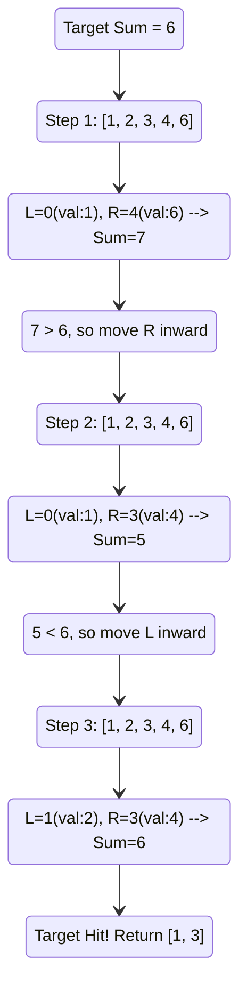

# 🚶‍♂️ Walkthrough: Pair with Target Sum

## 👶 Explain Like I'm 5
Imagine you have a line of friends arranged by height from shortest to tallest. You need to find exactly two friends whose combined height is exactly 10 feet. 

Instead of picking the first friend and asking every single other friend in line to measure heights together (which takes forever), you can try a smarter trick:
1. You point your left hand at the shortest friend (at the start of the line).
2. You point your right hand at the tallest friend (at the end of the line).
3. If their combined height is **too tall**, you don't need a taller person, you need a shorter person! So you move your right hand one spot to the left (to a slightly shorter friend).
4. If their combined height is **too short**, you move your left hand one spot to the right (to a slightly taller friend).
5. You keep squeezing your hands together until you find the perfect match!

## 🎯 Core Strategy
Because the input array is **sorted**, this problem is the textbook definition of the **Two Pointers (Opposite Ends)** pattern. 
By placing pointers at both extremes, we can deterministically eliminate one of the pointers at each step, reducing our search space without ever needing a nested loop. This turns an $O(N^2)$ brute force check into an elegant $O(N)$ sweep.

## 🏃‍♂️ Step-by-Step Execution (Dry Run)
**Example Input**: `arr = [1, 2, 3, 4, 6]`, `target_sum = 6`

| Step | `left` index | `right` index | `arr[left]` | `arr[right]` | Current Sum | Comparison to Target (6) | Action |
|------|--------------|---------------|-------------|--------------|-------------|--------------------------|--------|
| 1 | `0` | `4` | `1` | `6` | `1 + 6 = 7` | `7 > 6` (Too large) | Decrement `right` pointer (`right -= 1`) |
| 2 | `0` | `3` | `1` | `4` | `1 + 4 = 5` | `5 < 6` (Too small) | Increment `left` pointer (`left += 1`) |
| 3 | `1` | `3` | `2` | `4` | `2 + 4 = 6` | `6 == 6` (MATCH!) | **Return `[1, 3]`** |

## 📊 Visual Diagram
Here is a visualization of how the pointers converge on the target:

## 🛑 Edge Cases & Complexity

### Complexity
- **Time Complexity:** $O(N)$. We process each element at most once. The pointers only move inwards and never overlap, meaning the `while` loop runs at most $N/2$ times on average, bounded strictly by $N$.
- **Space Complexity:** $O(1)$. We are only storing two integer variables (`left` and `right`), requiring constant extra space regardless of the input array size.

### Edge Cases Handled Safely
- **No valid pair exists:** (e.g. `[1, 2, 3]`, target `100`). The pointers will eventually cross (`left >= right`) and break the loop, returning `[-1, -1]`.
- **Negative numbers:** (e.g. `[-3, -1, 0, 2, 5]`). Because the array is still strictly sorted, adding a negative number mathematically works identically. Moving `left` rightward still increases the value, and moving `right` leftward still decreases it. 
