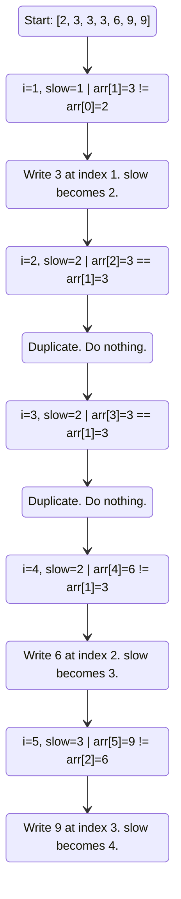

# 🚶‍♂️ Walkthrough: Find Non-Duplicate Number Instances

## 👶 Explain Like I'm 5
Imagine you have a line of friends holding numbered tickets, and they are standing in order from smallest number to largest. Some friends have the exact same number. Your job is to send all the friends with duplicate numbers to the back of the line, keeping only one friend per unique number at the front.

You can't create a new line (no extra memory), you must just swap people around in the current line. Because the line is sorted, all identical numbers are standing right next to each other! 

To do this, you can use two fingers:
1. One finger (the **Slow Finger**) points to the spot where the *next* unique friend should stand.
2. The other finger (the **Fast Finger**) points to the friend you are currently looking at as you walk down the line.
If the Fast Finger sees a number it hasn't seen before, you tell that friend to step into the spot the Slow Finger is pointing at, and then both fingers move forward.

## 🎯 Core Strategy
This problem utilizes the **Two Pointers (Same Direction)** pattern, also known as the Fast & Slow pointer technique for partitioning. 
Instead of pointers converging from opposite ends, both pointers start at the beginning. The fast pointer scans the array, and the slow pointer acts as a "bookmark" for where the next valid element should be written. This allows for $O(1)$ in-place array modification.

## 🏃‍♂️ Step-by-Step Execution (Dry Run)
**Example Input**: `arr = [2, 3, 3, 3, 6, 9, 9]`

We start `next_non_duplicate` (slow pointer) at index `1` and `i` (fast pointer) at index `1`, because the very first element at index `0` is always trivially unique!

| Step | `i` (Fast) | `arr[i]` | `next_non_dup` (Slow) | Last Unique Element (`arr[Slow - 1]`) | Match? | Action | Array State |
|------|------------|----------|-----------------------|---------------------------------------|--------|--------|-------------|
| 1 | `1` | `3` | `1` | `arr[0] = 2` | `3 != 2` (New!) | `arr[1] = 3`, slow++ | `[2, 3, 3, 3, 6, 9, 9]` |
| 2 | `2` | `3` | `2` | `arr[1] = 3` | `3 == 3` (Dup) | Do nothing. | `[2, 3, 3, 3, 6, 9, 9]` |
| 3 | `3` | `3` | `2` | `arr[1] = 3` | `3 == 3` (Dup) | Do nothing. | `[2, 3, 3, 3, 6, 9, 9]` |
| 4 | `4` | `6` | `2` | `arr[1] = 3` | `6 != 3` (New!) | `arr[2] = 6`, slow++ | `[2, 3, 6, 3, 6, 9, 9]` |
| 5 | `5` | `9` | `3` | `arr[2] = 6` | `9 != 6` (New!) | `arr[3] = 9`, slow++ | `[2, 3, 6, 9, 6, 9, 9]` |
| 6 | `6` | `9` | `4` | `arr[3] = 9` | `9 == 9` (Dup) | Do nothing. | `[2, 3, 6, 9, 6, 9, 9]` |

Loop ends. We return the slow pointer value `4`, and the first 4 elements are the unique sorted values `[2, 3, 6, 9]`.

## 📊 Visual Diagram
Here is a visualization of the array modification process:

## 🛑 Edge Cases & Complexity

### Complexity
- **Time Complexity:** $O(N)$. The fast pointer `i` traverses the array exactly once.
- **Space Complexity:** $O(1)$. We are only storing two integer variables (`i` and `next_non_duplicate`). The problem is solved entirely in-place.

### Edge Cases Handled Safely
- **Empty Array:** The algorithm immediately checks `if not arr` and returns `0`.
- **Single Element Array:** The loop is `for i in range(1, len(arr))`, so it won't execute at all, safely returning `next_non_duplicate = 1`.
- **Array with all duplicates:** e.g., `[5, 5, 5, 5]`. The inner `if` condition never triggers, so the array is unchanged and it returns `1`.
