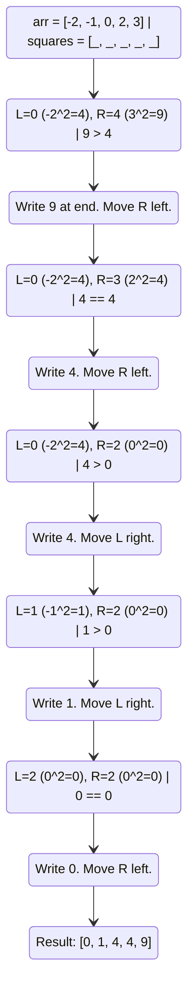

# 🚶‍♂️ Walkthrough: Squaring a Sorted Array

## 👶 Explain Like I'm 5
Imagine you have a line of friends holding numbers sorted from smallest to largest, but some friends are holding negative numbers. When you square a negative number, it magically becomes positive (for example, $-5$ squared is $25$). 

This means the **biggest squares** will always come from either:
- The largest positive numbers at the very right of the line.
- The most negative numbers at the very left of the line.

The smallest squares will be somewhere in the middle (near zero). 
Because we want to build a new list of squared numbers that is *also* sorted from smallest to largest, we can start by looking at the two ends. Whichever end has the bigger square gets placed at the **very back** of our new list, and then we slowly work our way toward the middle!

## 🎯 Core Strategy
Because the input array is sorted, this problem is a perfect fit for the **Two Pointers (Opposite Ends)** pattern. 
We place one pointer at the beginning (`left`) and one at the end (`right`). We compare the squares of the numbers they point to. The larger square is placed at the end of a new result array. We then step the winning pointer inward, and repeat until the pointers meet and cross. 

This builds the result array from back to front, running perfectly in $O(N)$ time.

## 🏃‍♂️ Step-by-Step Execution (Dry Run)
**Example Input**: `arr = [-2, -1, 0, 2, 3]`

We create an empty `squares` array of the same size: `[0, 0, 0, 0, 0]`.
`left` starts at `0`. `right` starts at `4`. `highest_square_idx` starts at `4`.

| Step | `left` idx | `right` idx | `arr[left]` | `arr[right]` | `left_sq` | `right_sq` | Action | `squares` State |
|------|------------|-------------|-------------|--------------|-----------|------------|--------|-----------------|
| 1 | `0` | `4` | `-2` | `3` | `4` | `9` | `9 > 4`. Write `9`. `right -= 1` | `[0, 0, 0, 0, 9]` |
| 2 | `0` | `3` | `-2` | `2` | `4` | `4` | `4 == 4`. Write `4`. `right -= 1` | `[0, 0, 0, 4, 9]` |
| 3 | `0` | `2` | `-2` | `0` | `4` | `0` | `4 > 0`. Write `4`. `left += 1` | `[0, 0, 4, 4, 9]` |
| 4 | `1` | `2` | `-1` | `0` | `1` | `0` | `1 > 0`. Write `1`. `left += 1` | `[0, 1, 4, 4, 9]` |
| 5 | `2` | `2` | `0` | `0` | `0` | `0` | `0 == 0`. Write `0`. `right -= 1` | `[0, 1, 4, 4, 9]` |

Loop ends because `left` (3) is now greater than `right` (2). 

## 📊 Visual Diagram
Here is a visualization of how the pointers compare the ends to build the array backwards:

## 🛑 Edge Cases & Complexity

### Complexity
- **Time Complexity:** $O(N)$. We process each element exactly once as `left` and `right` converge.
- **Space Complexity:** $O(N)$. Unlike some Two Pointer problems, this one requires an entirely new array `squares` of size $N$ to store the sorted output. 

### Edge Cases Handled Safely
- **Array is entirely positive:** (e.g., `[1, 2, 3]`). The `right` pointer will continually produce larger squares, so it will fill the array from right to left while the `left` pointer never moves.
- **Array is entirely negative:** (e.g., `[-5, -4, -1]`). The `left` pointer will continually produce larger squares (because -5 squared is 25), so it will fill the array from right to left while the `right` pointer never moves.
- **Using `<` vs `<=`:** Notice the loop is `while left <= right`. If we used `<` strictly, we would skip the very middle element when both pointers meet! The `=` ensures the final element is written.
