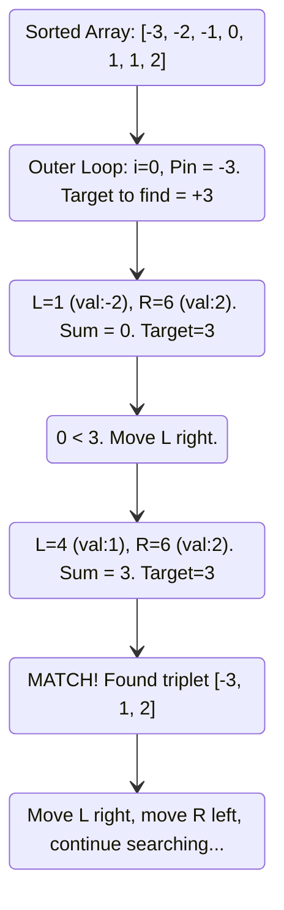

# 🚶‍♂️ Walkthrough: Triplet Sum to Zero (3Sum)

## 👶 Explain Like I'm 5
Imagine you are trying to pick exactly three numbers from a bag that add up perfectly to zero. 
Trying to guess three numbers all at once is confusing! But what if you pull out one number first—let's say a $-5$. 

Now, the math is much simpler. If you already have $-5$, the only way to reach zero is if the other two numbers add up to exactly $+5$. So your problem changes from "Find three numbers that equal 0" to "Find two numbers that equal $+5$". We already know how to find two numbers that hit a target—by sorting the numbers and using Two Pointers!

So, the trick is: Sort all the numbers. Point your finger at one number at a time (this is our "pinned" number). Then, use your Two Pointers (left and right hands) on the *rest* of the numbers to find the pair that cancels it out. Just make sure if you see the exact same number twice, you skip it so you don't write down the exact same triplet again!

## 🎯 Core Strategy
This uses the **Two Pointers (Opposite Ends)** pattern, but nested inside an outer `for` loop.
1. **Sort the array**: $O(N \log N)$. This enables the two pointers logic and makes skipping duplicates easy.
2. **Outer loop (`i`)**: Pins an element `arr[i]`. The target for the remaining two elements becomes `-arr[i]`.
3. **Inner while loop (`left < right`)**: Standard Two Pointers converging to find pairs that sum to the target.
4. **Duplicate skipping**: This is the hardest part. You must aggressively skip adjacent identical elements in *both* the outer loop and the inner pointers after a match is found.

## 🏃‍♂️ Step-by-Step Execution (Dry Run)
**Example Input**: `[-3, 0, 1, 2, -1, 1, -2]`
**Sorted Input**: `[-3, -2, -1, 0, 1, 1, 2]`

| Step | Outer `i` (Pinned) | Target (`-arr[i]`) | `left` idx | `right` idx | `arr[L] + arr[R]` | Action / Result |
|------|--------------------|--------------------|------------|-------------|-------------------|-----------------|
| 1 | `0` (val: `-3`) | `3` | `1` (val: `-2`) | `6` (val: `2`) | `-2 + 2 = 0` | `0 < 3` -> `left++` |
| 2 | `0` (val: `-3`) | `3` | `2` (val: `-1`) | `6` (val: `2`) | `-1 + 2 = 1` | `1 < 3` -> `left++` |
| 3 | `0` (val: `-3`) | `3` | `3` (val: `0`) | `6` (val: `2`) | `0 + 2 = 2` | `2 < 3` -> `left++` |
| 4 | `0` (val: `-3`) | `3` | `4` (val: `1`) | `6` (val: `2`) | `1 + 2 = 3` | **MATCH!** Add `[-3, 1, 2]`. `L++`, `R--` |
| 5 | `1` (val: `-2`) | `2` | `2` (val: `-1`) | `6` (val: `2`) | `-1 + 2 = 1` | `1 < 2` -> `left++` |
| 6 | `1` (val: `-2`) | `2` | `3` (val: `0`) | `6` (val: `2`) | `0 + 2 = 2` | **MATCH!** Add `[-2, 0, 2]`. `L++`, `R--` |
| 7 | `1` (val: `-2`) | `2` | `4` (val: `1`) | `5` (val: `1`) | `1 + 1 = 2` | **MATCH!** Add `[-2, 1, 1]`. `L++`, `R--` |
| ... | *(Loop continues for the rest of `i`)* | | | | | |

*Result*: `[[-3, 1, 2], [-2, 0, 2], [-2, 1, 1], [-1, 0, 1]]`

## 📊 Visual Diagram
Here is a visualization showing the outer pin and inner pointers for the first match:

## 🛑 Edge Cases & Complexity

### Complexity
- **Time Complexity:** $O(N^2)$. Sorting the array takes $O(N \log N)$. The `for` loop runs $N$ times. Inside the `for` loop, the `while` loop processes the remaining elements taking $O(N)$. Overall time complexity is $O(N \log N + N^2) = O(N^2)$.
- **Space Complexity:** $O(N)$. Ignoring the space used for the output array, the space complexity is dominated by the sorting algorithm (Python's Timsort takes $O(N)$ memory in the worst case).

### Edge Cases Handled Safely
- **Duplicates everywhere:** (e.g. `[0, 0, 0, 0]`). The first loop pins `0`, `left` finds `0`, `right` finds `0`. It records `[0, 0, 0]`. Then `L` and `R` increment/decrement past the duplicate zeros. The next iteration of `i` sees `i > 0 and arr[i] == arr[i-1]` and immediately skips it. The function safely returns exactly one `[[0, 0, 0]]`.
- **Fewer than 3 elements:** The loop is bounded by `range(n - 2)`. If the array has 1 or 2 elements, the loop never runs, safely returning `[]`.
