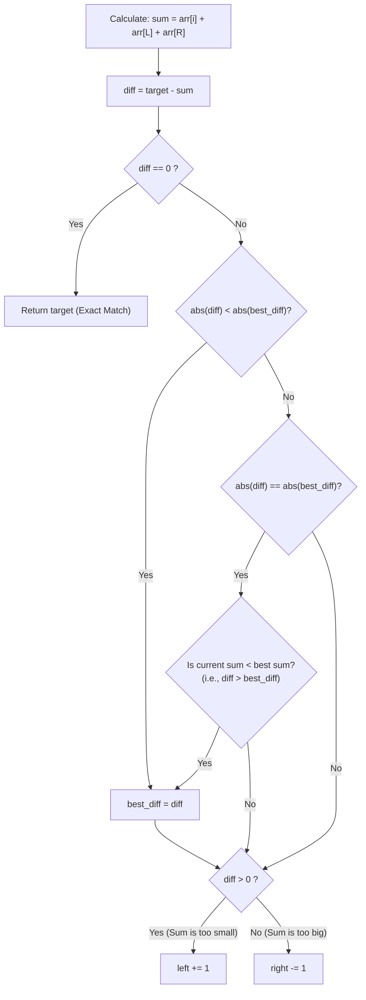

# 🚶‍♂️ Walkthrough: Triplet Sum Close to Target

## 👶 Explain Like I'm 5
Imagine you are at a carnival trying to guess the exact number of jellybeans in a huge jar (let's say the target is 100). You are allowed to pick exactly three smaller bags of jellybeans to pour together to make your guess. 

If you can't hit exactly 100, you want to get as *close as possible*. 
And there is a special carnival rule: if two different combinations get you equally close (for example, one combo gives you 98 jellybeans and another gives you 102—both are exactly 2 away from 100), you must always choose the **smaller** amount (98).

To solve this, you line up all your small bags from lightest to heaviest. You pick one bag to keep, and then you use your left and right hands on the remaining bags to find the best match. You keep a notepad tracking your "best guess so far." Every time you find a combination that is closer to 100 than your notepad says, you erase the notepad and write the new number down!

## 🎯 Core Strategy
This builds on the **Two Pointers (Opposite Ends)** 3Sum pattern. 
1. **Sort the array**: $O(N \log N)$.
2. **Pin an element (`i`)**: And use `left` and `right` pointers on the remainder.
3. **Track the Difference**: Instead of looking for an exact match, we calculate the difference: `target_diff = target_sum - current_sum`.
4. **Update Minimum**: We check if the absolute value of `target_diff` is smaller than our `smallest_difference`. If it is (or if it's a tie but the current sum is mathematically smaller), we update `smallest_difference`.
5. **Move Pointers**: 
   - If `target_diff > 0` (meaning our sum is smaller than the target), we need a larger sum, so `left++`.
   - If `target_diff < 0` (meaning our sum is larger than the target), we need a smaller sum, so `right--`.

## 🏃‍♂️ Step-by-Step Execution (Dry Run)
**Example Input**: `arr = [-2, 0, 1, 2]`, `target_sum = 2`
**Sorted Input**: `[-2, 0, 1, 2]`
*(Initial `smallest_diff = infinity`)*

| Step | Outer `i` (Pinned) | `L` idx | `R` idx | `arr[i] + arr[L] + arr[R]` | `target_diff` (Target 2 - Sum) | Smallest Diff So Far | Action |
|------|--------------------|---------|---------|----------------------------|--------------------------------|----------------------|--------|
| 1 | `0` (val: `-2`) | `1` (val: `0`) | `3` (val: `2`) | `-2 + 0 + 2 = 0` | `2 - 0 = 2` | `2` (Updated, 2 < inf) | `2 > 0`. Need larger sum. `L++` |
| 2 | `0` (val: `-2`) | `2` (val: `1`) | `3` (val: `2`) | `-2 + 1 + 2 = 1` | `2 - 1 = 1` | `1` (Updated, 1 < 2) | `1 > 0`. Need larger sum. `L++` |
| 3 | `1` (val: `0`) | `2` (val: `1`) | `3` (val: `2`) | `0 + 1 + 2 = 3` | `2 - 3 = -1` | `1` (Tie breaker check) | `abs(-1) == abs(1)`. But `-1 < 1`. Sum `3` is not smaller than Sum `1`. No update. `R--` |

Loop finishes. We return `target_sum - smallest_difference` -> `2 - 1 = 1`. The closest sum is `1`.

## 📊 Visual Diagram
Here is a visualization of the state tracking logic when comparing distances:

## 🛑 Edge Cases & Complexity

### Complexity
- **Time Complexity:** $O(N^2)$. Sorting the array takes $O(N \log N)$. The nested loops process the array taking $O(N^2)$ time.
- **Space Complexity:** $O(N)$. Required for the sorting algorithm (Timsort in Python).

### Edge Cases Handled Safely
- **The "Tie Breaker" Rule:** If target is `100`, and we find a sum of `90` (diff is `10`) and a sum of `110` (diff is `-10`). Both have an absolute difference of `10`. The logic `target_diff > smallest_difference` kicks in: `10 > -10` is True, so it overwrites the `best_diff` to `10`, effectively choosing the smaller sum (`90`).
- **Exact Match:** The moment `target_diff == 0`, the algorithm immediately short-circuits and returns `target_sum` without evaluating the rest of the array, saving time.
