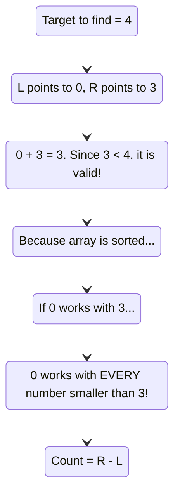

# 🚶‍♂️ Walkthrough: Triplets with Smaller Sum

## 👶 Explain Like I'm 5
Imagine you want to buy 3 toys, and you only have $20 total. You want to know **how many different combinations** of 3 toys you can afford.

You line up all the toys from cheapest to most expensive. First, you pick one toy to hold in your hand. 
Now, you need to find two more toys that cost less than the money you have left. 
Here is the magic trick: If the cheapest toy left on the shelf and the most expensive toy left on the shelf *combined* are affordable, then that cheapest toy paired with **ANY** toy in between will ALSO be affordable! 

Because they are sorted, you don't have to count them one by one. You can just look at the gap between the cheap toy and the expensive toy and say, "Wow, I can make 4 combinations instantly!" Then you move on to the next cheap toy to count more combinations.

## 🎯 Core Strategy
We use the **Two Pointers (Opposite Ends)** pattern after sorting the array.
Instead of finding an exact match, we are finding an inequality: `arr[left] + arr[right] < target`.
When this inequality is true, we leverage the sorted nature of the array: if `arr[right]` is small enough to be valid with `arr[left]`, then all elements smaller than `arr[right]` (which are everything down to `left + 1`) are *guaranteed* to be valid with `arr[left]` too.
We can simply add `(right - left)` to our total count, and then increment `left` to check the next element.

## 🏃‍♂️ Step-by-Step Execution (Dry Run)
**Example Input**: `arr = [-1, 0, 2, 3]`, `target_sum = 3`
**Sorted Input**: `[-1, 0, 2, 3]`

| Step | Outer `i` (Pinned) | Target to Find (`target_sum - arr[i]`) | `left` idx | `right` idx | `arr[L] + arr[R]` | Condition (`< Target`) | Action | Combinations Counted |
|------|--------------------|----------------------------------------|------------|-------------|-------------------|------------------------|--------|----------------------|
| 1 | `0` (val: `-1`) | `3 - (-1) = 4` | `1` (val: `0`) | `3` (val: `3`) | `0 + 3 = 3` | `3 < 4` (Yes) | Add `right - left` (`3 - 1 = 2`) to count. `left++`. | Count = 2 |
| 2 | `0` (val: `-1`) | `4` | `2` (val: `2`) | `3` (val: `3`) | `2 + 3 = 5` | `5 < 4` (No) | Sum too big. `right--`. | Count = 2 |
| 3 | `0` (val: `-1`) | `4` | `2` (val: `2`) | `2` (val: `2`) | Loop breaks (`left < right` fails) | | | Count = 2 |
| 4 | `1` (val: `0`) | `3 - 0 = 3` | `2` (val: `2`) | `3` (val: `3`) | `2 + 3 = 5` | `5 < 3` (No) | Sum too big. `right--`. | Count = 2 |
| 5 | `1` (val: `0`) | `3` | `2` (val: `2`) | `2` (val: `2`) | Loop breaks | | | Count = 2 |

Loop finishes. We return `count = 2`. The combinations were `[-1, 0, 3]` and `[-1, 0, 2]`.

## 📊 Visual Diagram
Here is a visualization of the "Magic Math" that allows us to count multiple pairs instantly:

## 🛑 Edge Cases & Complexity

### Complexity
- **Time Complexity:** $O(N^2)$. Sorting takes $O(N \log N)$. The outer loop runs $N$ times, and the inner Two Pointers traverse the remaining elements taking $O(N)$. Overall time is $O(N^2)$.
- **Space Complexity:** $O(N)$. Required by the sorting algorithm (Timsort in Python).

### Edge Cases Handled Safely
- **No triplets sum to less than target:** (e.g., `[1, 2, 3, 4]`, target `0`). The condition `arr[left] + arr[right] < target` will always fail, `right` will decrement until it crosses `left`, and nothing will be added to the count. Returns `0` safely.
- **Duplicate Elements:** Unlike "3Sum to Zero", we do NOT need to skip duplicate values here. If the array is `[1, 1, 1, 1]` and target is `4`, the problem asks for the *count of valid triplets by index*, not by unique values. The algorithm naturally handles this without skipping logic.
