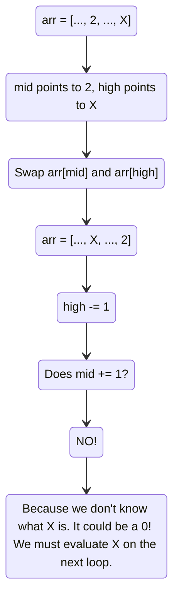

# 🚶‍♂️ Walkthrough: Dutch National Flag Problem

## 👶 Explain Like I'm 5
Imagine you have a messy pile of red, white, and blue balls. You want to sort them so all the red balls are on the left, all the white balls are in the middle, and all the blue balls are on the right. 

Instead of putting them into three separate buckets and then putting them back (which takes extra space), you can sort them *in-place* by just swapping them around!

You use three fingers to keep track of things:
1. **Left Finger**: points to the spot where the *next red ball* should go.
2. **Right Finger**: points to the spot where the *next blue ball* should go.
3. **Middle Finger**: points to the ball you are currently holding and looking at.

As you move your middle finger through the pile:
- If it's pointing to a **red** ball (0), you swap it with the ball at your Left Finger, and move both your Left and Middle fingers forward.
- If it's pointing to a **white** ball (1), it's already in the correct middle section! Just move your Middle finger forward.
- If it's pointing to a **blue** ball (2), you swap it with the ball at your Right Finger, and move your Right finger backward. *(But don't move your Middle finger forward yet, because the ball you just swapped from the right side needs to be checked!)*

## 🎯 Core Strategy
This is a famous partitioning algorithm designed by Edsger Dijkstra, known as the **Three Pointers** technique (an advanced variation of Two Pointers). 
We use three pointers: `low`, `mid`, and `high`.
- `low` boundary: Everything strictly to the left of `low` is `0`.
- `high` boundary: Everything strictly to the right of `high` is `2`.
- `mid` acts as our active scanner. 

The algorithm is inherently $O(N)$ because the `mid` pointer and `high` pointer converge, evaluating every element exactly once.

## 🏃‍♂️ Step-by-Step Execution (Dry Run)
**Example Input**: `arr = [1, 0, 2, 1, 0]`

Start: `low = 0`, `mid = 0`, `high = 4`.

| Step | `mid` idx | `arr[mid]` | Action Logic | Swaps | Array State | Pointers After Action |
|------|-----------|------------|--------------|-------|-------------|-----------------------|
| 1 | `0` | `1` | It's a 1. Belongs in middle. Just advance `mid`. | None | `[1, 0, 2, 1, 0]` | `low=0`, `mid=1`, `high=4` |
| 2 | `1` | `0` | It's a 0. Belongs on left. Swap with `low`. | `arr[0]` ↔ `arr[1]` | `[0, 1, 2, 1, 0]` | `low=1`, `mid=2`, `high=4` |
| 3 | `2` | `2` | It's a 2. Belongs on right. Swap with `high`. | `arr[2]` ↔ `arr[4]` | `[0, 1, 0, 1, 2]` | `low=1`, `mid=2`, `high=3` |
| 4 | `2` | `0` | *Note `mid` didn't move!* It's a 0. Swap with `low`. | `arr[1]` ↔ `arr[2]` | `[0, 0, 1, 1, 2]` | `low=2`, `mid=3`, `high=3` |
| 5 | `3` | `1` | It's a 1. Belongs in middle. Just advance `mid`. | None | `[0, 0, 1, 1, 2]` | `low=2`, `mid=4`, `high=3` |

Loop breaks because `mid` (4) is now greater than `high` (3).

## 📊 Visual Diagram
Here is a visualization of the most critical part of the logic: why `mid` does *not* advance when swapping with `high`.

## 🛑 Edge Cases & Complexity

### Complexity
- **Time Complexity:** $O(N)$. We iterate through the array once. At each step, either `mid` increments or `high` decrements. Thus, the total number of operations is bounded by $N$.
- **Space Complexity:** $O(1)$. We are sorting the array strictly in-place.

### Edge Cases Handled Safely
- **Array is entirely one color:** (e.g., `[0, 0, 0]`). `mid` and `low` will increment together, doing trivial self-swaps until the end.
- **Array of length 1:** Loop runs exactly once, evaluates the single element, and terminates. Perfectly safe.
- **Why do we increment `mid` when swapping with `low`?** Because the element coming from `low` into `mid` is guaranteed to be either a `1` (if `low` was lagging behind `mid`) or a `0` (if `low == mid`). We have already processed that element, so we know it doesn't need to be sent to `high`. Therefore, it's safe to advance `mid`.
