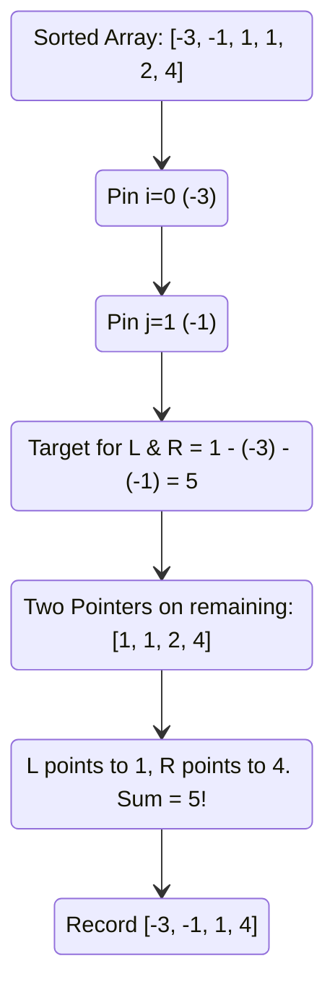

# 🚶‍♂️ Walkthrough: Quadruple Sum to Target (4Sum)

## 👶 Explain Like I'm 5
Remember when we looked for *three* numbers that add up to a target? We picked one number to "pin" down, and then used our two fingers (pointers) on the rest of the numbers to find the matching pair.

Now we need to find **four** numbers. The trick is exactly the same, but we just need to "pin" down **two** numbers first! 
1. We sort all the numbers.
2. We pin the first number.
3. We pin a second number right after it.
4. Now we have two pinned numbers. We just look at the remaining numbers and ask: "What do the last two numbers need to add up to so that all four equal the target?"
5. We use our Two Pointers on the rest of the numbers to find that exact match. 

We just have to be extra careful to skip identical numbers at *every single step* so we don't accidentally write down the exact same set of four numbers twice!

## 🎯 Core Strategy
This is an extension of the **Two Pointers (Opposite Ends)** pattern. Instead of a single outer loop (like in 3Sum), we use **two nested outer loops**.
- `i` iterates through the array (First pinned element).
- `j` iterates from `i + 1` to the end (Second pinned element).
- `left` and `right` pointers converge on the remainder of the array.

By doing this, an $O(N^4)$ brute force check is reduced to $O(N^3)$.

## 🏃‍♂️ Step-by-Step Execution (Dry Run)
**Example Input**: `arr = [4, 1, 2, -1, 1, -3]`, `target = 1`
**Sorted Input**: `[-3, -1, 1, 1, 2, 4]`

Let's trace just a few key iterations to see how it works.

| Outer `i` (Pin 1) | Inner `j` (Pin 2) | Target to Find (`1 - arr[i] - arr[j]`) | `L` idx | `R` idx | `arr[L] + arr[R]` | Action |
|-------------------|-------------------|----------------------------------------|---------|---------|-------------------|--------|
| `0` (val: `-3`) | `1` (val: `-1`) | `1 - (-3) - (-1) = 5` | `2` (val: `1`) | `5` (val: `4`) | `1 + 4 = 5` | **MATCH!** Add `[-3, -1, 1, 4]`. Move `L++`, `R--` |
| `0` (val: `-3`) | `1` (val: `-1`) | `5` | `3` (val: `1`) | `4` (val: `2`) | `1 + 2 = 3` | `3 < 5`. Need larger sum. `L++` |
| *(Loop finishes)* | | | | | | |
| `0` (val: `-3`) | `2` (val: `1`) | `1 - (-3) - 1 = 3` | `3` (val: `1`) | `5` (val: `4`) | `1 + 4 = 5` | `5 > 3`. Need smaller sum. `R--` |
| `0` (val: `-3`) | `2` (val: `1`) | `3` | `3` (val: `1`) | `4` (val: `2`) | `1 + 2 = 3` | **MATCH!** Add `[-3, 1, 1, 2]`. Move `L++`, `R--` |

Result: `[[-3, -1, 1, 4], [-3, 1, 1, 2]]`

## 📊 Visual Diagram
Here is a visualization of the nested pinning structure:

## 🛑 Edge Cases & Complexity

### Complexity
- **Time Complexity:** $O(N^3)$. Sorting takes $O(N \log N)$. The two nested `for` loops take $O(N^2)$, and the inner `while` loop (Two Pointers) takes $O(N)$. $N \times N \times N = O(N^3)$.
- **Space Complexity:** $O(N)$. Driven entirely by the sorting algorithm space requirements.

### Edge Cases Handled Safely
- **Avoiding Duplicates in `j`**: Just like we skip duplicates for `i` using `if i > 0 and arr[i] == arr[i-1]: continue`, we MUST skip duplicates for `j`. But `j` starts at `i + 1`, so the check is `if j > i + 1 and arr[j] == arr[j-1]: continue`. If we just used `j > 0`, it would break because `arr[j]` could legitimately equal `arr[i]`!
- **Not Enough Elements**: The first loop is `for i in range(n - 3)`. If the array has fewer than 4 elements, `n - 3` is less than or equal to 0, so the loops never execute, safely returning an empty list `[]`.
