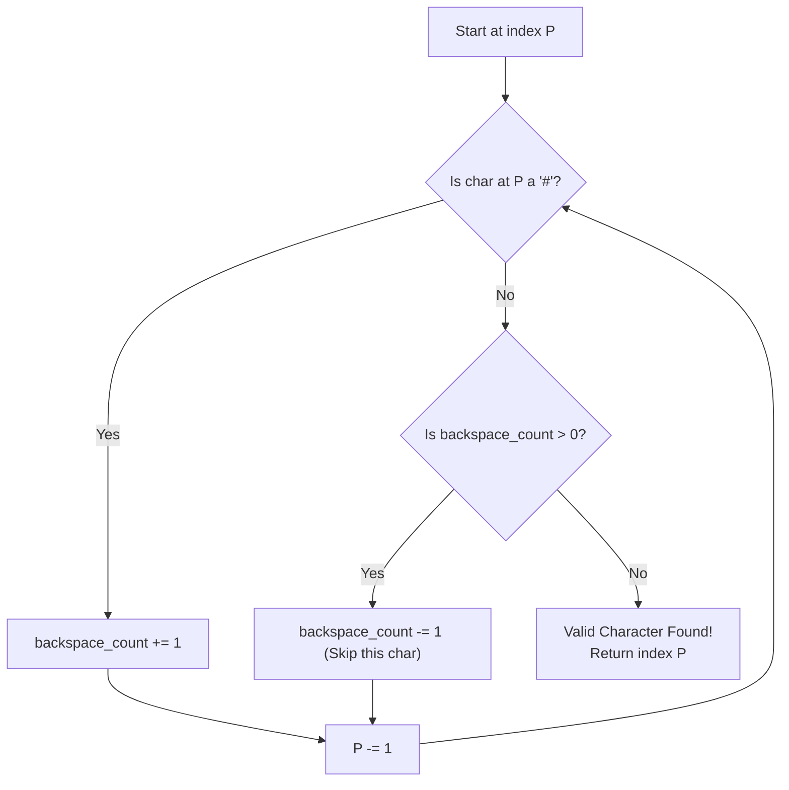

# 🚶‍♂️ Walkthrough: Comparing Strings containing Backspaces

## 👶 Explain Like I'm 5
Imagine you are watching your friend type a word on a keyboard. Sometimes they make a mistake and hit the 'Backspace' key (represented by the `#` symbol). If they type `a b c # d`, the `#` deletes the `c`, so the final word on the screen is actually `a b d`.

You are given two strings representing what two different friends typed. You need to figure out if their final words on the screen match perfectly.

You *could* take out a piece of paper, simulate typing both words out, and then compare the two pieces of paper. But that takes extra paper (extra memory!). 
A smarter trick is to read both words **backwards**. 
Starting from the end of the word, if you see a normal letter, that letter is part of the final word. But if you see a `#` (Backspace), you think to yourself, "Ah, I need to skip the *next* letter I see." 
You just read both words backwards at the same time, skipping letters whenever you've seen a backspace, and comparing the valid letters that survive.

## 🎯 Core Strategy
This problem utilizes the **Two Pointers (Opposite Ends - Backwards)** pattern.
Instead of parsing the string left-to-right (which would require a Stack data structure to handle the backspaces, costing $O(N)$ space), we parse **right-to-left**. 
We use two pointers, `p1` and `p2`, initialized to the last character of each string. A helper function `get_next_valid_char_index` is used to leap backwards over backspaces and the characters they delete, returning the index of the next character that actually belongs in the final string.

## 🏃‍♂️ Step-by-Step Execution (Dry Run)
**Example Input**: `str1 = "xy#z"`, `str2 = "xzz#"`

`p1` starts at index `3` (pointing to `z` in `str1`).
`p2` starts at index `3` (pointing to `#` in `str2`).

| Step | `p1` (str1) | `str1` Valid Char Found | `p2` (str2) | `str2` Valid Char Found | Match? | Action |
|------|-------------|-------------------------|-------------|-------------------------|--------|--------|
| 1 | `3` (`z`) | Finds `z` at index `3`. | `3` (`#`) | Sees `#`, skips the `z` at index `2`. Finds `x`? Wait, no, finds `z` at index `1`. | `z == z` | Match! Both pointers move back. `p1 = 2`, `p2 = 0`. |
| 2 | `2` (`#`) | Sees `#`, skips the `y` at index `1`. Finds `x` at index `0`. | `0` (`x`) | Finds `x` at index `0`. | `x == x` | Match! Both pointers move back. `p1 = -1`, `p2 = -1`. |
| 3 | `-1` | Both indices are `< 0`. | `-1` | Both indices are `< 0`. | Loop Ends | Return `True`! |

## 📊 Visual Diagram
Here is a flowchart of the logic used to find the next valid character when moving backwards:

## 🛑 Edge Cases & Complexity

### Complexity
- **Time Complexity:** $O(N + M)$ where $N$ and $M$ are the lengths of the two strings. We iterate through both strings exactly once from right to left.
- **Space Complexity:** $O(1)$. We do not build any new strings or arrays; we solely rely on integer pointers.

### Edge Cases Handled Safely
- **Multiple backspaces in a row:** `ab##`. The logic handles this flawlessly by accumulating `backspace_count` up to 2, and then skipping the next two valid characters (`b`, then `a`).
- **Backspacing an empty string:** `a#b#c#`. If a user hits backspace when there is nothing left to delete, it does nothing. The loop `while index >= 0` ensures we don't crash when skipping characters that don't exist.
- **Different resulting lengths:** If one string runs out of characters before the other, the main loop catches it: `if i1 < 0 or i2 < 0: return False`.
