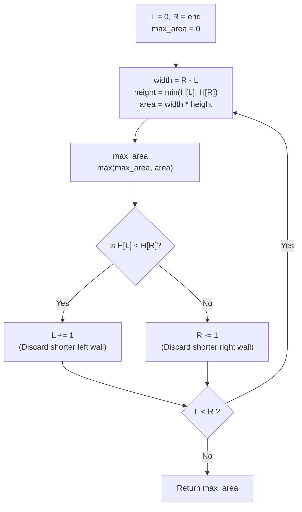

# 🚶‍♂️ Walkthrough: Container With Most Water

## 👶 Explain Like I'm 5
Imagine you have a bunch of wooden walls of different heights planted in the ground at equal distances. You want to pick two walls to form a fish tank, and you want the tank that can hold the **MOST** water.

The amount of water a tank can hold depends on two things:
1. How far apart the walls are (Width).
2. The height of the **SHORTER** wall (if one wall is tall and the other is short, the water will just spill over the short one).

If we start by picking the two walls that are the **FARTHEST** apart (the very first wall and the very last wall), we get the maximum possible Width.
To find a tank with even more water, we **MUST** find a taller wall. 
If we move the taller wall inwards, the width gets smaller AND the water is STILL limited by the shorter wall! That's a lose-lose situation. 
So, we **greedily** move the SHORTER wall inwards, hoping to find a much taller wall that makes up for the lost width.

## 🎯 Core Strategy
This uses the **Two Pointers (Opposite Ends)** pattern, but with a **Greedy Area Maximization** twist.
Instead of moving pointers based on a target sum, we move pointers based on the height of the walls.
1. `Area = Width * min(height[left], height[right])`.
2. Width decreases by 1 at every step as pointers move inward.
3. Therefore, to maximize area, we *must* maximize the limiting height. We discard the shorter line because it can never support a higher water level, even if paired with a massive wall later on. 

## 🏃‍♂️ Step-by-Step Execution (Dry Run)
**Example Input**: `height = [1, 8, 6, 2, 5, 4, 8, 3, 7]`

| Step | `L` idx | `R` idx | `H[L]` | `H[R]` | Width (`R-L`) | Min Height | Area | Max Area So Far | Action (Move Shorter) |
|------|---------|---------|--------|--------|---------------|------------|------|-----------------|-----------------------|
| 1 | `0` | `8` | `1` | `7` | `8` | `1` | `8 * 1 = 8` | `8` | `H[L] < H[R]` (1<7). `L++` |
| 2 | `1` | `8` | `8` | `7` | `7` | `7` | `7 * 7 = 49` | `49` | `H[L] > H[R]` (8>7). `R--` |
| 3 | `1` | `7` | `8` | `3` | `6` | `3` | `6 * 3 = 18` | `49` | `H[L] > H[R]` (8>3). `R--` |
| 4 | `1` | `6` | `8` | `8` | `5` | `8` | `5 * 8 = 40` | `49` | `H[L] == H[R]` (8=8). `R--` (or `L++`) |
| 5 | `1` | `5` | `8` | `4` | `4` | `4` | `4 * 4 = 16` | `49` | `H[L] > H[R]` (8>4). `R--` |
| ... | ... | ... | ... | ... | ... | ... | ... | `49` | ... |

*(The pointers continue to converge until they meet. The max area found remains 49).*

## 📊 Visual Diagram
Here is a visualization of the greedy choice at each step:

## 🛑 Edge Cases & Complexity

### Complexity
- **Time Complexity:** $O(N)$. We scan the array exactly once. Both pointers move towards each other and never overlap.
- **Space Complexity:** $O(1)$. We only track three variables (`left`, `right`, and `max_water`), requiring no extra memory regardless of the array size.

### Edge Cases Handled Safely
- **Equal Heights (`H[L] == H[R]`):** When the heights are equal, it doesn't actually matter which one you move! Moving either `L` or `R` is mathematically sound because to beat the current area (with a smaller width), *both* new lines would have to be taller than the current lines anyway. The algorithm safely defaults to moving `R` inwards via the `else` block.
- **Minimum Elements:** If the array is `[1, 1]`, the loop runs exactly once, calculates an area of `1`, and safely terminates, returning `1`.
