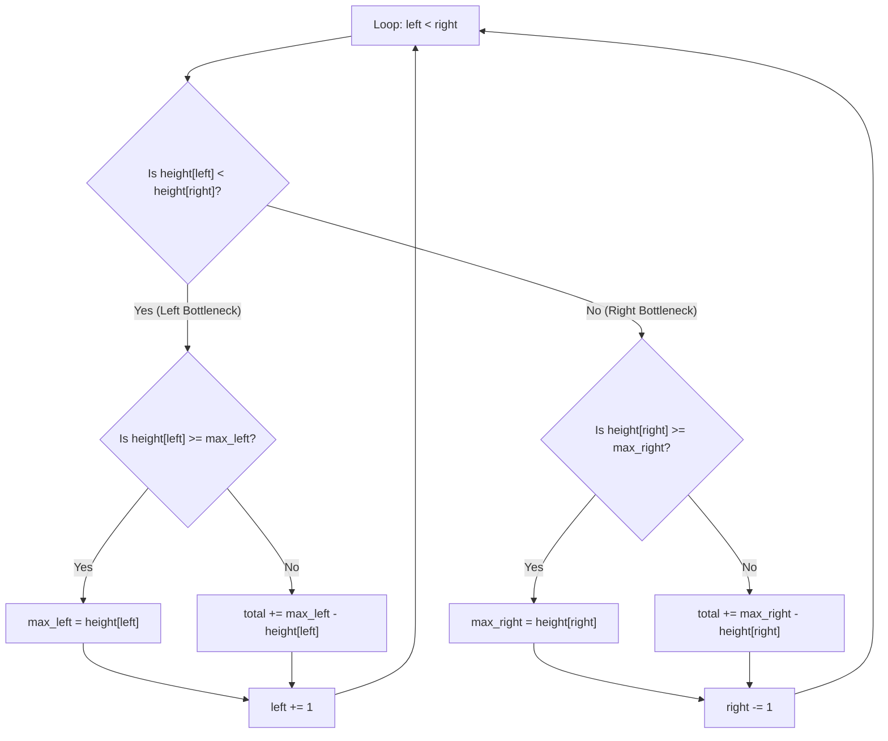

# 🚶‍♂️ Walkthrough: Trapping Rain Water

## 👶 Explain Like I'm 5
Imagine you have a landscape made of square blocks of different heights. It starts raining heavily. Water will get trapped in the "valleys" between the tall blocks.

How much water sits on top of any single block? It depends entirely on the tallest block to its left, and the tallest block to its right. The water level will rise until it spills over the **SHORTER** of those two tall blocks. 

Instead of walking across the whole landscape for every single block to find the tallest ones, we can just send two scouts: one starting from the left, one from the right. The scout standing on the shorter block ALWAYS knows their limiting wall (it's the highest block they've personally walked over so far). So, they can safely calculate the water on their current block and take a step forward!

## 🎯 Core Strategy
This uses the **Two Pointers (Converging Boundaries)** pattern.
To know how much water a specific index `i` traps, the formula is:
`Water[i] = min(max_left_height, max_right_height) - height[i]`

Instead of pre-calculating arrays for `max_left` and `max_right` (which costs $O(N)$ space), we use two pointers.
- We maintain a `max_left` and `max_right`.
- At any point, if `height[left] < height[right]`, we are **guaranteed** that `max_left` will be smaller than (or equal to) the true `max_right` for the left block. Thus, `max_left` is the bottleneck for `left`.
- We can safely calculate the water for the `left` pointer and advance it.
- Conversely, if `height[right] <= height[left]`, `max_right` is the bottleneck for the `right` pointer.

## 🏃‍♂️ Step-by-Step Execution (Dry Run)
**Example Input**: `height = [0, 1, 0, 2]`

Start: `left = 0`, `right = 3`. `max_left = 0`, `max_right = 0`. `total = 0`.

| Step | `L` idx | `R` idx | `H[L]` | `H[R]` | Compare Heights | `max_left` | `max_right` | Action | `total` |
|------|---------|---------|--------|--------|-----------------|------------|-------------|--------|---------|
| 1 | `0` | `3` | `0` | `2` | `H[L] < H[R]` (Left is bottleneck) | `0` | `0` | `H[L] >= max_left` (0 >= 0). Update `max_left = 0`. `L++` | `0` |
| 2 | `1` | `3` | `1` | `2` | `H[L] < H[R]` (Left is bottleneck) | `0` | `0` | `H[L] >= max_left` (1 >= 0). Update `max_left = 1`. `L++` | `0` |
| 3 | `2` | `3` | `0` | `2` | `H[L] < H[R]` (Left is bottleneck) | `1` | `0` | `H[L] < max_left` (0 < 1). Trap water! `total += (max_left - H[L])` -> `1 - 0 = 1`. `L++` | `1` |
| 4 | `3` | `3` | `2` | `2` | Loop ends because `L < R` is false. | | | Return `total`. | `1` |

Result: `1` unit of water trapped.

## 📊 Visual Diagram
Here is a logic map showing how the pointers decide who moves and when to add water:

## 🛑 Edge Cases & Complexity

### Complexity
- **Time Complexity:** $O(N)$. We iterate through the array precisely once from both ends until the pointers meet.
- **Space Complexity:** $O(1)$. By using pointers instead of pre-computed arrays (like in the Dynamic Programming approach to this problem), we achieve constant extra space.

### Edge Cases Handled Safely
- **Perfect Bowl / V-shape:** e.g., `[3, 2, 1, 2, 3]`. The `max_left` quickly becomes 3, and `max_right` becomes 3. As the pointers descend into the bowl, they trap exactly `1` and `2` units of water appropriately.
- **Stairs up or down:** e.g., `[1, 2, 3, 4]`. The left pointer will always be shorter, so it will continually update `max_left` and never trap water. Safely returns `0`.
- **Fewer than 3 blocks:** Handled explicitly at the start: `if not height or len(height) < 3: return 0`. You need at least 3 blocks to form a valley.
