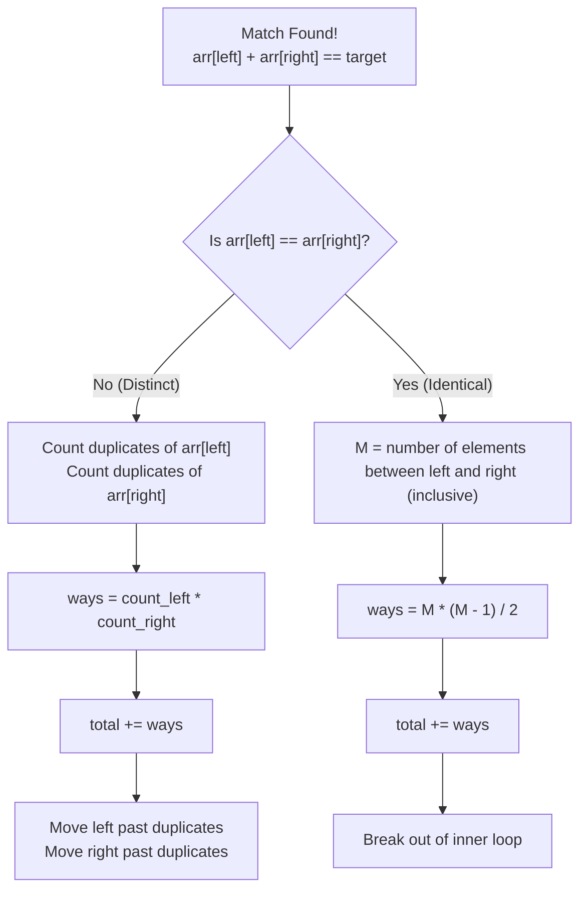

# 🚶‍♂️ Walkthrough: 3Sum With Multiplicity

## 👶 Explain Like I'm 5
Remember the standard 3Sum problem where we skipped duplicate numbers because we only wanted *unique* triplets?
Now, the rules have changed! We **WANT** to count the duplicates! 

Imagine we have a target of 5, and our array of cards is `[1, 2, 2, 2]`. 
The combination of values `(1, 2, 2)` equals 5. But because there are three *different* "2" cards we can choose from, we can actually form that exact combination in 3 different ways!
(Card 1 + Card 2 + Card 3), or (Card 1 + Card 2 + Card 4), or (Card 1 + Card 3 + Card 4).

Instead of blindly skipping duplicates, we use math. When we find a match using our Two Pointers, we count how many copies of the left card exist, and how many copies of the right card exist. 
If the left side has 2 copies and the right side has 3 copies, that gives us `2 * 3 = 6` valid combinations instantly!

## 🎯 Core Strategy
This uses the **Two Pointers (Opposite Ends)** pattern, but with a **Combinatorics** twist.
1. Sort the array.
2. Pin the first element `i` and use `left` and `right` pointers for the rest.
3. When `arr[left] + arr[right] == target`:
   - **Case 1 (Distinct values)**: `arr[left] != arr[right]`. Count the occurrences of `arr[left]` (`count_left`). Count the occurrences of `arr[right]` (`count_right`). Multiply them and add to the total. Then move pointers past the duplicates.
   - **Case 2 (Identical values)**: `arr[left] == arr[right]`. This means ALL numbers between `left` and `right` are exactly the same! If we have $M$ identical numbers, the number of ways to pick 2 of them is given by the combination formula: $\frac{M \times (M - 1)}{2}$. Add this to the total and immediately break out of the inner loop (since all pairs for this `i` are exhausted).

## 🏃‍♂️ Step-by-Step Execution (Dry Run)
**Example Input**: `arr = [1, 1, 2, 2, 2, 2]`, `target_sum = 5`
*(Sorted already)*

| Step | Outer `i` (Pin) | Target for L & R (`5 - arr[i]`) | `L` idx (val) | `R` idx (val) | `Sum` | Match? | Combinatorics Action | `total` |
|------|-----------------|---------------------------------|---------------|---------------|-------|--------|----------------------|---------|
| 1 | `0` (val `1`) | `4` | `1` (val `1`) | `5` (val `2`) | `3` | `3 < 4`. `L++` | | `0` |
| 2 | `0` (val `1`) | `4` | `2` (val `2`) | `5` (val `2`) | `4` | **YES** | `arr[L] == arr[R]` (both are 2). There are $M=4$ elements from L to R inclusive. ways = $\frac{4 \times 3}{2} = 6$. Add 6. Break. | `6` |
| 3 | `1` (val `1`) | `4` | `2` (val `2`) | `5` (val `2`) | `4` | **YES** | `arr[L] == arr[R]` (both are 2). $M=4$. ways = 6. Add 6. Break. | `12` |
| 4 | `2` (val `2`) | `3` | `3` (val `2`) | `5` (val `2`) | `4` | `4 > 3`. `R--` | | `12` |
| 5 | `2` (val `2`) | `3` | `3` (val `2`) | `4` (val `2`) | `4` | `4 > 3`. `R--` | | `12` |
| ... | *(Loop continues for rest of 2s, but sums will always be too large)* | | | | | | | `12` |

Result: `12` ways.

## 📊 Visual Diagram
Here is a flowchart explaining the combinatorics calculation when a match is found:

## 🛑 Edge Cases & Complexity

### Complexity
- **Time Complexity:** $O(N^2)$. Sorting takes $O(N \log N)$. The outer loop runs $N$ times. In the worst case (where we have many distinct matching pairs), the inner Two Pointers and the `while` loops for counting duplicates visit each element at most once per outer iteration, resulting in $O(N)$ for the inner step. Overall time is $O(N^2)$.
- **Space Complexity:** $O(N)$. Due to sorting.

### Edge Cases Handled Safely
- **All elements identical:** (e.g., `[2, 2, 2, 2, 2]`, target `6`). Pinned `2`, target is `4`. `left` points to `2`, `right` points to `2`. It triggers `arr[left] == arr[right]`, calculates $\frac{4 \times 3}{2} = 6$, and breaks. Next iteration: Pinned next `2`, target `4`. $M=3$, calculates $\frac{3 \times 2}{2} = 3$. Next iteration: $M=2$, calculates $\frac{2 \times 1}{2} = 1$. Total = $6 + 3 + 1 = 10$. Exactly right ($5 \text{ choose } 3$).
- **Large answers:** Handled correctly by applying `% (10**9 + 7)` to `total_ways` during every addition.
