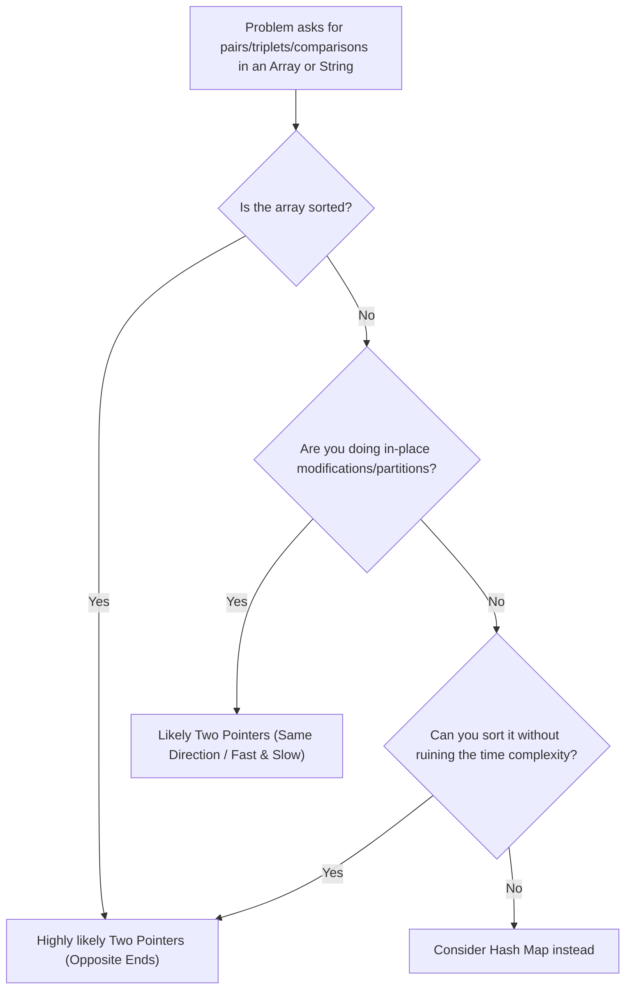
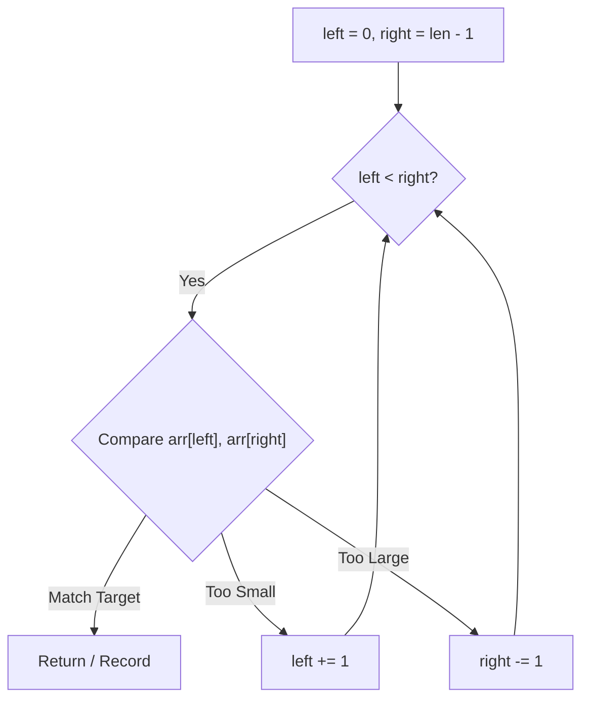
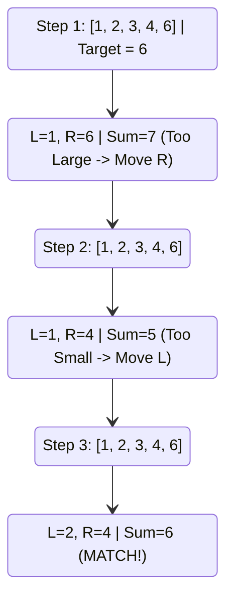
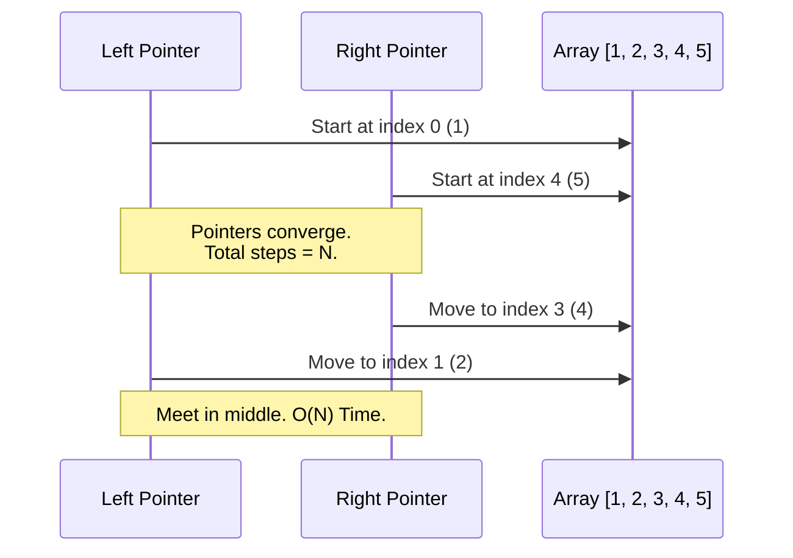
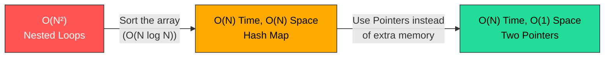
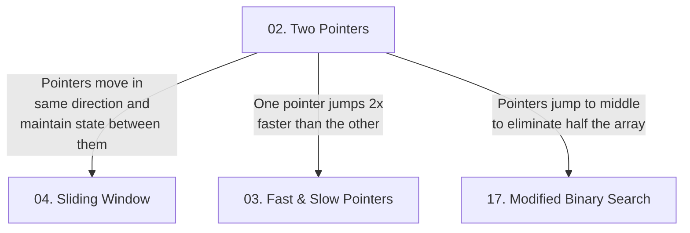

# Pattern 02: Two Pointers

## 👶 Explain Like I'm 5
Imagine you have a row of books on a shelf and you want to find two books that have exactly 100 pages combined.
If you just grab the first book and then check every other book, it takes a long time. 
But if the books are sorted by size (smallest on the left, biggest on the right), you can place your left hand on the smallest book and your right hand on the biggest book. 
- If their combined pages are too many, you move your right hand one book to the left (to a slightly smaller book).
- If their combined pages are too few, you move your left hand one book to the right (to a slightly bigger book).
You just keep moving your hands toward the middle until you find the exact match! This is the magic of the **Two Pointers** pattern.

---

## 🧩 Core Idea & Pattern Detection

The Two Pointers pattern involves using two variables (pointers) to iterate through a data structure (usually an Array or String) in tandem, rather than using nested loops. 

### When to use it:
- The input array/string is **sorted** (or you are allowed to sort it).
- You need to find a **pair, triplet, or subarray** that satisfies a specific condition (e.g., a target sum).
- You need to **compare elements** at the beginning and end of a string (e.g., Palindromes).
- You need to process an array **in-place** (e.g., removing duplicates).

---

## 🔧 Algorithmic Anatomy

There are two main variations of the Two Pointers pattern.

### Recipe A: Opposite Ends (Collision)
Used primarily when searching for pairs in a sorted array or checking palindromes.
1. **Initialize** `left` pointer at index `0` and `right` pointer at index `n - 1`.
2. **Loop** `while left < right`.
3. **Check Condition**: Compare `arr[left]` and `arr[right]`.
4. **Move Pointers**:
   - If condition met perfectly → Record result / Return.
   - If value is too small → `left += 1`
   - If value is too large → `right -= 1`

### Recipe B: Same Direction (Runner / Partitioning)
Used for in-place array modifications, moving zeroes, or removing duplicates.
1. **Initialize** both pointers (e.g., `slow` and `fast`) at index `0` or `1`.
2. **Loop** `fast` through the array.
3. **Check Condition**: If `arr[fast]` is valid / unique.
4. **Swap/Assign**: `arr[slow] = arr[fast]` and `slow += 1`.

---

## 🛑 Per-Variant DOs and DON'Ts

| Variant | DO | DON'T |
|---------|----|-------|
| **Opposite Ends** | **DO** use `while left < right`. If pointers cross or meet, you've checked all pairs. | **DON'T** use `while left <= right` if the problem requires distinct elements (you'll process the same element twice). |
| **Same Direction** | **DO** use a `for` loop for the `fast` pointer, and manually increment the `slow` pointer. | **DON'T** create a new array. This variant is specifically designed for `O(1)` space in-place modifications. |
| **Triplets (3Sum)** | **DO** sort the array first, then use a `for` loop to pin the first element, and use Opposite Ends for the remaining two. | **DON'T** forget to skip duplicate elements in both the outer loop and the inner pointers to avoid duplicate triplets. |

---

## 📊 Visual Walkthrough
**Problem:** Find a pair in `[1, 2, 3, 4, 6]` that sums to `6`.

---

## ⏱️ Complexity Analysis

| Aspect | Complexity | Why |
|--------|-----------|-----|
| **Time (Opposite)** | **O(N)** | The `left` and `right` pointers move towards each other and never overlap. Each element is evaluated at most once. |
| **Time (Triplets)** | **O(N²)** | Sorting takes `O(N log N)`. Pinning the first element takes `O(N)`, and the inner Two Pointers takes `O(N)`. Total: `O(N log N + N²) = O(N²)`. |
| **Space** | **O(1)** | We only store pointer indices (integers), ignoring space used for the output array. |

---

## 🔄 Brute Force to Optimal Evolution

---

## ⚠️ Common Pitfalls

1. **Forgetting to Sort:** The Opposite Ends pattern relies entirely on the array being sorted so that moving left/right guarantees a strictly increasing/decreasing value change.
2. **Infinite Loops with Duplicates:** When skipping duplicates in 3Sum or related problems, if you don't aggressively skip all identical adjacent numbers, you will produce duplicate answer sets.
3. **Index Out of Bounds:** When advancing `left` or `right` inside a `while` loop to skip duplicates, you MUST constantly ensure `left < right` before accessing the array.

---

## 🧪 Self-Test Questions

1. When should you use 'left < right' vs 'left <= right'?

Use `left < right` when you are looking for pairs (two distinct elements). Use `left <= right` in Binary Search or when a single element interacting with itself is a valid state (e.g. reversing a string in-place with an odd number of characters).

2. How do you avoid duplicate triplets in a 3Sum problem?

After sorting, skip identical adjacent elements in the outer `for` loop (`if i > 0 and arr[i] == arr[i-1]: continue`). Then, after finding a valid pair in the inner `while` loop, aggressively increment `left` and decrement `right` while they point to identical adjacent elements.

---

## 🚀 Advanced Paradigms (Beyond the Basics)

### 1. Partitioning (Dutch National Flag)
Sorting arrays with strictly 3 distinct values (like 0, 1, 2) can be done in a single pass `O(N)` without extra memory by using **three pointers**: `low`, `mid`, and `high`.
- `mid` traverses the array.
- 0s are swapped to the `low` side, 2s are swapped to the `high` side.
- 1s are left in the middle.

### 2. Area Maximization (Greedy Two Pointers)
Problems like "Container With Most Water" require calculating an area (Width × Height). We start with the maximum width (`left = 0, right = n-1`). To potentially find a larger area, we *must* increase the height. Thus, we greedily move the pointer pointing to the shorter line inward.

---

## ✅ Problems in This Pattern

| # | Problem | Difficulty | Key Twist |
|---|---------|------------|-----------|
| 1 | Pair with Target Sum | Easy | Standard opposite-ends convergence |
| 2 | Find Non-Duplicate Number Instances | Easy | Same-direction, in-place overwriting |
| 3 | Squaring a Sorted Array | Easy | Opposite-ends, populating result from back to front |
| 4 | Triplet Sum to Zero (3Sum) | Medium | Pin one element, opposite-ends for the other two. Skip duplicates! |
| 5 | Triplet Sum Close to Target | Medium | Track smallest difference, careful with absolute values |
| 6 | Triplets with Smaller Sum | Medium | Math trick: if `arr[L]+arr[R] < target`, then ALL elements between L and R are also valid pairs for L! |
| 7 | Dutch National Flag Problem | Medium | Three pointers (low, mid, high) for 3-way partition |
| 8 | Quadruple Sum to Target (4Sum) | Medium | Two nested `for` loops, then standard opposite-ends Two Pointers |
| 9 | Comparing Strings containing Backspaces | Medium | Traverse backwards, keep track of 'backspace' counts to skip characters |
| 10 | Minimum Window Sort | Medium | Find unsorted subarray bounds, then expand them to include min/max anomalies |
| 11 | Container With Most Water | Medium | **Advanced:** Greedy height maximization |
| 12 | Trapping Rain Water | Hard | **Advanced:** Track max bounds from both ends simultaneously |
| 13 | 3Sum With Multiplicity | Hard | **Advanced:** Combinatorics when duplicates exist |

---

## 🔗 Pattern Connections

