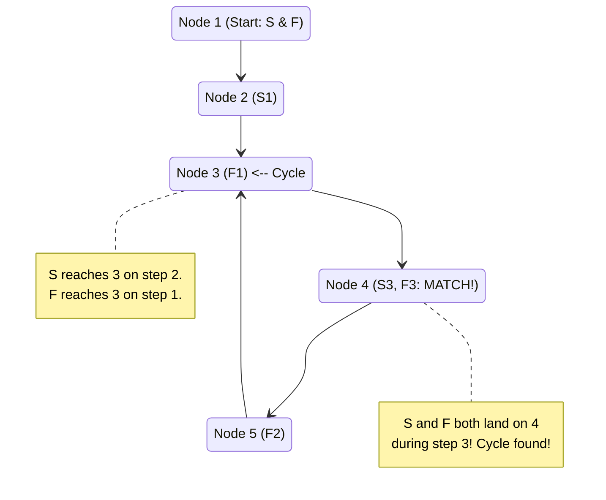

# 🚶‍♂️ Walkthrough: LinkedList Cycle

## 👶 Explain Like I'm 5
Imagine you are walking down a path made of stepping stones. You want to know if the path is a straight line that eventually ends, or if it loops around in a circle forever.

If you just keep walking, you might walk forever if there's a loop! You need a smarter way to check.
Send two friends down the path: a **Slow Tortoise** and a **Fast Hare**. 
The Tortoise takes 1 step at a time. The Hare takes 2 steps at a time.

- If the path has an end, the Hare will just reach the end first.
- But if the path is a circle, they will both end up running in circles. Because the Hare is faster, he will eventually run all the way around and lap the Tortoise!

If they ever land on the exact same stone at the exact same time, you know for sure there is a loop!

## 🎯 Core Strategy
This is the classic implementation of **Floyd’s Cycle-Finding Algorithm**, also known as the **Fast & Slow Pointers** pattern.
1. Initialize a `slow` pointer and a `fast` pointer, both starting at the `head` of the LinkedList.
2. Traverse the list: `slow` moves one step (`slow = slow.next`), while `fast` moves two steps (`fast = fast.next.next`).
3. If there is a cycle, the `fast` pointer will eventually "lap" the `slow` pointer, meaning `slow == fast`.
4. If there is no cycle, the `fast` pointer will simply reach the end of the list (`None`).

## 🏃‍♂️ Step-by-Step Execution (Dry Run)
**Example Input**: `1 -> 2 -> 3 -> 4 -> 5 -> (Cycle back to 3)`

| Step | `slow` Node | `fast` Node | Action / Check |
|------|-------------|-------------|----------------|
| 1 (Start) | `1` | `1` | Start at head. `fast` and `fast.next` are not None. |
| 2 | `2` | `3` | `slow` moves 1 step. `fast` moves 2 steps. `slow != fast`. |
| 3 | `3` | `5` | `slow` moves 1 step. `fast` moves 2 steps. `slow != fast`. |
| 4 | `4` | `4` | `slow` moves 1 step. `fast` moves 2 steps (5 -> 3 -> 4). `slow == fast`! |

**Result:** Cycle detected! The loop breaks and returns `True`.

## 📊 Visual Diagram
Here is a state diagram showing how the pointers move through the cycle:

## 🛑 Edge Cases & Complexity

### Complexity
- **Time Complexity:** $O(N)$. If there is no cycle, the fast pointer reaches the end in $N/2$ steps. If there is a cycle, the fast pointer catches the slow pointer in at most $N$ steps. Total time complexity is strictly linear.
- **Space Complexity:** $O(1)$. We only maintain two node references (`slow` and `fast`), taking constant extra space.

### Edge Cases Handled Safely
- **Empty List (`head = None`):** The `while` loop condition `fast is not None` fails immediately, and the function safely returns `False`.
- **Single Node (No Cycle):** `fast.next` is `None`. The loop condition `fast.next is not None` fails immediately, returning `False`.
- **Single Node (With Cycle):** `fast` moves 2 steps and lands back on the single node. `slow` moves 1 step and lands on the single node. `slow == fast` evaluates to `True`, correctly identifying the cycle.
