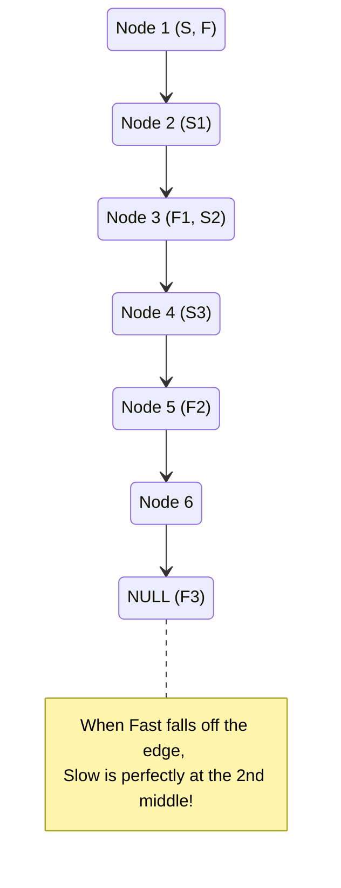

# 🚶‍♂️ Walkthrough: Middle of the LinkedList

## 👶 Explain Like I'm 5
Imagine you want to find the exact middle of a long, straight road, but you don't know how long the road is, and you don't have a measuring tape. 

You can use two cars: a **Slow Car** (goes 1 mile per hour) and a **Fast Car** (goes 2 miles per hour). Both start at the beginning of the road at the exact same time.

Because the Fast Car is exactly twice as fast, when the Fast Car reaches the end of the road, the Slow Car will be exactly HALFWAY there! 
So you just drive both cars, and the moment the Fast Car hits the end, you look at where the Slow Car is. That's the middle!

## 🎯 Core Strategy
This is another fundamental application of the **Fast & Slow Pointers** pattern.
1. Initialize `slow` and `fast` pointers at the `head` of the LinkedList.
2. Traverse the list: `slow` moves one step (`slow = slow.next`), while `fast` moves two steps (`fast = fast.next.next`).
3. The loop stops when `fast` reaches the end of the list (i.e., `fast is None`) or when it lands on the very last node (`fast.next is None`).
4. At that exact moment, `slow` is guaranteed to be pointing at the middle node. 

## 🏃‍♂️ Step-by-Step Execution (Dry Run)
**Example Input (Odd Length)**: `1 -> 2 -> 3 -> 4 -> 5`

| Step | `slow` Node | `fast` Node | Action / Check |
|------|-------------|-------------|----------------|
| 1 (Start) | `1` | `1` | `fast` and `fast.next` are not None. |
| 2 | `2` | `3` | `slow` moves 1 step. `fast` moves 2 steps. `fast.next` is `4` (not None). |
| 3 | `3` | `5` | `slow` moves 1 step. `fast` moves 2 steps. `fast.next` is `None`! |
| 4 | `3` | `5` | Loop breaks. Return `slow` (Node 3). |

**Example Input (Even Length)**: `1 -> 2 -> 3 -> 4 -> 5 -> 6`

| Step | `slow` Node | `fast` Node | Action / Check |
|------|-------------|-------------|----------------|
| 1 (Start) | `1` | `1` | `fast` and `fast.next` are not None. |
| 2 | `2` | `3` | `slow` moves 1 step. `fast` moves 2 steps. `fast.next` is `4` (not None). |
| 3 | `3` | `5` | `slow` moves 1 step. `fast` moves 2 steps. `fast.next` is `6` (not None). |
| 4 | `4` | `None` | `slow` moves 1 step. `fast` moves 2 steps (6 -> None). `fast` is `None`! |
| 5 | `4` | `None`| Loop breaks. Return `slow` (Node 4 - the second middle). |

## 📊 Visual Diagram
Here is a visualization of the pointers moving through an Even-length list:

## 🛑 Edge Cases & Complexity

### Complexity
- **Time Complexity:** $O(N)$. The `fast` pointer visits at most $N$ nodes (skipping half of them). Thus, we traverse the list exactly once.
- **Space Complexity:** $O(1)$. We only require two node references, regardless of the size of the LinkedList.

### Edge Cases Handled Safely
- **List has 1 node:** `fast.next` is immediately `None`. The `while` loop never runs. It safely returns the `head` node as the middle.
- **List has an EVEN number of nodes:** As shown in the dry run, the logic naturally advances `slow` to the second of the two middle nodes, which is the standard expected behavior for this problem (e.g., in `[1, 2, 3, 4]`, returning `3`).
