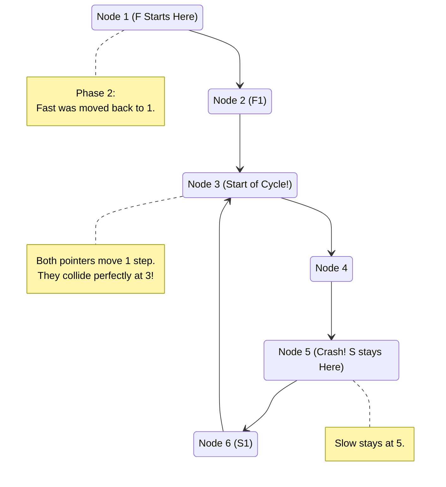

# 🚶‍♂️ Walkthrough: Start of LinkedList Cycle

## 👶 Explain Like I'm 5
Imagine our Slow Tortoise and Fast Hare are running on a track that has a straight path leading into a circle. We know they will eventually crash into each other inside the circle because the Hare is faster. But we want to know EXACTLY where the circle begins!

Through some really cool math, we know a secret: the distance from the very start of the track to the start of the circle is **EXACTLY THE SAME** as the distance from their crash site to the start of the circle!

So, once they crash, we leave the Tortoise exactly where he is (at the crash site). We pick up the Hare and put him all the way back at the Start Line. 
Now, we change the rules: they BOTH run at the EXACT SAME speed (1 step at a time). Because the distances are equal, they will both arrive at the exact spot where the circle begins at the exact same time! That spot is our answer!

## 🎯 Core Strategy
This is **Floyd's Cycle-Finding Algorithm (Phase 2)**.
1. **Phase 1 (Detect Cycle)**: Move `slow` 1 step and `fast` 2 steps until they meet. If `fast` reaches the end (`None`), there is no cycle.
2. **Phase 2 (Find Start)**: Once they meet, move `fast` back to the `head` of the list. Leave `slow` at the meeting point inside the cycle.
3. Move BOTH `slow` and `fast` exactly 1 step at a time.
4. The exact node where they collide (`slow == fast`) is guaranteed mathematically to be the start of the cycle.

## 🏃‍♂️ Step-by-Step Execution (Dry Run)
**Example Input**: `1 -> 2 -> 3 -> 4 -> 5 -> 6 -> (Cycle back to 3)`

**Phase 1: Detect Cycle**
Start: `S=1`, `F=1`

| Step | `slow` Node | `fast` Node | Action |
|------|-------------|-------------|--------|
| 1 | `2` | `3` | Move S 1, F 2 |
| 2 | `3` | `5` | Move S 1, F 2 |
| 3 | `4` | `3` | Move S 1, F 2 (wraps around) |
| 4 | `5` | `5` | Move S 1, F 2. **MATCH at Node 5!** |

**Phase 2: Find Start**
Move `fast` back to head (`1`). `slow` stays at `5`.
Now, move BOTH by 1 step!

| Step | `slow` Node | `fast` Node | Action |
|------|-------------|-------------|--------|
| 5 | `6` | `2` | Move S 1, F 1 |
| 6 | `3` | `3` | Move S 1 (wraps around), F 1. **MATCH at Node 3!** |

**Result:** Node 3 is the start of the cycle.

## 📊 Visual Diagram
Here is a visual map showing Phase 2 (finding the start):

## 🛑 Edge Cases & Complexity

### Complexity
- **Time Complexity:** $O(N)$. Phase 1 takes at most $N$ steps. Phase 2 takes at most $N$ steps. Overall time is strictly linear.
- **Space Complexity:** $O(1)$. We just use the `slow` and `fast` pointers.

### Edge Cases Handled Safely
- **No Cycle Exists:** Phase 1 finishes normally when `fast` or `fast.next` becomes `None`. It immediately returns `None` without ever entering Phase 2.
- **Cycle starts at the very first node (`head`):** If the list is `1 -> 2 -> 3 -> 1`, Phase 1 will detect the crash. When `fast` is reset to `head`, it might immediately equal `slow`. The `while slow != fast` loop won't even execute, safely returning `slow`.
