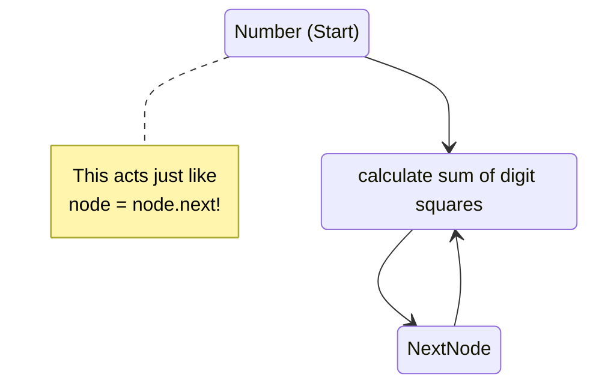
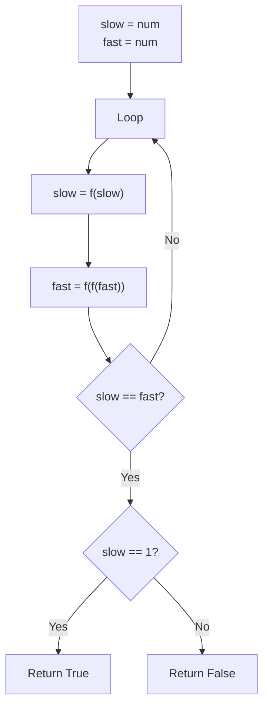

# 🚶‍♂️ Walkthrough: Happy Number

## 👶 Explain Like I'm 5
A "Happy Number" is a number that eventually turns into `1` if you keep squaring its digits and adding them together. 
For example, for `23`:
1. $2^2 + 3^2 = 4 + 9 = 13$
2. $1^2 + 3^2 = 1 + 9 = 10$
3. $1^2 + 0^2 = 1 + 0 = 1$. 
Yay, 23 is a Happy Number!

But what if a number is **NOT** happy? It won't just keep growing forever. Math proves that it will eventually get stuck in a **LOOP** (a cycle)! For example, you might get `4 -> 16 -> 37 -> 58 -> 89 -> 145 -> 42 -> 20 -> 4` and now you are trapped!

Because we are dealing with a sequence of numbers that either ends in `1` or gets stuck in a loop, this is EXACTLY like our Tortoise and Hare problem! The only difference is we don't have a real LinkedList; we just GENERATE the "next node" by doing the math!

## 🎯 Core Strategy
This is an incredible application of the **Fast & Slow Pointers** pattern on a *Virtual* sequence.
1. The "head" of the sequence is the starting number.
2. We create a helper function `find_square_sum(num)` which acts exactly like `node.next`.
3. We set `slow = num` and `fast = num`.
4. We move `slow` by applying the math function once. We move `fast` by applying the math function twice.
5. They will inevitably collide (because an unhappy number loops, and a happy number loops at `1 -> 1 -> 1`).
6. When `slow == fast`, we break the loop and check if they collided on the number `1`. 

## 🏃‍♂️ Step-by-Step Execution (Dry Run)
**Example Input**: `num = 12`

Start: `slow = 12`, `fast = 12`.

| Step | `slow` (1 step) | `fast` (2 steps) | Action / Check |
|------|-----------------|------------------|----------------|
| 1 | `f(12) = 5` | `f(f(12)) = f(5) = 25` | `slow != fast` |
| 2 | `f(5) = 25` | `f(f(25)) = f(29) = 85` | `slow != fast` |
| 3 | `f(25) = 29` | `f(f(85)) = f(89) = 145` | `slow != fast` |
| 4 | `f(29) = 85` | `f(f(145)) = f(42) = 20` | `slow != fast` |
| ... | ... | ... | ... |
| N | `89` | `89` | **COLLISION!** `slow == fast`. Loop breaks! |

Result: Collision at `89`. Is `89 == 1`? No. So `12` is not a happy number!

## 📊 Visual Diagram
Here is a state diagram showing how the pointers move through the virtual sequence:

How the Tortoise and Hare traverse it:

## 🛑 Edge Cases & Complexity

### Complexity
- **Time Complexity:** $O(\log N)$. Finding the next number by summing squares of digits takes time proportional to the number of digits in $N$, which is $O(\log N)$. The sequence length before hitting a cycle is small (maximum 243 for a 3-digit number, and any number larger than 999 quickly drops to a 3-digit number).
- **Space Complexity:** $O(1)$. This is the main advantage over using a `HashSet` to detect the cycle, which would take $O(\text{cycle length})$ memory.

### Edge Cases Handled Safely
- **Number is already 1:** Start at 1. `slow` becomes `f(1) = 1`. `fast` becomes `f(f(1)) = 1`. They collide immediately at `1`. Loop breaks, returns `True`.
- **Single digit unhappy numbers (e.g., 2):** It generates the sequence `2 -> 4 -> 16 -> 37 ...` and safely detects the cycle without throwing any index or bounds errors.
