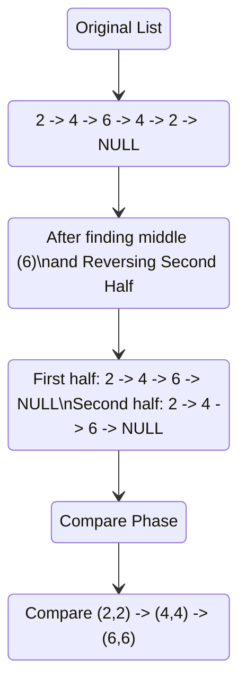

# 🚶‍♂️ Walkthrough: Palindrome LinkedList

## 👶 Explain Like I'm 5
A palindrome is a word that is spelled the exact same way forwards and backwards (like `RACECAR` or `1-2-3-2-1`).

If you have a LinkedList, you can easily read it forwards. But you can't easily read it backwards because the arrows between the nodes only point forward! So, how do we compare the front to the back? 

1. **Find the Middle:** We use our trusty Fast and Slow cars (pointers) to find the exact middle of the road.
2. **Turn the Cars Around:** We take the entire second half of the road and manually turn all the one-way street signs around (Reverse the second half of the list).
3. **Compare:** Now we have two cars starting from the outside edges pointing inward. We just drive them both step by step. If they see the exact same signs at every step, it's a palindrome!
4. *(Bonus points: we reverse the second half back to normal when we're done so we don't break the original road permanently).*

## 🎯 Core Strategy
This brings together two major linked list patterns: **Fast & Slow Pointers** and **In-Place Reversal**.
1. Find the middle of the LinkedList using `slow` and `fast` pointers. When `fast` reaches the end, `slow` is at the middle.
2. Reverse the second half of the list starting from `slow`. Let's call the new head of this reversed half `head_second_half`.
3. Iterate through both the original `head` and `head_second_half`, comparing their values one by one.
4. If a mismatch is found, it's not a palindrome.
5. Re-reverse the second half back to its original state using the `copy_head_second_half` pointer before returning the result.

## 🏃‍♂️ Step-by-Step Execution (Dry Run)
**Example Input**: `2 -> 4 -> 6 -> 4 -> 2`

**Step 1: Find the Middle**
`slow` and `fast` start at `2`.
- S=2, F=6
- S=4, F=2 (end)
- `slow` lands on `6` (the middle).

**Step 2: Reverse Second Half**
We reverse the sub-list starting at `6`.
Before: `6 -> 4 -> 2 -> None`
After: `2 -> 4 -> 6 -> None`
`head_second_half` points to the `2`.

**Step 3: Compare Both Halves**
First half starts at original head (`2`). Second half starts at `head_second_half` (`2`).

| Step | First Half Node | Second Half Node | Match? | Action |
|------|-----------------|------------------|--------|--------|
| 1 | `2` | `2` | Yes | Move both forward |
| 2 | `4` | `4` | Yes | Move both forward |
| 3 | `6` | `6` | Yes | Move both forward |
| 4 | `None` | `None` | - | End of lists reached! It is a palindrome. |

**Step 4: Restore List**
We reverse the second half again starting from `copy_head_second_half` (`6`), restoring the list to `2 -> 4 -> 6 -> 4 -> 2`.

## 📊 Visual Diagram
Here is a visualization of the list mutation:

## 🛑 Edge Cases & Complexity

### Complexity
- **Time Complexity:** $O(N)$. Finding the middle takes $O(N/2)$. Reversing the second half takes $O(N/2)$. Comparing them takes $O(N/2)$. Restoring the list takes $O(N/2)$. Total time is bounded by $O(N)$.
- **Space Complexity:** $O(1)$. We reverse the list strictly in-place by updating the `next` pointers, using no extra memory proportional to the list size.

### Edge Cases Handled Safely
- **Even length list:** (e.g., `2 -> 4 -> 4 -> 2`). `slow` will land on the second `4`. Reversing from there gives `2 -> 4 -> None`. The first half will be `2 -> 4 -> 4...`, but the `while` loop condition `curr_second_half is not None` will safely stop the comparison after 2 successful matches.
- **Single Node:** `head.next` is `None`. The initial check `if head is None or head.next is None: return True` catches this immediately and returns `True` without executing the rest of the algorithm.
