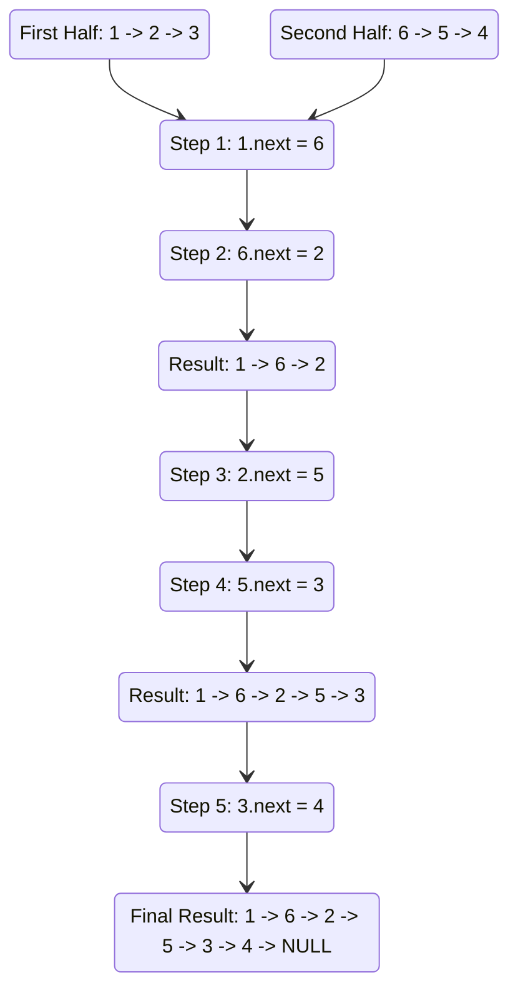

# 🚶‍♂️ Walkthrough: Rearrange a LinkedList

## 👶 Explain Like I'm 5
Imagine you have a long line of dominoes numbered `1, 2, 3, 4, 5, 6`.
You want to reorganize them into a very specific pattern: 
**1st Domino**, **LAST Domino**, **2nd Domino**, **SECOND-TO-LAST Domino**, and so on...
So it becomes `1, 6, 2, 5, 3, 4`.

If we just had a regular array, this would be easy. But with a LinkedList, we can only move forward! How do we grab the "last" one easily?
We can split the problem into three simple steps:
1. Find the MIDDLE of the LinkedList (using our Slow Tortoise and Fast Hare).
2. Take the entire second half and REVERSE it (so it now points backwards).
3. Now we have two lists starting from opposite ends. We simply take turns picking one domino from the first list, then one from the second list, weaving them together like a zipper!

## 🎯 Core Strategy
This combines three fundamental linked list operations:
1. **Find the middle**: `fast` and `slow` pointers.
2. **Reverse a sub-list**: Reverse the second half in-place starting from the middle node.
3. **Weave/Merge**: Iterate through both the `first_half` and `second_half` heads, manipulating their `next` pointers to alternate nodes. 

Crucially, to prevent an infinite cycle at the end of the weaving process, we must ensure the final node points to `None`.

## 🏃‍♂️ Step-by-Step Execution (Dry Run)
**Example Input**: `1 -> 2 -> 3 -> 4 -> 5 -> 6`

**Step 1: Find the Middle**
`slow` stops at `4`.

**Step 2: Reverse Second Half**
Reverse from `4`. The second half becomes `6 -> 5 -> 4 -> None`.
First half starts at `1`.

**Step 3: Weave**
`first_half` points to `1`. `second_half` points to `6`.

| Step | `first_half` Node | `second_half` Node | Action | `first_half` Next | `second_half` Next |
|------|-------------------|--------------------|--------|-------------------|--------------------|
| 1 | `1` | `6` | Link `1 -> 6`. Link `6 -> 2`. | `2` | `5` |
| 2 | `2` | `5` | Link `2 -> 5`. Link `5 -> 3`. | `3` | `4` |
| 3 | `3` | `4` | Link `3 -> 4`. Link `4 -> 4` (Wait, see note below!) | `4` | `None` |

*Note on Step 3:* When `first_half == second_half` (which happens for odd lengths) or when we are at the end, we break to avoid creating a cycle where `4` points to `4`. 
The code handles this beautifully by doing `if first_half: first_half.next = None` at the very end to sever any remaining cyclic tails.

Resulting List: `1 -> 6 -> 2 -> 5 -> 3 -> 4 -> None`

## 📊 Visual Diagram
Here is a visual map showing the Weaving ("Zipper") process:

## 🛑 Edge Cases & Complexity

### Complexity
- **Time Complexity:** $O(N)$. We traverse the list to find the middle ($O(N)$), traverse half the list to reverse it ($O(N)$), and traverse both halves to weave them ($O(N)$). The total runtime is strictly linear.
- **Space Complexity:** $O(1)$. Everything is done in-place by manipulating `next` pointers.

### Edge Cases Handled Safely
- **List with 1 or 2 nodes:** Requires no rearranging. The middle is found, the second half (length 1) is reversed (no change), and weaving stops instantly. Returns exactly what it started with.
- **Preventing Cycles:** If the middle node of the first half still pointed to the start of the reversed half, a cycle could occur during weaving. We prevent this by enforcing `if first_half is not None: first_half.next = None` at the end of our function.
