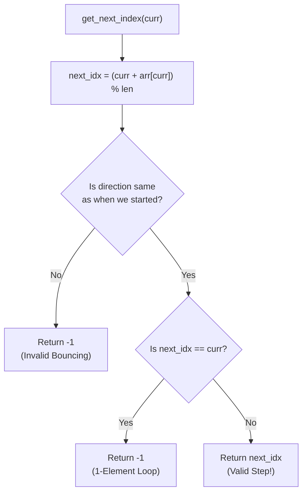

# 🚶‍♂️ Walkthrough: Cycle in a Circular Array

## 👶 Explain Like I'm 5
Imagine a board game where the spaces are arranged in a circle. Each space has a number on it. If you land on a space with a `3`, you jump forward 3 spaces. If you land on `-2`, you jump backward 2 spaces. 
Because the board is a circle, jumping off the end just wraps you around to the beginning!

We want to know if there is an **INFINITE LOOP** in this board game!
BUT, there are two strict rules for a loop to be valid:
1. The loop must involve **AT LEAST two spaces**. (Jumping from space 4 back to space 4 forever doesn't count).
2. The loop must only go in **ONE DIRECTION**. You can't jump forward, then backward, then forward again to make a loop. That's just bouncing back and forth!

To solve this, we can pretend every space is the start of a LinkedList and use our Fast & Slow Pointers (Tortoise and Hare). If they ever meet, we found a loop!
If they hit a wall (like changing directions, or a 1-element loop), they stop, and we just start over from the next space.

## 🎯 Core Strategy
This is an advanced variation of **Floyd's Cycle-Finding Algorithm**. 
1. We iterate through every index `i` in the array.
2. For each index, we launch a `slow` and `fast` pointer.
3. We define a helper function `get_next_index` that acts as our `node.next`. It calculates the next index using modulo arithmetic: `(curr + arr[curr]) % len(arr)`.
4. Inside the helper function, we strictly enforce the two rules. If the new direction is different from the starting direction, or if the new index is the same as the current index, the helper returns `-1` (a dead end).
5. If `slow == fast`, we found a valid cycle! If either pointer hits `-1`, we break and try the next starting index.

## 🏃‍♂️ Step-by-Step Execution (Dry Run)
**Example Input**: `arr = [1, 2, -1, 2, 2]`
Length: `5`

Let's test starting at index `0` (value `1`). Direction is Forward (`is_forward = True`).

| Step | `slow` Index | `fast` Index | Actions & Math |
|------|--------------|--------------|----------------|
| 1 | `0` (val `1`) | `0` (val `1`) | Initialization |
| 2 | `1` (val `2`) | `3` (val `2`) | `slow` moves 1: `(0 + 1) % 5 = 1`.   `fast` moves 2: `(0 + 1) % 5 = 1`, then `(1 + 2) % 5 = 3`. |
| 3 | `3` (val `2`) | `3` (val `2`) | `slow` moves 1: `(1 + 2) % 5 = 3`.   `fast` moves 2: `(3 + 2) % 5 = 0`, then `(0 + 1) % 5 = 1`. Wait, looking closely: `fast` was at `3`. Moves 1: `(3+2)%5 = 0`. Moves 2: `(0+1)%5 = 1`. Ah, `fast` is actually `1`! Let me recount carefully. |

*Wait, let's recount exactly what the code does starting from index 0:*
`S = 0, F = 0`.
- Loop 1:
  - `S` next: `(0 + 1)%5 = 1`. `S = 1`.
  - `F` next: `(0 + 1)%5 = 1`. `F = 1`.
  - `F` next again: `(1 + 2)%5 = 3`. `F = 3`.
  - Check: `S (1) != F (3)`.
- Loop 2:
  - `S` next: `(1 + 2)%5 = 3`. `S = 3`.
  - `F` next: `(3 + 2)%5 = 0`. `F = 0`.
  - `F` next again: `(0 + 1)%5 = 1`. `F = 1`.
  - Check: `S (3) != F (1)`.
- Loop 3:
  - `S` next: `(3 + 2)%5 = 0`. `S = 0`.
  - `F` next: `(1 + 2)%5 = 3`. `F = 3`.
  - `F` next again: `(3 + 2)%5 = 0`. `F = 0`.
  - Check: `S (0) == F (0)`. **MATCH FOUND!** Return `True`.

## 📊 Visual Diagram
Here is how the helper function acts as a strict traffic cop:

## 🛑 Edge Cases & Complexity

### Complexity
- **Time Complexity:** $O(N^2)$ in the worst case (as implemented). If we check every node and it takes $O(N)$ steps to hit a dead end, it's $N \times N$. *Note: This can be optimized to $O(N)$ by marking visited nodes with `0` or a special marker once they are proven to not lead to a valid cycle.*
- **Space Complexity:** $O(1)$. We strictly use pointers and index math.

### Edge Cases Handled Safely
- **Alternating Directions (Bouncing):** `[2, 1, -1, -2]`. A jump might go forward, then the next jump goes backward. The `if is_forward != direction:` check instantly catches this and returns `-1`, breaking the loop.
- **Single Element Loops:** `[1, -2]`. `(0 + 1) % 2 = 1`. At index 1, `(1 - 2) % 2 = -1 % 2 = 1`. Index 1 jumps to Index 1. The check `if next_index == current_index:` catches this and returns `-1`.
- **Negative Modulo:** Python's `%` operator beautifully handles negative numbers. `-1 % 5 == 4`. In languages like Java or C++, you have to do `((curr + arr[curr]) % len + len) % len` to prevent negative results!
