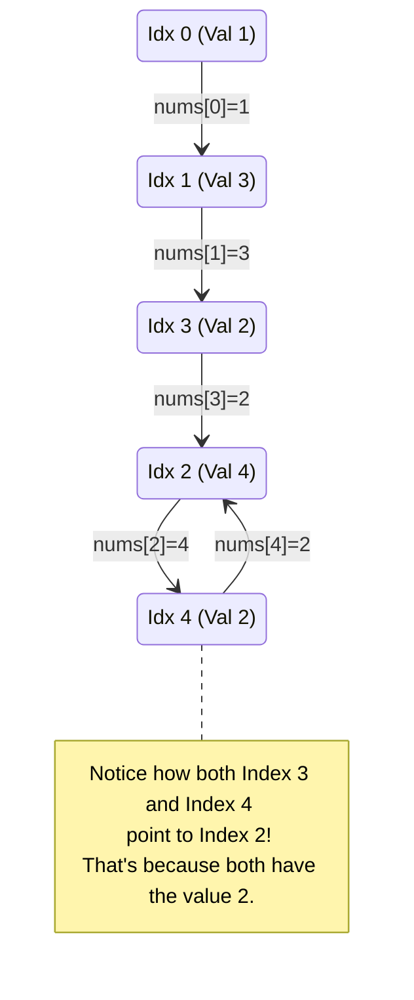

# 🚶‍♂️ Walkthrough: Find the Duplicate Number

## 👶 Explain Like I'm 5
You have a box of toys numbered `1` to `N`, and there are exactly `N+1` toys in the box. Because there are more toys than unique numbers, at least ONE number must be duplicated!

We can't sort the toys, and we can't bring in a second box to keep track of what we've seen (no extra space). 
But there's a magical trick! We can pretend this box is a **LinkedList**!
If we are at index `0`, the number inside (let's say `3`) tells us to go to index `3` next. Then the number at index `3` tells us where to go next.

Because multiple spots in the array contain the SAME duplicate number, multiple paths will **POINT to the exact same index**. This creates a CYCLE! 
And the exact spot where the cycle BEGINS is the duplicate number itself! 
So, we just use our Tortoise and Hare trick to find the start of the cycle, exactly like we did in the "Start of LinkedList Cycle" problem.

## 🎯 Core Strategy
This is an incredibly clever application of **Floyd’s Cycle-Finding Algorithm** to an array instead of a linked list.
1. Use `nums[i]` as the "next" pointer. The array values dictate the jumps between indices.
2. **Phase 1 (Detect Cycle)**: Move `slow` by 1 jump (`nums[slow]`) and `fast` by 2 jumps (`nums[nums[fast]]`). Because there is a duplicate pointing to the same index, a cycle is 100% guaranteed. They will eventually meet inside the cycle.
3. **Phase 2 (Find Start of Cycle)**: Leave one pointer at the meeting point. Send the other pointer back to the start (`0`). Move both pointers 1 step at a time. The node where they meet is the start of the cycle, which is precisely the duplicate number!

## 🏃‍♂️ Step-by-Step Execution (Dry Run)
**Example Input**: `nums = [1, 3, 4, 2, 2]`
*(Values: 1 to 4. Length: 5. Duplicate: 2)*

Start: `slow = 0`, `fast = 0`.

**Phase 1: Detect Cycle**

| Step | `slow` Index (1 jump) | `fast` Index (2 jumps) | Action / Check |
|------|-----------------------|------------------------|----------------|
| 1 | `nums[0] = 1` | `nums[nums[0]] = nums[1] = 3` | `1 != 3` |
| 2 | `nums[1] = 3` | `nums[nums[3]] = nums[2] = 4` | `3 != 4` |
| 3 | `nums[3] = 2` | `nums[nums[4]] = nums[2] = 4` | `2 != 4` |
| 4 | `nums[2] = 4` | `nums[nums[4]] = nums[2] = 4` | `4 == 4`. **COLLISION!** |

**Phase 2: Find Start of Cycle**
Leave `fast` at `4`. Send a new `slow2` back to `0`. Move both 1 step at a time.

| Step | `fast` Index (1 jump) | `slow2` Index (1 jump) | Action / Check |
|------|-----------------------|------------------------|----------------|
| 5 | `nums[4] = 2` | `nums[0] = 1` | `2 != 1` |
| 6 | `nums[2] = 4` | `nums[1] = 3` | `4 != 3` |
| 7 | `nums[4] = 2` | `nums[3] = 2` | `2 == 2`. **MATCH!** |

Result: `2` is the duplicate number.

## 📊 Visual Diagram
Here is how the array maps to a linked list with a cycle:

## 🛑 Edge Cases & Complexity

### Complexity
- **Time Complexity:** $O(N)$. Phase 1 takes at most $O(N)$ steps. Phase 2 takes at most $O(N)$ steps. Overall time is strictly linear.
- **Space Complexity:** $O(1)$. We don't sort the array, and we don't use any extra data structures. We just use pointers holding integer indices.

### Edge Cases Handled Safely
- **All identical elements:** `[2, 2, 2, 2, 2]`. 
  - `slow` goes `0 -> 2`. `fast` goes `0 -> 2 -> 2`.
  - Collision at `2`.
  - `slow2` goes `0 -> 2`. `fast` goes `2 -> 2`.
  - Match at `2`. Perfectly handled.
- **Why is a cycle guaranteed?** The problem states the array has `N + 1` elements and contains numbers in the range `[1, N]`. This means `nums[0]` will never point to index `0` (since `0` is not in the range `1..N`). It also guarantees that at least two indices will contain the exact same number (Pigeonhole Principle), which means two different indices will point to the *same* destination index, forming a cycle.
