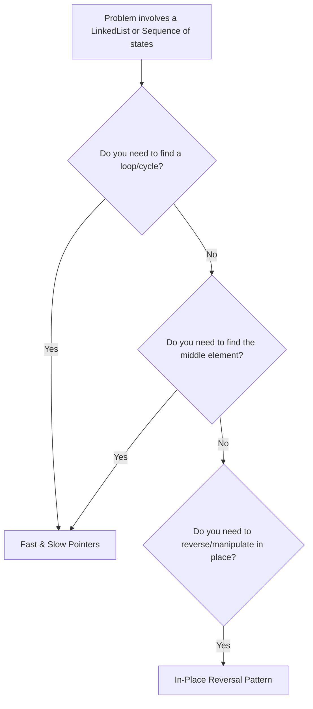
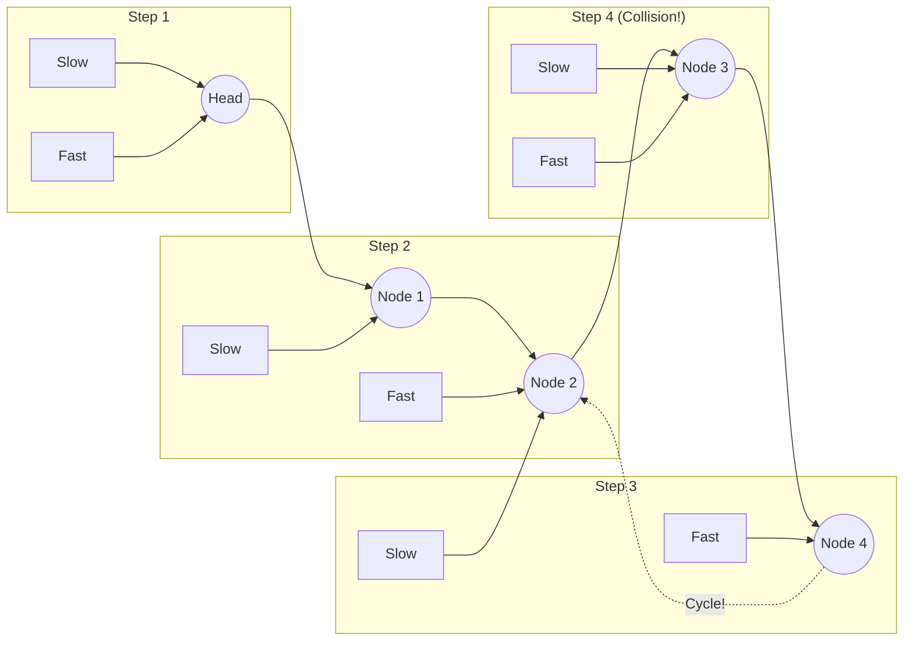

# Pattern 03: Fast & Slow Pointers (Hare & Tortoise)

## 👶 Explain Like I'm 5
Imagine two animals racing on a track: a Slow Tortoise and a Fast Hare. 
The Hare runs twice as fast as the Tortoise.
If the track is a straight line, the Hare will just reach the finish line first, 
and the race ends.
But what if the track is a **circle**? The Hare will keep running around and around, 
and eventually, because he is faster, he will run up right behind the Tortoise and 
"lap" him! 
If they ever crash into each other on the track, you know 100% for sure that the 
track is a circle (a cycle). If the Hare crosses a finish line instead, you know 
the track was straight. This is the **Fast & Slow Pointers** algorithm!

---

## 🧩 Core Idea & Pattern Detection

The Fast & Slow Pointers approach (also known as Floyd's Cycle Detection algorithm) uses two pointers that move through a sequence at different speeds. This is heavily used for **LinkedLists** and sometimes arrays that simulate LinkedList behavior.

### When to use it:
- Dealing with **LinkedLists** or Arrays where values point to indices.
- You need to detect a **Cycle** (loop) in the structure.
- You need to find the **Middle** of a LinkedList in a single pass.
- You need to determine the **Length of a cycle**.

---

## 🔧 Algorithmic Anatomy

### Recipe: Cycle Detection
1. **Initialize** `slow` and `fast` pointers at the `head` of the list.
2. **Loop** while `fast` is not `None` AND `fast.next` is not `None`.
3. **Move Pointers**:
   - `slow` moves 1 step (`slow = slow.next`)
   - `fast` moves 2 steps (`fast = fast.next.next`)
4. **Check Condition**: If `slow == fast`, a cycle exists! Return `True`.
5. **End**: If the loop finishes because `fast` reached the end, there is no cycle. Return `False`.

---

## 🛑 Per-Variant DOs and DON'Ts

| Variant | DO | DON'T |
|---------|----|-------|
| **Cycle Detection** | **DO** check `fast and fast.next` in the while loop to prevent NullPointerExceptions. | **DON'T** check `slow.next`. `fast` will always hit the end of the list first, so checking `fast` is sufficient. |
| **Finding the Middle** | **DO** use `slow = slow.next` and `fast = fast.next.next`. When `fast` hits the end, `slow` is exactly at the middle. | **DON'T** traverse the list once to count the nodes and then traverse again to reach `N/2`. One pass is faster! |
| **Finding Cycle Start** | **DO** reset ONE pointer back to the `head` after they collide, then move BOTH pointers at 1 step per tick. | **DON'T** try to use extra memory like a Hash Set unless the constraints specifically allow O(N) space. |

---

## ⏱️ Complexity Analysis

| Aspect | Complexity | Why |
|--------|-----------|-----|
| **Time (Cycle)** | **O(N)** | If no cycle exists, `fast` reaches the end in N/2 steps. If a cycle exists, the `fast` pointer will catch the `slow` pointer in at most N steps after entering the cycle. |
| **Space** | **O(1)** | We only maintain two node pointers, regardless of the size of the LinkedList. |

---

## ⚠️ Common Pitfalls

1. **Null Reference Errors:** The most common mistake is writing `while fast != None:` but forgetting to check `fast.next != None:`. When you execute `fast = fast.next.next`, if `fast.next` is None, you will crash trying to access `.next` on a NoneType.
2. **Even vs Odd Lengths (Middle):** When finding the middle of an even-lengthed LinkedList (e.g. 4 nodes), there are two middles. If you want the SECOND middle, start both at `head`. If you want the FIRST middle, you may need to adjust the starting positions or the while condition (`fast.next and fast.next.next`).

---

## 🚀 Advanced Paradigms (Beyond the Basics)

### 1. The Mathematics of Finding the Cycle Start (Floyd's Phase 2)
When `slow` and `fast` collide, they are somewhere inside the loop, but NOT necessarily at the start of the loop.
To find the start:
1. Leave `slow` at the collision point.
2. Move `fast` back to the `head` of the LinkedList.
3. Now, move BOTH pointers at a speed of **1 step at a time**.
4. The exact node where they collide again is GUARANTEED to be the start of the cycle.
*(This works because the distance from the head to the cycle start is mathematically equal to the distance from the collision point to the cycle start).*

### 2. Arrays acting as LinkedLists (The "Index as a Pointer" trick)
Some problems give you an Array of integers and ask you to find cycles (like finding a Duplicate Number). Because the numbers in the array are bounded between `1` and `N`, you can treat the *value* of the array as a "pointer" to the next *index*.
`next_node = arr[current_node]`
This allows you to run Fast & Slow Pointers on an Array without O(N) memory!

---

## ✅ Problems in This Pattern

| # | Problem | Difficulty | Key Twist |
|---|---------|------------|-----------|
| 1 | LinkedList Cycle | Easy | Standard cycle detection |
| 2 | Middle of the LinkedList | Easy | Stop when fast reaches the end |
| 3 | Start of LinkedList Cycle | Medium | Phase 2: Reset one pointer, step by 1 |
| 4 | Happy Number | Medium | Math problem converted to a cycle detection |
| 5 | Palindrome LinkedList | Medium | Find middle -> Reverse second half -> Compare |
| 6 | Rearrange a LinkedList | Medium | Find middle -> Reverse second half -> Interleave |
| 7 | Cycle in a Circular Array | Hard | Array values as jump sizes, careful of direction |
| 8 | Find the Duplicate Number | Medium | **Advanced**: Array values as pointers |
