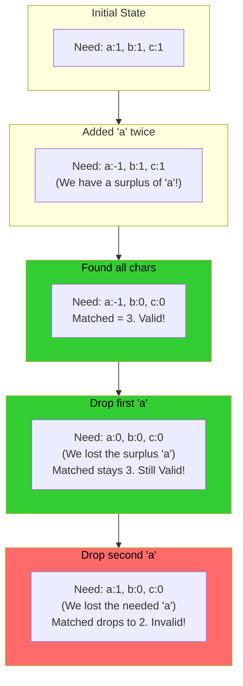

# 🚶‍♂️ Walkthrough: Smallest Window containing Substring

## 👶 Explain Like I'm 5
Imagine you have a shopping list of ingredients (your `pattern`), like `1 Apple, 1 Banana, 1 Carrot`. You are walking down a very long grocery aisle (the `string`). You want to find the **shortest possible section** of the aisle that contains every single ingredient on your list. 

You start walking and dropping things into your cart (expanding the window). You keep walking until you finally have everything on your list. Yay! 
But wait! Maybe you walked further than you needed to. Maybe that Apple you grabbed at the very beginning isn't the only Apple. What if there's another Apple closer to where you are right now? 
To find the absolute *shortest* section, you start pulling items out of the bottom of your cart (shrinking the window from the left). As long as you *still* have everything on your list, your window is valid and getting smaller! 

## 🎯 Core Strategy
This uses the **Dynamic-Size Sliding Window** paired with a **HashMap** and a `matched` counter.
Unlike the "Permutation in a String" problem where we needed a *perfect* size match, here the window can be larger, and characters can be over-collected.
1. Initialize `window_start = 0`, `matched = 0`, `min_length = infinity`, `substr_start = 0`, and a `char_freq` map counting the required characters of the `pattern`.
2. Iterate `window_end` through the string `s`.
3. If the incoming character is in `char_freq`, decrement its count. If the count becomes $\ge 0$, it means we *needed* this character (it wasn't just a surplus extra copy), so we increment `matched`.
4. **Shrink Loop**: The moment `matched == len(pattern)`, our window has all the ingredients! We enter a `while` loop to try and shrink it.
   - Record the window size if it's smaller than `min_length`, and save `substr_start = window_start`.
   - Drop the left-most character (`s[window_start]`). If it's in our `char_freq` map, we must increment its count.
   - If its count was exactly `0` *before* incrementing, it means dropping it ruined our collection (we no longer have enough of that character), so we decrement `matched`, which will break the `while` loop so we can go back to expanding.

## 🏃‍♂️ Step-by-Step Execution (Dry Run)
**Example Input**: `s = "aabdec"`, `pattern = "abc"`
Initialization: `pattern` length is 3. `freq = {'a':1, 'b':1, 'c':1}`. 
`start = 0`, `matched = 0`.

| Step | `end` char | `freq` map (Needed) | `matched` | All Ingredients? (matched==3) | Action (Record, Shrink) |
|------|------------|---------------------|-----------|-------------------------------|-------------------------|
| 1 | `0` ('a') | `{'a':0, 'b':1, 'c':1}` | `1` | No | Expand. |
| 2 | `1` ('a') | `{'a':-1, 'b':1, 'c':1}` | `1` (surplus 'a') | No | Expand. (Needed 0, got -1). |
| 3 | `2` ('b') | `{'a':-1, 'b':0, 'c':1}` | `2` | No | Expand. |
| 4 | `3` ('d') | ignored | `2` | No | Expand. |
| 5 | `4` ('e') | ignored | `2` | No | Expand. |
| 6 | `5` ('c') | `{'a':-1, 'b':0, 'c':0}`| `3` | **YES!** | *SHRINK LOOP START* |

**Inside the Shrink Loop (at `end = 5`, `window = "aabdec"`):**
1. Size = 6. `min_length = 6`. `substr_start = 0`.
2. Drop `s[0]` ('a'). `freq['a']` goes from `-1` to `0`. Wait, it didn't drop below 0! That means it was a surplus! `matched` stays 3. `start = 1`.
3. Loop continues! (because `matched == 3`)
4. Size = 5. `min_length = 5`. `substr_start = 1`. Window is now `"abdec"`.
5. Drop `s[1]` ('a'). `freq['a']` goes from `0` to `1`. It was exactly 0! We just lost our only needed 'a'! `matched` drops to 2. `start = 2`.
6. Loop breaks (because `matched != 3`).

Result: `min_length = 5`. `substr_start = 1`. Slicing `s[1:6]` gives `"abdec"`.

## 📊 Visual Diagram
Here is how the tracking of surplus characters works with the hash map:

## 🛑 Edge Cases & Complexity

### Complexity
- **Time Complexity:** $O(N + M)$, where $N$ is the length of `s` and $M$ is the length of `pattern`. The right pointer scans `s` once, and the left pointer scans `s` at most once.
- **Space Complexity:** $O(M)$ or $O(1)$ for the hash map to store the character counts of the `pattern`.

### Edge Cases Handled Safely
- **Pattern longer than string:** Instant return of `""`.
- **String doesn't contain pattern:** The `matched == len(pattern)` condition never becomes true, `min_length` remains `infinity`, and the function safely returns `""`.
- **Duplicate characters in pattern:** The condition `matched == len(pattern)` refers to the total number of *all* required characters, not distinct types. So if pattern is "aa", `len(pattern) = 2`. When the first 'a' is seen, `matched` becomes 1. When the second is seen, `matched` becomes 2, triggering the while loop perfectly!
