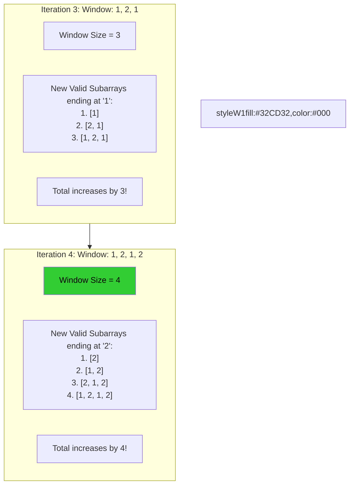

# 🚶‍♂️ Walkthrough: Subarrays with K Different Integers

## 👶 Explain Like I'm 5
Imagine you want to cut a piece of a ribbon that has different colored stripes, but you want a piece that has **exactly** 3 different colors. 
Finding "exactly 3" is mathematically tricky with a sliding window. When you have exactly 3 colors in your window, should you expand right to get a longer piece? If you expand, you might accidentally grab a 4th color. Or should you shrink left? It's confusing!

Instead, we use a brilliant math trick: 
Imagine we find all the possible pieces of ribbon that have **3 or fewer colors**. Then, we find all the possible pieces that have **2 or fewer colors**. 
If we take the total number of "3 or fewer" pieces and SUBTRACT the total number of "2 or fewer" pieces, what are we left with? Only the pieces that have **EXACTLY 3** colors!

`(Total pieces with AT MOST 3) - (Total pieces with AT MOST 2) = (Pieces with EXACTLY 3)`

## 🎯 Core Strategy
Because calculating "exactly K" is hard, we write a helper function to calculate `at_most_k()`, and just call it twice.

Inside `at_most_k(nums, limit)`:
1. Initialize `window_start = 0`, `total_subarrays = 0`, and a `freq_map` counter.
2. Iterate `window_end` to expand the window, adding `nums[window_end]` to the map.
3. If the window has more than `limit` distinct integers, shrink from the left (deleting from map, incrementing `start`) until we are back down to the limit.
4. **The Counting Trick:** When the window from `start` to `end` is valid, how many valid subarrays end precisely at `end`? The answer is exactly the window length (`window_end - window_start + 1`)! 
   *For example, if the window is `[A, B, C]`, the valid subarrays ending at `C` are `[C]`, `[B, C]`, and `[A, B, C]` (3 arrays, length is 3).*
5. Add the window length to `total_subarrays`.

Then just return `at_most_k(nums, k) - at_most_k(nums, k - 1)`.

## 🏃‍♂️ Step-by-Step Execution (Dry Run)
**Example Input**: `nums = [1, 2, 1, 2, 3]`, `k = 2`. 
We need `at_most_k(nums, 2)` minus `at_most_k(nums, 1)`.

### Part 1: `at_most_k(nums, 2)`
`start = 0`, `total = 0`.

| Step | `end` | `nums[end]` | `freq` map | Distinct > 2? | Window Size | `total` so far | Valid Subarrays Added |
|------|-------|-------------|------------|---------------|-------------|----------------|-----------------------|
| 1 | `0` | `1` | `{1:1}` | No (1) | `0-0+1=1` | `0+1 = 1` | `[1]` |
| 2 | `1` | `2` | `{1:1, 2:1}`| No (2) | `1-0+1=2` | `1+2 = 3` | `[2]`, `[1,2]` |
| 3 | `2` | `1` | `{1:2, 2:1}`| No (2) | `2-0+1=3` | `3+3 = 6` | `[1]`, `[2,1]`, `[1,2,1]` |
| 4 | `3` | `2` | `{1:2, 2:2}`| No (2) | `3-0+1=4` | `6+4 = 10`| `[2]`, `[1,2]`, `[2,1,2]`, `[1,2,1,2]` |
| 5 | `4` | `3` | `{1:2, 2:2, 3:1}`| **Yes (3)** | Shrink! Drop 1s & 2s until `start=3`.   Window:`[2, 3]`. Size=`2` | `10+2=12` | `[3]`, `[2,3]` |

Result for AtMost 2: **12**.

### Part 2: `at_most_k(nums, 1)`
Result for AtMost 1: **5** (The individual elements `[1]`, `[2]`, `[1]`, `[2]`, `[3]`).

### Part 3: Subtract
`Exact(2) = 12 - 5 = 7`.

## 📊 Visual Diagram
Here is a visualization of the counting trick that adds `window_size` to the total:

## 🛑 Edge Cases & Complexity

### Complexity
- **Time Complexity:** $O(N)$. The `at_most_k` helper function processes the array using standard sliding window logic, which is $O(N)$. We call this function exactly twice. $O(2N)$ simplifies to strictly $O(N)$.
- **Space Complexity:** $O(N)$. In the worst case (where all elements in the array are distinct), the `freq_map` Hash Map inside `at_most_k` will grow to size $N$. 

### Edge Cases Handled Safely
- **`k = 1`:** The formula becomes `at_most_k(nums, 1) - at_most_k(nums, 0)`. The helper function has a fast path `if limit == 0: return 0`, which safely returns 0, making the result correctly equal `at_most_k(nums, 1)`.
- **`k` is larger than the total number of distinct elements:** `at_most_k(nums, k)` will just return all possible subarrays. `at_most_k(nums, k - 1)` will also return all possible subarrays (since we never exceed `k - 1` either). The subtraction will result in `0`, which is correctly the answer since no subarray has exactly `k` elements!
