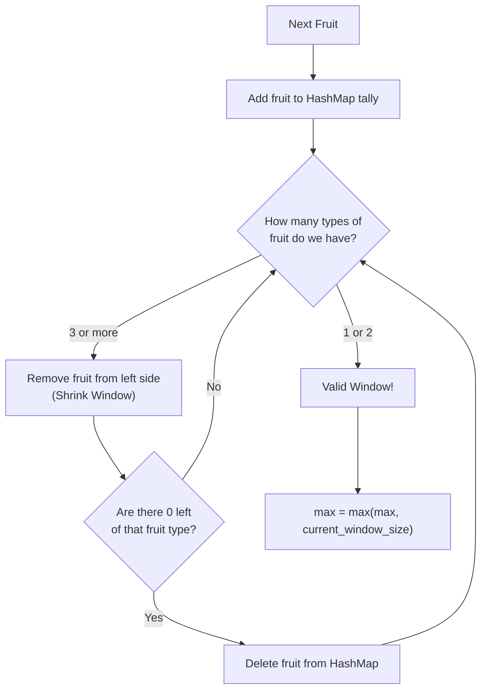

# 🚶‍♂️ Walkthrough: Fruits into Baskets

## 👶 Explain Like I'm 5
Imagine you are walking past a long row of fruit trees. You are carrying exactly **2 baskets**, and each basket can only hold **one type of fruit** (like only apples in Basket 1, and only oranges in Basket 2).

You want to pick as many fruits as possible by walking continuously down the row. 
If you walk past an Apple tree, and then an Orange tree, you put them in your baskets. But if you then walk to a Banana tree, you have a problem! You don't have a 3rd basket!
You have to stop, empty out the apples you picked earlier, and pretend you started walking *later* down the row so you only have Oranges and Bananas.
By keeping track of the most fruits you ever held at one time, you will find the maximum!

*(Psst: This problem is actually the exact same as "Longest Substring with K Distinct Characters", but $K$ is permanently locked to $2$!)*

## 🎯 Core Strategy
This uses a **Dynamic-Size Sliding Window** paired with a **HashMap** (or Frequency Counter) to track the types of fruits in our baskets.
1. Initialize `window_start = 0`, `max_fruits = 0`, and a `fruit_freq` hash map to count fruit occurrences.
2. Iterate `window_end` through the array, adding the right-most fruit to `fruit_freq`.
3. If the number of distinct fruit types (`len(fruit_freq)`) exceeds $2$ (our 2 baskets), the window is invalid. We enter a `while` loop to shrink from the left.
4. While shrinking, decrement the count of `fruits[window_start]`. If a fruit count hits `0`, completely delete it from the hash map so `len(fruit_freq)` accurately reflects the number of active fruit types.
5. Once the window is valid again, record its length with `max_fruits = max(max_fruits, window_end - window_start + 1)`.

## 🏃‍♂️ Step-by-Step Execution (Dry Run)
**Example Input**: `fruits = [3, 3, 3, 1, 2, 1, 1, 2, 3, 3, 4]` (Values represent fruit types)
Initialization: `start = 0`, `max_f = 0`, `freq = {}`

Let's skip ahead to where it gets interesting...
At `end = 3`, our window is `[3, 3, 3, 1]`. `freq` is `{3: 3, 1: 1}`. Valid (2 types)! `max_f = 4`.

| Step | `end` fruit | `freq` map | > 2 types? | Action (Update max_f, Shrink) |
|------|-------------|------------|------------|-------------------------------|
| 5 | `4` (val 2)| `{3:3, 1:1, 2:1}` | **Yes (3)** | *SHRINK LOOP*: Drop 3s from the left until they are gone.   - Drop `S0, S1, S2` (all 3s). `freq` = `{1:1, 2:1}`. `start = 3`. Valid! |
| 6 | - | - | - | After shrink: `max_f` = max(4, 2) = **4**. Window: `[1, 2]` |
| 7 | `5` (val 1)| `{1:2, 2:1}` | No (2) | `max_f` = max(4, 3) = **4**. Window: `[1, 2, 1]` |
| 8 | `6` (val 1)| `{1:3, 2:1}` | No (2) | `max_f` = max(4, 4) = **4**. Window: `[1, 2, 1, 1]` |
| 9 | `7` (val 2)| `{1:3, 2:2}` | No (2) | `max_f` = max(4, 5) = **5**. Window: `[1, 2, 1, 1, 2]` |
| 10 | `8` (val 3)| `{1:3, 2:2, 3:1}` | **Yes (3)** | *SHRINK LOOP*: Drop from left.   - Drop `S3`(1), `S4`(2), `S5`(1), `S6`(1). `freq` = `{2:1, 3:1}`. `start = 7`. Valid! |
| 11 | - | - | - | After shrink: `max_f` = max(5, 2) = **5**. Window: `[2, 3]` |

Result: The max fruits collected is `5` (from the subarray `[1, 2, 1, 1, 2]`).

## 📊 Visual Diagram
Here is a simplified flowchart of the logic:

## 🛑 Edge Cases & Complexity

### Complexity
- **Time Complexity:** $O(N)$. Even with the `while` loop, the right pointer adds each fruit exactly once, and the left pointer removes each fruit at most once. Hash map operations take $O(1)$. Thus, the time scales linearly with the array length.
- **Space Complexity:** $O(1)$. We store fruits in a Hash Map. Because we delete a fruit as soon as its count hits `0`, the map will only ever hold a maximum of $3$ items at any given time. This is strictly constant space.

### Edge Cases Handled Safely
- **Array has only 1 or 2 types of fruit:** The `while` loop never executes, and the window grows to encompass the entire array, returning the total number of fruits.
- **Empty Array:** The initial check `if not fruits: return 0` catches this immediately.
