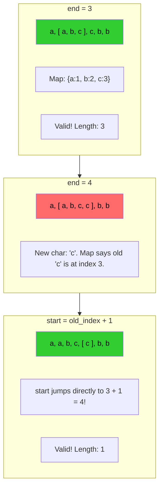

# 🚶‍♂️ Walkthrough: No-repeat Substring

## 👶 Explain Like I'm 5
Imagine you are collecting different types of stickers in a row. You want the longest strip of stickers possible, but you are absolutely **not allowed to have any duplicates**! 

As you slide your viewing frame to the right, you check if the new sticker entering the frame is one you already have inside. If it is, you can't just stop! You have to cut off the left side of your strip until that duplicate sticker is thrown away. 
Once the duplicate is gone from the left, your current strip only has unique stickers again, and you can keep sliding right!

## 🎯 Core Strategy
This is an optimized version of the **Dynamic-Size Sliding Window**.
Instead of using a `while` loop to slowly shrink `window_start` one step at a time until the duplicate is removed, we use a **Hash Map** (`char_index`) to remember the *exact index* where we last saw every character.

1. Initialize `window_start = 0`, `max_length = 0`, and `char_index = {}`.
2. Iterate `window_end` through the string.
3. If the current character `s[window_end]` is already in our map, AND its recorded index is $\ge$ `window_start` (meaning the duplicate is currently inside our window), we know exactly where the conflict is! 
4. We instantly **jump** `window_start` to `char_index[s[window_end]] + 1`. This safely cuts the old duplicate out of our window in one fast move.
5. Update the map with the new character's index: `char_index[s[window_end]] = window_end`.
6. Calculate the current valid window size and update `max_length`.

## 🏃‍♂️ Step-by-Step Execution (Dry Run)
**Example Input**: `s = "aabccbb"`
Initialization: `start = 0`, `max_len = 0`, `char_idx = {}`

| Step | `end` char | `char_idx` before | In map & $\ge$ start? | Action (Update start, Update map, Calc max) |
|------|------------|-------------------|-----------------------|---------------------------------------------|
| 1 | `0` ('a') | `{}` | No | `char_idx['a'] = 0`.   `max_len` = max(0, 1) = **1**. (`[a]`) |
| 2 | `1` ('a') | `{'a': 0}` | **Yes (0 $\ge$ 0)** | Jump `start` to `0 + 1 = 1`.   `char_idx['a'] = 1`.   `max_len` = max(1, 1) = **1**. (`[a]`) |
| 3 | `2` ('b') | `{'a': 1}` | No | `char_idx['b'] = 2`.   `max_len` = max(1, 2) = **2**. (`[ab]`) |
| 4 | `3` ('c') | `{'a': 1, 'b': 2}` | No | `char_idx['c'] = 3`.   `max_len` = max(2, 3) = **3**. (`[abc]`) |
| 5 | `4` ('c') | `{'a':1, 'b':2, 'c':3}` | **Yes (3 $\ge$ 1)** | Jump `start` to `3 + 1 = 4`.   `char_idx['c'] = 4`.   `max_len` = max(3, 1) = **3**. (`[c]`) |
| 6 | `5` ('b') | `{'a':1, 'b':2, 'c':4}` | No (2 is not $\ge$ 4)* | `char_idx['b'] = 5`.   `max_len` = max(3, 2) = **3**. (`[cb]`) |
| 7 | `6` ('b') | `{'a':1, 'b':5, 'c':4}` | **Yes (5 $\ge$ 4)** | Jump `start` to `5 + 1 = 6`.   `char_idx['b'] = 6`.   `max_len` = max(3, 1) = **3**. (`[b]`) |

*\*Notice at step 6: 'b' was in the map at index 2, but our window started at index 4. The old 'b' was already thrown away, so it doesn't count as a conflict!*

Result: The max length is `3` (from the substring `"abc"`).

## 📊 Visual Diagram
Here is how the "Jump" optimization works:

## 🛑 Edge Cases & Complexity

### Complexity
- **Time Complexity:** $O(N)$. Because we use the "Jump" optimization, both the right and left pointers traverse the string strictly once. Hash map insertions and lookups are $O(1)$.
- **Space Complexity:** $O(K)$, where $K$ is the number of distinct characters in the alphabet. For English letters, $K \le 26$, which is $O(1)$ constant space. In the worst case (all unique characters), it is bounded by the length of the string, so $O(\min(N, K))$.

### Edge Cases Handled Safely
- **All identical characters:** `s = "aaaaa"`. The `window_start` pointer jumps forward every single time `window_end` moves. The window size never exceeds 1. Returns `1`.
- **Empty String:** The loop never executes, safely returns `0`.
- **Old duplicates ignored:** If we see a duplicate that is *outside* our current window (i.e. `char_index[char] < window_start`), the `if` condition fails. This perfectly ensures we don't accidentally jump our `window_start` backward!
