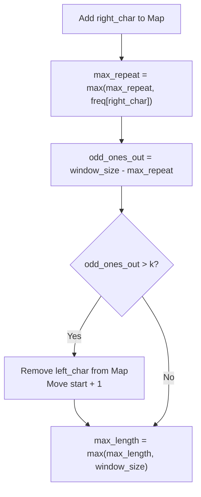

# 🚶‍♂️ Walkthrough: Longest Substring with Same Letters after Replacement

## 👶 Explain Like I'm 5
Imagine you have a string of colored beads. You want a really long segment where all the beads are the **exact same color**. You are allowed to magically repaint up to $K$ beads to any color you want. 

To get the longest segment, what should you do? You should look at a group of beads, figure out which color is the *most common*, and use your $K$ magic repaints on the "odd ones out".
If you look at 5 beads, and 3 are Red, you only need to repaint 2 beads to make them all Red! 

The rule is simple: 
**Total beads you are looking at** MINUS **Count of the most common bead** $\le$ **$K$**.
If this is true, your magic works! If it's bigger than $K$, you have too many "odd ones out" and you need to drop a bead from the left side.

## 🎯 Core Strategy
This uses a **Dynamic-Size Sliding Window** paired with a **HashMap** and a really clever mathematical optimization.
1. Initialize `window_start = 0`, `max_length = 0`, `max_repeat_letter_count = 0`, and a `char_freq` hash map.
2. Iterate `window_end` through the string, tallying the current character in `char_freq`.
3. Update `max_repeat_letter_count` to be the maximum of itself or the frequency of the newly added character. This keeps track of the "most common bead".
4. Check if the window is invalid: `(window_end - window_start + 1) - max_repeat_letter_count > k`.
5. If invalid, we shrink the window from the left by decrementing the count of `s[window_start]` and moving `window_start` forward.
6. *Brilliant Optimization:* We do **not** need to recalculate `max_repeat_letter_count` when we shrink! Why? Because we only care about finding a *longer* window than we already have. A longer window strictly requires a *larger* `max_repeat_letter_count`. So keeping the historical high watermark is completely safe and saves a ton of time!

## 🏃‍♂️ Step-by-Step Execution (Dry Run)
**Example Input**: `s = "aabccbb"`, `k = 2`
Initialization: `start = 0`, `max_len = 0`, `max_repeat = 0`, `freq = {}`

| Step | `end` char | `freq` map | `max_repeat` | Math: Size - max_repeat > 2? | Action (Update max_len, Shrink) |
|------|------------|------------|--------------|------------------------------|---------------------------------|
| 1 | `0` ('a') | `{'a': 1}` | `1` | 1 - 1 = 0 $\le$ 2 | `max_len` = 1. (`[a]`) |
| 2 | `1` ('a') | `{'a': 2}` | max(1, 2) = `2` | 2 - 2 = 0 $\le$ 2 | `max_len` = 2. (`[aa]`) |
| 3 | `2` ('b') | `{'a': 2, 'b': 1}`| max(2, 1) = `2` | 3 - 2 = 1 $\le$ 2 | `max_len` = 3. (`[aab]`) |
| 4 | `3` ('c') | `{'a':2, 'b':1, 'c':1}`| max(2, 1) = `2` | 4 - 2 = 2 $\le$ 2 | `max_len` = 4. (`[aabc]`) |
| 5 | `4` ('c') | `{'a':2, 'b':1, 'c':2}`| max(2, 2) = `2` | 5 - 2 = 3 > 2 (**YES**) | *SHRINK*: Drop `s[0]` ('a'). `freq` = `{'a':1...}`. `start = 1`. |
| 6 | - | - | `2` (Stays 2!) | Size is now 4. 4 - 2 = 2 $\le$ 2 | `max_len` = max(4, 4) = 4. Window: `[abcc]` |
| 7 | `5` ('b') | `{'a':1, 'b':2, 'c':2}`| max(2, 2) = `2` | 5 - 2 = 3 > 2 (**YES**) | *SHRINK*: Drop `s[1]` ('a'). `freq` = `{'a':0...}`. `start = 2`. |
| 8 | - | - | `2` | Size is now 4. 4 - 2 = 2 $\le$ 2 | `max_len` = 4. Window: `[bccb]` |
| 9 | `6` ('b') | `{'b':3, 'c':2}` | max(2, 3) = `3` | 5 - 3 = 2 $\le$ 2 | `max_len` = max(4, 5) = **5**. Window: `[bccbb]` |

Result: The max length is `5`.

## 📊 Visual Diagram
Here is the core logical flow of the window validation:

*Note that if `odd_ones_out > k`, we shrink exactly once because `window_size` decreases by 1, bringing `odd_ones_out` back down to `k`.*

## 🛑 Edge Cases & Complexity

### Complexity
- **Time Complexity:** $O(N)$. We iterate through the string exactly once. The `window_start` pointer only moves forward, and because we don't recalculate `max_repeat_letter_count` inside the shrink phase, the operations inside the loop are strictly $O(1)$.
- **Space Complexity:** $O(1)$. We store English letters in a Hash Map, which takes a maximum of 26 keys.

### Edge Cases Handled Safely
- **String length is smaller than K:** `s="abcd", k=4`. The math `window_size - max_repeat` will never exceed $K$, so the window will just expand to include the entire string, correctly returning $4$.
- **All identical characters:** `s="aaaaa", k=0`. `max_repeat` perfectly matches `window_size` at every step. Math results in $0$, which is $\le K$. Expands to include entire string.
