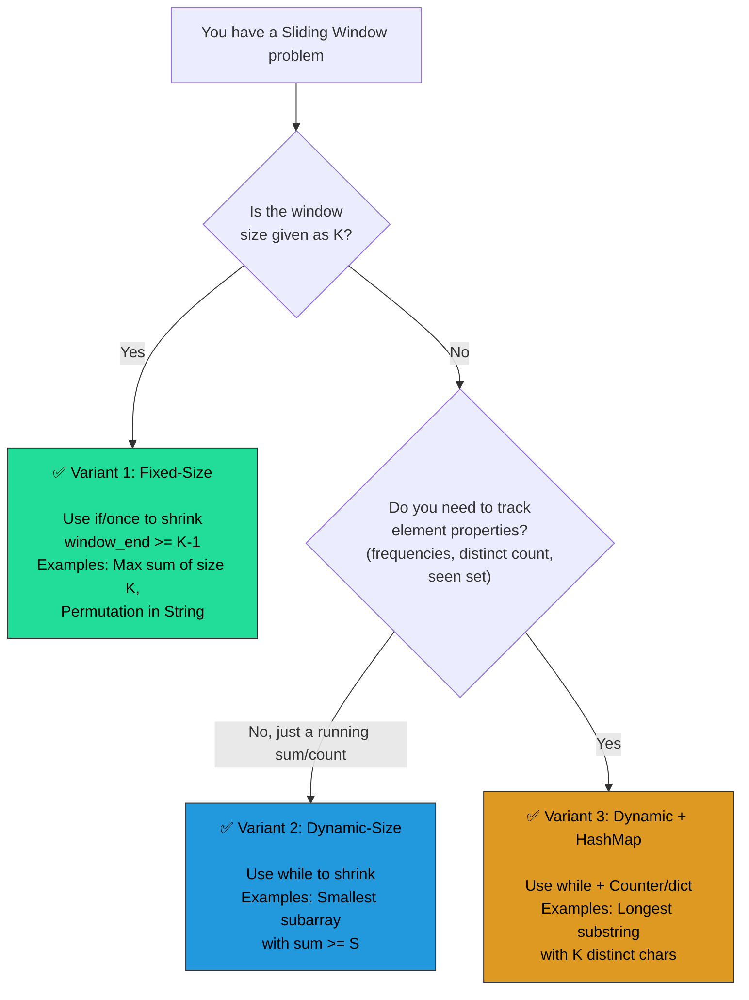
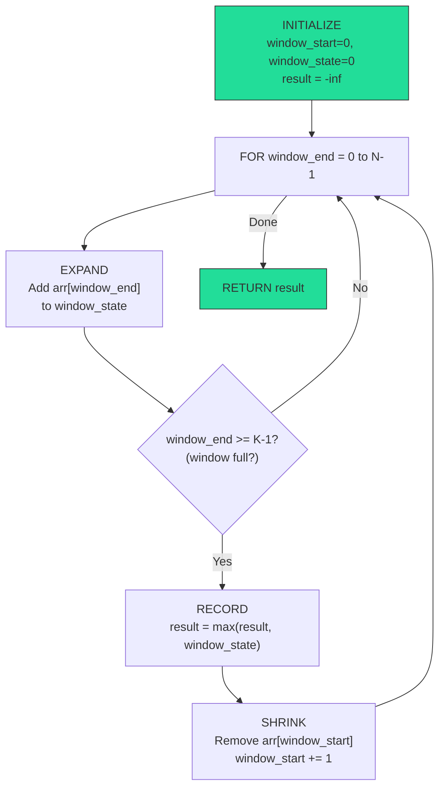
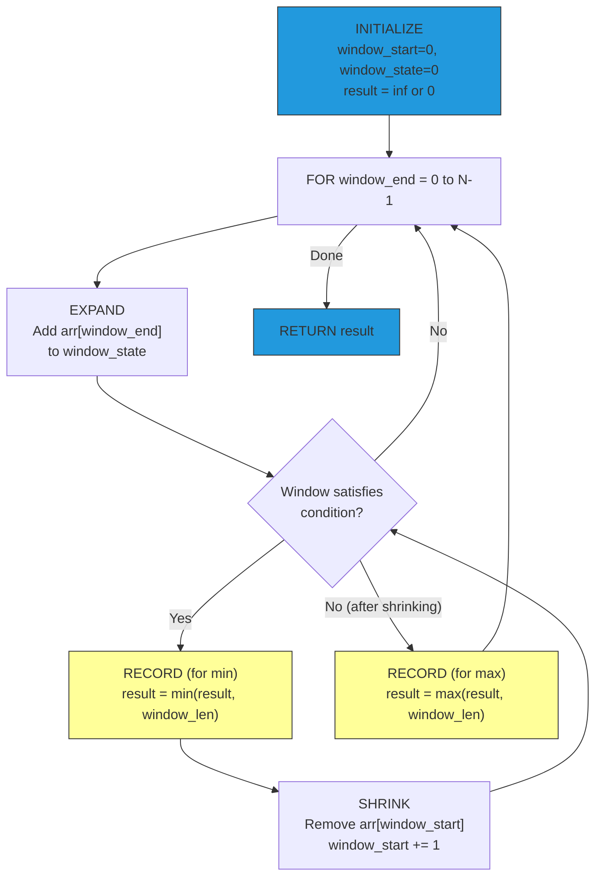
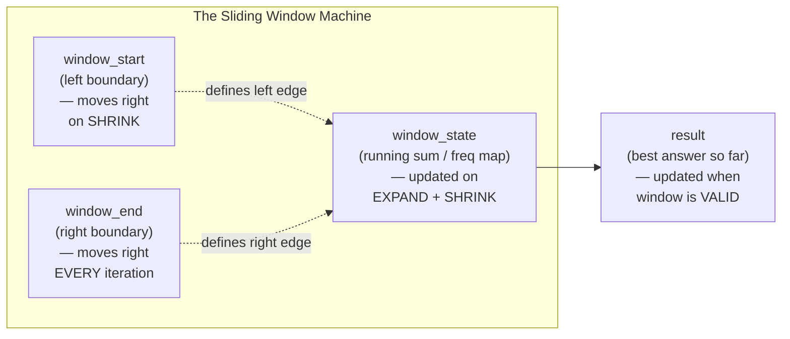
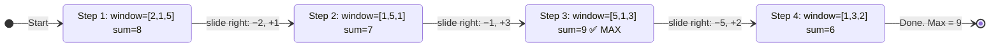
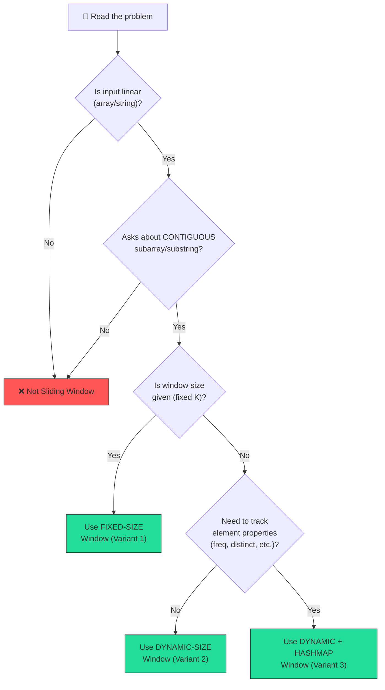
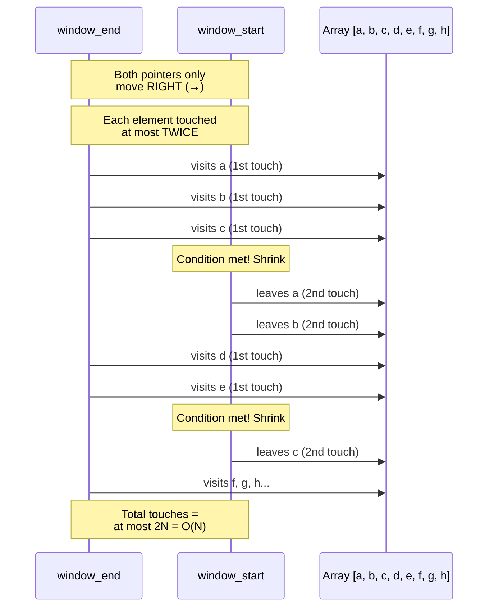
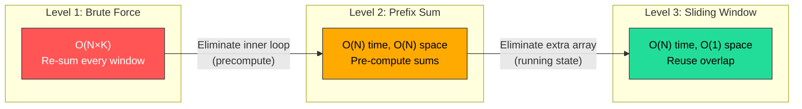
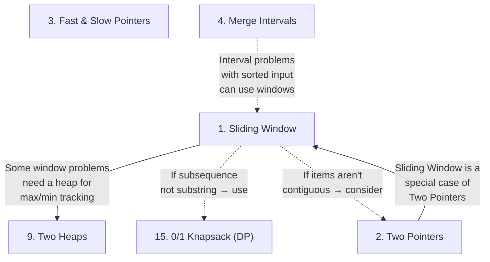

# Pattern 1: Sliding Window

## 🧒 The 5-Year-Old Explanation

### The Picture Frame (Fixed-Size Window)

Imagine you're standing in front of a really long train made of colourful LEGO blocks. You hold up a small picture frame — just big enough to see, say, 3 blocks at a time. That frame is your **window**.

Now you want to find *which group of 3 blocks has the most red ones*. Instead of picking up every possible group of 3, you just **slide** the frame one block to the right: the block on the left side disappears from view, and a new block on the right side appears.

🖼️ → 🟥🟦🟩 | 🟨🟥🟥 | ...

You never look at the whole train again. You just update what you see by **removing the old left block** and **adding the new right block**. That's it!

### The Stretchy Rubber Band (Dynamic-Size Window)

Now imagine a different game. You have a **rubber band** and you're wrapping it around LEGO blocks on the train. The rule: you need to find the **smallest group of blocks whose numbers add up to at least 10**.

You start by stretching the rubber band to the right, adding one block at a time: 2... then 2+3=5... then 2+3+6=11. Hey, that's ≥ 10! Now you **squeeze from the left** — can you remove a block and still have ≥ 10? Remove the 2: 3+6=9. Nope, too small. So the answer for this stretch was 3 blocks.

You keep going — stretch right, squeeze left — always looking for the smallest group that works.

🧷 → ⟨🟥🟦🟩⟩ squeeze! → ⟨🟦🟩🟨⟩ stretch! → ...

### The Stretchy Band + Tally Sheet (Dynamic + Hash Map)

Same rubber band game, but now the rule is about **variety**: find the longest stretch with at most 2 different colours. You keep a **tally sheet** (a hash map!) that counts how many of each colour are in your band. Whenever you have too many colours on the tally, squeeze from the left and cross off a mark.

**Why is this so clever?** Because instead of checking every possible group from scratch (which takes forever on a long train), you only do a tiny bit of work each time you slide — you fix what changed, not what stayed the same.

> **One sentence:** A sliding window is a frame (or rubber band) that moves across a sequence, keeping track of what’s inside so you don’t have to start over each time.

---

## 📦 Prerequisite Data Structures

Before you tackle Sliding Window problems, make sure you're comfortable with:

**You should be comfortable with:**
- **Arrays / Lists** — iterating with index, accessing `arr[i]`, slicing. You'll use these as the primary input in 90% of sliding window problems.
- **Strings** — treating them as character arrays, slicing `s[i:j]`, comparing characters.
- **Hash Maps (dictionaries)** — `O(1)` insert, lookup, delete. Used in the *dynamic window with auxiliary DS* variant to track character frequencies, distinct counts, etc.
- **Hash Sets** — `O(1)` membership check. Used to track "seen" elements (e.g., no-repeat substring).
- **Basic math** — running sums, min/max tracking.

> **Refs for brushing up:** keon/algorithms has clean array and hashmap implementations.
> jmportilla's "02-Array Sequences" notebooks cover array foundations.
> theja-m's "Data Structures - Arrays" and "Data Structures - Hashtables" folders have standalone implementations.

---

## 🔍 How to Spot This Pattern (Signal Detection)

**You should think of Sliding Window when you see:**

1. ✅ The input is a **linear, ordered data structure** — an array, string, or linked list.
2. ✅ You're asked to find something about **contiguous subarrays / substrings** — longest, shortest, max sum, min sum, or whether a contiguous block satisfies a condition.
3. ✅ There's a **brute force O(N²) or O(N³) solution** staring you in the face — nested loops iterating over all possible subarrays.
4. ✅ The problem mentions a **window size K**, or asks you to find an optimal **range [i, j]** within the array.
5. ✅ You see the words: "contiguous", "subarray", "substring", "consecutive".

**Common keywords in problem statements:**
- "maximum sum subarray of size K"
- "smallest subarray with sum ≥ S"
- "longest substring with at most K distinct characters"
- "find all anagrams"
- "permutation in a string"
- "minimum window substring"
- "contiguous", "consecutive", "subarray", "substring"

**Anti-signals (when NOT to use this pattern):**
- The problem asks about **subsequences** (not contiguous) → use Dynamic Programming or Two Pointers
- The elements don't need to be **adjacent/contiguous** → likely not Sliding Window
- The input is a **tree or graph** → use BFS/DFS patterns instead
- You need to **sort** the input first → likely Two Pointers or Merge Intervals
- The problem is about **pairs** at specific positions → likely Two Pointers

---

## 🧩 The Core Idea (Technical Explanation)

The sliding window technique maintains a **range `[window_start, window_end]`** over the input and moves it from left to right, processing each element at most twice (once when entering the window, once when leaving). This converts O(N²) brute-force approaches into O(N).

There are **three variants**, each building on the previous:

### Variant 1: Fixed-Size Window

The window size is **given** (e.g., "subarray of size K"). The window always contains exactly K elements.

**Algorithm:**
1. Start with `window_start = 0`.
2. Expand `window_end` from `0` to `N-1`, adding each element to the running computation.
3. Once the window has K elements (`window_end >= K - 1`):
   - Record/compare the current result.
   - **Slide**: subtract the element at `window_start`, then increment `window_start`.

### Variant 2: Dynamic-Size Window

The window size is **not given** — you grow or shrink it based on a condition (e.g., "smallest subarray with sum ≥ S").

**Algorithm:**
1. Start with `window_start = 0`.
2. Expand `window_end` to the right, adding elements.
3. When the window **satisfies** the condition:
   - Record/compare the result.
   - **Shrink** from the left: remove `arr[window_start]` and increment `window_start`.
   - Keep shrinking while the condition still holds (to find the minimum).

### Variant 3: Dynamic Window + Hash Map

Same as Variant 2, but you need **auxiliary data** to track what's in the window (e.g., character frequencies for "longest substring with K distinct characters").

**Algorithm:**
1. Use a `dict` / `Counter` to track frequencies of elements in the window.
2. Expand `window_end`, updating the hash map.
3. When the hash map indicates a condition violation (e.g., too many distinct chars):
   - Shrink from the left, updating the hash map.
4. At each valid state, record/compare the result.

### Variant Comparison: When to Use Which?



---

## 🔧 Algorithmic Anatomy (Variable-by-Variable Breakdown)

Before writing a single line of code, you need to understand the **exact building blocks** of a sliding window solution. Every sliding window problem requires these pieces — think of them as the parts of a machine. Miss one, and the machine breaks.

### 1. Essential Variables / Building Blocks

Every sliding window solution in Python 3.14 uses some combination of these variables:

| Variable | Python 3.14 Type | Role | Initial Value | Movement / Update Rule |
|----------|------------------|------|---------------|------------------------|
| `window_start` | `int` | **Left boundary** of the window. Defines where the window begins. Think of it as the "left edge of the picture frame." | `0` | Moves right (increments) when the window needs to **shrink** — either because it hit the target size (fixed) or because a condition is violated/satisfied (dynamic). **Never moves left.** |
| `window_end` | `int` (loop variable) | **Right boundary** of the window. Defines where the window ends. Think of it as the "right edge of the picture frame." | `0` (driven by `for window_end in range(len(arr))`) | Moves right **every single iteration** — one step at a time, no exceptions. This is what drives the loop. **Never moves left.** |
| `window_state` | `int` or `int \| float` | **The data about what's inside the window.** This is your running computation — the "thing you're tracking." Examples: running sum, product, count. | `0` for sums/counts, `-inf` for max tracking, `inf` for min tracking | Updated **twice per slide**: once when an element **enters** the window (expand: `+= arr[window_end]`), once when an element **leaves** (shrink: `-= arr[window_start]`). |
| `aux_state` | `Counter[str]`, `dict[str, int]`, or `set` | **Auxiliary tracking structure** (only for Variant 3). Tracks properties of the elements currently in the window — character frequencies, distinct element counts, seen elements, etc. | `Counter()` or `{}` or `set()` | Keys/elements **added** when `window_end` brings a new element in. Keys **removed** (or decremented + deleted if zero) when `window_start` pushes an element out. |
| `result` | `int \| float` | **Answer accumulator.** Stores the best answer found so far. | `-inf` for max problems, `inf` for min problems, `0` for count/length problems | Updated **only when the window is in a valid state** — via `max(result, ...)` or `min(result, ...)`. |

> **The "3 Variables" Rule:** At minimum, you ALWAYS need:
> 1. **Left boundary** (`window_start`)
> 2. **Right boundary** (`window_end`)
> 3. **Window state** (`window_sum`, `char_freq`, etc.)
>
> Everything else (result accumulator, auxiliary structures) is built on top of this core trio.

### 2. Step-by-Step Algorithmic Recipe (Pseudocode)

This is the recipe you'd write on a whiteboard before touching a keyboard. **No code — just logic.**

#### Recipe A: Fixed-Size Window (K is given)

```text
1. INITIALIZE:
   → window_start = 0
   → window_state = 0 (e.g., running sum)
   → result = -inf (or whatever the "worst" answer is)

2. FOR window_end = 0 to N-1:
   a. EXPAND: Add arr[window_end] to window_state.

   b. CHECK SIZE: Has the window reached size K?
      → Test: window_end >= K - 1
      → If NO: continue to next iteration (window still growing).
      → If YES: proceed to step c.

   c. RECORD: Compare window_state to result. Update result if better.

   d. SHRINK: Remove arr[window_start] from window_state.
      Increment window_start by 1.
      (This keeps the window at exactly size K for the next iteration.)

3. RETURN result.
```



#### Recipe B: Dynamic-Size Window (find optimal size)

```text
1. INITIALIZE:
   → window_start = 0
   → window_state = 0
   → result = inf (for "smallest") or 0 (for "longest")

2. FOR window_end = 0 to N-1:
   a. EXPAND: Add arr[window_end] to window_state.

   b. SHRINK LOOP: WHILE the window satisfies/violates the condition:
      → RECORD: Compare current window to result. Update if better.
      → Remove arr[window_start] from window_state.
      → Increment window_start.
      (Repeat the WHILE until condition no longer holds.)

   c. (For "longest" problems: RECORD here instead, AFTER the while loop,
       because you want the largest valid window.)

3. RETURN result.
```



> **Critical difference:** In "smallest" problems, you RECORD **inside** the while loop (before shrinking). In "longest" problems, you RECORD **outside** the while loop (after the window is valid). Getting this placement wrong is one of the most common bugs.

#### Recipe C: Dynamic Window + Hash Map

```text
1. INITIALIZE:
   → window_start = 0
   → aux_state = Counter() (or empty dict)
   → result = 0

2. FOR window_end = 0 to N-1:
   a. EXPAND: Add the element at window_end to aux_state.
      → aux_state[arr[window_end]] += 1

   b. SHRINK LOOP: WHILE aux_state indicates a condition violation:
      → Remove element at window_start from aux_state.
        → aux_state[arr[window_start]] -= 1
        → If count hits 0: DELETE the key entirely.
      → Increment window_start.

   c. RECORD: The window is now valid.
      → result = max(result, window_end - window_start + 1)

3. RETURN result.
```

### 3. Loop Invariants

These are the **rules that must ALWAYS be true** at every point during execution. If any invariant breaks, your solution has a bug.

| Invariant | What it means | What breaks if violated |
|-----------|--------------|------------------------|
| `window_start <= window_end` | The left boundary never passes the right boundary. | You'd have a "negative size" window — reading garbage indices. |
| `window_state` reflects exactly the elements in `arr[window_start : window_end + 1]` | Your running sum/count/frequency map is always in sync with the actual window contents. | If you forget to subtract on shrink or add on expand, your state is stale — wrong results. |
| `window_start` and `window_end` **only move right, never left** | Both pointers are monotonically non-decreasing. This is what guarantees O(N) time. | If a pointer moves left, you re-visit elements → could become O(N²). |
| For HashMap variant: `len(aux_state)` equals the number of **distinct elements currently in the window** | No phantom keys with frequency 0. | `len()` would overcount distinct elements → shrink logic triggers incorrectly or doesn't trigger at all. |
| `result` is **only updated when the window is in a valid state** | You never record an answer from an invalid/incomplete window. | Off-by-one errors, recording partial windows before they're ready. |

### 4. Per-Variant DOs and DON'Ts

| Variant | ✅ DO | ❌ DON'T |
|---------|-------|----------|
| **Fixed-Size** | Check `window_end >= k - 1` before recording — this ensures the window is full. | Don't record results while the window is still growing (first K-1 iterations). |
| **Fixed-Size** | Subtract `arr[window_start]` BEFORE incrementing `window_start`. | Don't increment `window_start` first — you'd skip the element that needs removing. |
| **Fixed-Size** | Use `if` (not `while`) for the shrink — you only shrink once per expansion since the window stays at exactly K. | Don't use `while` for fixed-size — there's no condition to loop on; size is always K. |
| **Dynamic-Size** | Use `while` (not `if`) for the shrink loop — you may need to shrink multiple times. | Don't use `if` — it only shrinks once and might leave the window in an invalid state. |
| **Dynamic-Size** | Think carefully about WHERE you record the result: inside vs. outside the while loop. | Don't assume it's always inside or always outside — it depends on whether you want min or max. |
| **Dynamic + HashMap** | Always `del aux_state[key]` when frequency drops to `0`. | Don't leave zero-frequency keys — they corrupt `len()` and all distinct-count logic. |
| **Dynamic + HashMap** | Use `collections.Counter` (Python 3.14) for cleaner syntax over raw `dict`. | Don't use `defaultdict(int)` if you need `len()` to track distinct count — it auto-creates keys on access, polluting your count. |
| **All Variants** | Initialize `result` with `-inf` (for max) or `inf` (for min) using `from math import inf`. | Don't initialize `result = 0` — it fails when all values are negative (max) or when no valid window exists (min). |
| **All Variants** | Compute window length as `window_end - window_start + 1` (inclusive range). | Don't use `window_end - window_start` — that's off by one and gives length minus one. |



---

## 📊 Visual Walkthrough

### Example: Maximum Sum Subarray of Size K = 3

**Input:** `[2, 1, 5, 1, 3, 2]`, K = 3



**Trace table:**

| Step | window_start | window_end | Window | Sum | Operation | max_sum |
|------|-------------|-----------|--------|-----|-----------|---------|
| 1 | 0 | 2 | [2,1,5] | 8 | Initial window filled | 8 |
| 2 | 1 | 3 | [1,5,1] | 8−2+1=7 | Slide: remove 2, add 1 | 8 |
| 3 | 2 | 4 | [5,1,3] | 7−1+3=9 | Slide: remove 1, add 3 | **9** |
| 4 | 3 | 5 | [1,3,2] | 9−5+2=6 | Slide: remove 5, add 2 | 9 |

### Sliding Window Algorithm Decision Flowchart



### Example: Smallest Subarray with Sum ≥ 7 (Dynamic Window)

**Input:** `[2, 1, 5, 2, 3, 2]`, target = 7

```mermaid
stateDiagram-v2
    direction LR

    state "Expand: [2] sum=2" as D1
    state "Expand: [2,1] sum=3" as D2
    state "Expand: [2,1,5] sum=8 ≥ 7" as D3
    state "Record len=3, Shrink: [1,5] sum=6" as D4
    state "Expand: [1,5,2] sum=8 ≥ 7" as D5
    state "Record len=3, Shrink: [5,2] sum=7 ≥ 7" as D6
    state "Record len=2 ✅, Shrink: [2] sum=2" as D7
    state "Expand: [2,3] sum=5" as D8
    state "Expand: [2,3,2] sum=7 ≥ 7" as D9
    state "Record len=3, Shrink: [3,2] sum=5" as D10

    [*] --> D1 : Start
    D1 --> D2 : stretch right
    D2 --> D3 : stretch right
    D3 --> D4 : sum≥7! squeeze left
    D4 --> D5 : stretch right
    D5 --> D6 : sum≥7! squeeze left
    D6 --> D7 : still ≥7! squeeze again
    D7 --> D8 : stretch right
    D8 --> D9 : stretch right
    D9 --> D10 : sum≥7! squeeze left
    D10 --> [*] : Done. Min len = 2
```



**Trace table:**

| Step | window_start | window_end | Window | Sum | Action | min_length |
|------|-------------|-----------|--------|-----|--------|-----------|
| 1 | 0 | 0 | [2] | 2 | Expand | ∞ |
| 2 | 0 | 1 | [2,1] | 3 | Expand | ∞ |
| 3 | 0 | 2 | [2,1,5] | 8 | Record (3), Shrink | 3 |
| 4 | 1 | 2 | [1,5] | 6 | Expand | 3 |
| 5 | 1 | 3 | [1,5,2] | 8 | Record (3), Shrink | 3 |
| 6 | 2 | 3 | [5,2] | 7 | Record (2), Shrink | **2** |
| 7 | 3 | 3 | [2] | 2 | Expand | 2 |
| 8 | 3 | 4 | [2,3] | 5 | Expand | 2 |
| 9 | 3 | 5 | [2,3,2] | 7 | Record (3), Shrink | 2 |
| 10 | 4 | 5 | [3,2] | 5 | Done | **2** |

> **Notice the key difference from fixed-size:** `window_start` can jump multiple times per iteration of `window_end` (Steps 5→6→7). That's why dynamic-size uses `while`, not `if`.

---

## ⏱️ Complexity Analysis

| Aspect | Complexity | Why |
|--------|-----------|-----|
| **Time** | **O(N)** | Each element is visited at most **twice** — once when `window_end` moves right to include it, and at most once when `window_start` moves right to exclude it. Two passes over N = O(2N) = O(N). |
| **Space** | **O(1)** for fixed-size / dynamic-size without hash | Only a few variables: `window_start`, `window_sum`, `max_sum`, etc. |
| **Space** | **O(K)** for dynamic + hash map variant | The hash map stores at most K distinct elements (where K is the constraint, e.g., distinct characters). In the worst case (all unique chars), this is O(N). |



---

## 🏗️ Template / Boilerplate Code

### Template 1: Fixed-Size Window (size K)

```python
from math import inf


def fixed_window(arr: list[int], k: int) -> int | float:
    """Find [max sum / some property] of a contiguous subarray of size K."""
    window_sum: int = 0
    max_sum: int | float = -inf
    window_start: int = 0

    for window_end in range(len(arr)):
        window_sum += arr[window_end]              # expand: add the right element

        # window has hit size K — time to record and slide
        if window_end >= k - 1:
            max_sum = max(max_sum, window_sum)      # record the result
            window_sum -= arr[window_start]          # shrink: remove the left element
            window_start += 1                        # slide the window forward

    return max_sum
```

### Template 2: Dynamic-Size Window (shrink when condition met)

```python
from math import inf


def dynamic_window(arr: list[int], target: int) -> int:
    """Find smallest subarray with sum ≥ target."""
    window_sum: int = 0
    min_length: int | float = inf
    window_start: int = 0

    for window_end in range(len(arr)):
        window_sum += arr[window_end]              # expand: add the right element

        # shrink from the left while condition is satisfied
        while window_sum >= target:
            min_length = min(min_length, window_end - window_start + 1)
            window_sum -= arr[window_start]         # remove the left element
            window_start += 1                        # slide the start forward

    return min_length if min_length != inf else 0
```

### Template 3: Dynamic Window + Hash Map

```python
from collections import Counter


def dynamic_window_hashmap(s: str, k: int) -> int:
    """Find longest substring with at most K distinct characters."""
    char_freq: Counter[str] = Counter()             # track character frequencies
    max_length: int = 0
    window_start: int = 0

    for window_end in range(len(s)):
        char_freq[s[window_end]] += 1                # expand: count the right char

        # shrink from left until we have at most K distinct characters
        while len(char_freq) > k:
            left_char: str = s[window_start]
            char_freq[left_char] -= 1
            if char_freq[left_char] == 0:
                del char_freq[left_char]             # clean up zero-frequency entries
            window_start += 1

        # window is valid — record the result
        max_length = max(max_length, window_end - window_start + 1)

    return max_length
```

---

## 🔄 Brute Force → Optimal Evolution

Let's use **"Maximum Sum Subarray of Size K"** as the running example to show WHY sliding window exists.

### Level 1: Brute Force

- **Approach:** For every possible starting index `i`, compute the sum of K elements starting at `i` using an inner loop.
- **Time:** O(N × K) — N starting positions, each summing K elements.
- **Space:** O(1)
- **Why it's slow:** You're re-computing the sum from scratch for every position. The overlap between adjacent windows is wasted — you're adding K-1 of the same elements over and over.

```python
from math import inf


# BRUTE FORCE — O(N*K)
def max_sum_brute(arr: list[int], k: int) -> int | float:
    max_sum: int | float = -inf
    for i in range(len(arr) - k + 1):       # N - K + 1 starting positions
        window_sum: int = sum(arr[i:i + k])  # sum K elements each time 🐌
        max_sum = max(max_sum, window_sum)
    return max_sum
```

### Level 2: Prefix Sum (Better but not optimal for this use case)

- **Approach:** Precompute a prefix sum array. Sum of any subarray `[i, j]` = `prefix[j+1] - prefix[i]` in O(1).
- **Time:** O(N) for building prefix + O(N) for querying = **O(N)**
- **Space:** O(N) — the prefix sum array is extra space.
- **What improved:** Eliminated the inner loop. But we use extra O(N) memory.

```python
from math import inf


# PREFIX SUM — O(N) time, O(N) space
def max_sum_prefix(arr: list[int], k: int) -> int | float:
    prefix: list[int] = [0] * (len(arr) + 1)
    for i in range(len(arr)):
        prefix[i + 1] = prefix[i] + arr[i]

    max_sum: int | float = -inf
    for i in range(len(arr) - k + 1):
        window_sum: int = prefix[i + k] - prefix[i]  # O(1) per window
        max_sum = max(max_sum, window_sum)
    return max_sum
```

### Level 3: Sliding Window (Optimal) ✅

- **Approach:** Maintain a running sum. When you slide right, subtract the leftmost element and add the new rightmost element.
- **Time:** **O(N)** — single pass.
- **Space:** **O(1)** — only a few variables.
- **The key insight that makes it optimal:** Adjacent windows share K-1 elements. Instead of re-summing all K elements, you only process the **one element that entered** and the **one element that left**. That's O(1) work per slide.

```python
from math import inf


# SLIDING WINDOW — O(N) time, O(1) space ✅
def max_sum_sliding(arr: list[int], k: int) -> int | float:
    window_sum: int = 0
    max_sum: int | float = -inf
    window_start: int = 0

    for window_end in range(len(arr)):
        window_sum += arr[window_end]

        if window_end >= k - 1:
            max_sum = max(max_sum, window_sum)
            window_sum -= arr[window_start]
            window_start += 1

    return max_sum
```

**Evolution summary:**

| Level | Approach | Time | Space | Key Change |
|-------|---------|------|-------|-----------|
| 1 | Brute Force (nested loops) | O(N×K) | O(1) | Baseline — re-sums everything |
| 2 | Prefix Sum | O(N) | O(N) | Eliminated re-summing, but uses extra memory |
| 3 | **Sliding Window** | **O(N)** | **O(1)** | **Reuses overlap** — O(1) update per slide |



---

## 🚀 Advanced Paradigms (Beyond the Basics)

While standard sliding window variants rely on simple variables or hashmaps to track state, advanced problems introduce data structures or mathematical tricks to handle constraints that break the basic templates.

### 1. The Monotonic Deque Window
When you need to track the **maximum or minimum** element inside a sliding window in `O(1)` time, a simple variable or hashmap fails because when the `window_start` moves past the maximum, you don't know what the *second* largest element is.
- **Solution**: Use a Monotonic Deque (Double-ended queue). We keep the deque sorted (e.g., strictly decreasing for a max-window). When a new element arrives, we pop smaller elements from the back because they can never be the maximum anymore. When shrinking the window, we pop from the front if the front element falls out of the window.

### 2. The "At Most K" Trick for Exact Matches
Finding subarrays with *exactly* K distinct elements (or sum exactly K) is often difficult with a single dynamic window because you don't know when to shrink.
- **Solution**: Mathematically, `Exact(K) = AtMost(K) - AtMost(K-1)`. We can write a helper function `at_most_k()` using standard Variant 2 logic, and call it twice.

### 3. Handling Negative Numbers
Standard dynamic windows **fail completely** if the array contains negative numbers. Why? Because expanding the window (adding negative numbers) can *decrease* the sum, and shrinking the window can *increase* the sum. The monotonic property of the window is destroyed.
- **Solution**: We combine **Prefix Sums** with a **Monotonic Deque**. We calculate prefix sums, and then use the deque to keep track of the lowest prefix sums we've seen, allowing us to find valid `window_start` points even when the sum fluctuates.

### 4. Counting Valid Substrings
Instead of finding the max/min length, some problems ask "how many valid substrings exist?"
- **Solution**: If a window `[L, R]` satisfies the condition (e.g., contains all 3 characters 'a', 'b', 'c'), then extending the window to the right `[L, R+1], [L, R+2]...` also satisfies it. So, when a valid window is found, we add `len(s) - window_end` to our total count, and then shrink `L`.

---

## ✅ Problems in This Pattern

> **Difficulty labels follow Grokking's classification.** LeetCode reference links are for problem statements and submission only. Where LC labels differ, the discrepancy is noted.

| # | Problem | Difficulty (Grokking) | Reference Link | Key Twist |
|---|---------|----------------------|----------------|-----------|
| 1 | Maximum Sum Subarray of Size K | Easy | [GFG](https://www.geeksforgeeks.org/find-maximum-minimum-sum-subarray-size-k/) | Fixed window, running sum |
| 2 | Smallest Subarray with Sum ≥ S | Easy | [LC 209](https://leetcode.com/problems/minimum-size-subarray-sum/) · LC labels Medium | Dynamic window, shrink when sum met |
| 3 | Longest Substring with K Distinct Characters | Medium | [LC 340](https://leetcode.com/problems/longest-substring-with-at-most-k-distinct-characters/) | Dynamic + hashmap, track distinct count |
| 4 | Fruits into Baskets | Medium | [LC 904](https://leetcode.com/problems/fruit-into-baskets/) | Same as #3 with K=2 (disguised problem) |
| 5 | No-repeat Substring | Hard | [LC 3](https://leetcode.com/problems/longest-substring-without-repeating-characters/) · LC labels Medium | Dynamic + hashset/hashmap, all unique |
| 6 | Longest Substring with Same Letters after Replacement | Hard | [LC 424](https://leetcode.com/problems/longest-repeating-character-replacement/) · LC labels Medium | Track max frequency char, window size − max_freq ≤ K |
| 7 | Longest Subarray with Ones after Replacement | Hard | [LC 1004](https://leetcode.com/problems/max-consecutive-ones-iii/) · LC labels Medium | Same idea as #6 but with binary array |
| 8 | Permutation in a String | Hard | [LC 567](https://leetcode.com/problems/permutation-in-string/) · LC labels Medium | Fixed window = len(pattern), match frequency maps |
| 9 | String Anagrams | Hard | [LC 438](https://leetcode.com/problems/find-all-anagrams-in-a-string/) · LC labels Medium | Same as #8 but collect ALL starting indices |
| 10 | Smallest Window containing Substring | Hard | [LC 76](https://leetcode.com/problems/minimum-window-substring/) | Dynamic + hashmap, shrink to find minimum |
| 11 | Words Concatenation | Hard | [LC 30](https://leetcode.com/problems/substring-with-concatenation-of-all-words/) | Fixed window of total word length, word-level sliding |
| 12 | Sliding Window Maximum | Hard | [LC 239](https://leetcode.com/problems/sliding-window-maximum/) | Advanced: Monotonic Deque for O(1) max tracking |
| 13 | Subarrays with K Different Integers | Hard | [LC 992](https://leetcode.com/problems/subarrays-with-k-different-integers/) | Advanced: Exact K = AtMost(K) - AtMost(K-1) |
| 14 | Shortest Subarray with Sum at Least K | Hard | [LC 862](https://leetcode.com/problems/shortest-subarray-with-sum-at-least-k/) | Advanced: Prefix Sums + Monotonic Deque (Negatives) |
| 15 | Count Substrings with All Three Chars | Medium | [LC 1358](https://leetcode.com/problems/number-of-substrings-containing-all-three-characters/) | Advanced: Math trick to count extensions |

---

## 🔗 Pattern Connections



**Key relationships:**
- **Sliding Window IS a special case of Two Pointers.** Both `window_start` and `window_end` are two pointers moving in the same direction. The difference: in Sliding Window, the pointers define a *contiguous range* with a *specific meaning* (the "window"), and you maintain state about the window contents.
- **Two Heaps** can augment a sliding window when you need the median or other order statistics within the window (e.g., Sliding Window Median).
- **Dynamic Programming** is the fallback when the problem looks like Sliding Window but asks about *subsequences* (non-contiguous) instead of subarrays.

---

## ⚠️ Common Mistakes & Pitfalls

> **Note:** Mechanical mistakes (off-by-one, `del` on zero-frequency keys, `if` vs. `while`, wrong initialization) are covered in the **Per-Variant DOs and DON'Ts** table in the Algorithmic Anatomy section above. This section focuses on **conceptual and strategic** mistakes.

1. **Mistake:** Forgetting to pair expansion with a shrink condition.
   **Fix:** Every time you add code to expand the window, immediately ask: "Under what condition do I move `window_start`?" If you can't answer, your window will grow forever.

2. **Mistake:** Applying Sliding Window to problems that ask about *subsequences*.
   **Fix:** Sliding Window ONLY works on **contiguous** subarrays/substrings. The word "subsequence" means elements can be non-adjacent → use DP or backtracking instead.

3. **Mistake:** Not recognizing a **disguised** sliding window problem.
   **Fix:** "Fruits into Baskets" is really "longest substring with at most 2 distinct characters." "Max Consecutive Ones III" is really "longest subarray with at most K zeros." Strip the story; find the window.

4. **Mistake:** Confusing **when to record inside vs. outside** the shrink loop.
   **Fix:** If you want the **smallest** valid window → record **inside** the while (before each shrink). If you want the **longest** valid window → record **outside** the while (after shrinking to validity). See Recipe B in Algorithmic Anatomy.

5. **Mistake:** Assuming the brute force is always O(N²) so sliding window will always help.
   **Fix:** Some problems have brute force that is already O(N) but with bad constants, or the "window state" itself costs O(K) to update (e.g., finding median in window → needs a heap). Sliding window doesn't magically fix everything — it specifically exploits **overlap between adjacent windows**.

---

## 🎤 Interview Communication Guide

**Opening statement template:**
> "This problem asks me to find [optimal subarray/substring property] in a contiguous range, which is a classic signal for the **Sliding Window** pattern. I'll maintain a window `[start, end]` and slide it across the input in a single pass."

**Key phrases to use:**
- "Let me start with the brute force: I'd check every subarray, which is O(N²). But adjacent subarrays share most of their elements, so I can **reuse the overlap**."
- "I'll use a **fixed-size window** / **dynamic window** because [the window size is given] / [I need to find the optimal size]."
- "As I expand the window to the right, I [add the new element to my running sum / update my hash map]."
- "When [the window hits size K / the condition is violated], I shrink from the left."
- "Let me trace through a small example to verify..."

**What the interviewer wants to hear:**
- ✅ You identified the **contiguous** nature of the problem (not subsequence).
- ✅ You explained WHY brute force is slow and how the window **reuses work**.
- ✅ You chose the right **variant** (fixed vs. dynamic vs. dynamic+hashmap).
- ✅ You handled **edge cases**: empty input, K > array length, all same elements.
- ✅ You correctly stated **O(N) time, O(1) or O(K) space** and justified it.

---

## 🧪 Self-Test Questions

Answer these WITHOUT looking at the material above:

1. **What's the key insight that makes Sliding Window faster than brute force?**

2. **When should you use a fixed-size window vs. a dynamic-size window?**

3. **What's the time complexity of Sliding Window, and WHY is each element visited at most twice?**

4. **You see a problem: "Find the longest subsequence with sum ≤ K." Should you use Sliding Window? Why or why not?**

5. **In the hash map variant, why is it critical to delete keys from the hash map when their frequency drops to 0?**

6. **Name the 3 essential variables every sliding window solution needs, and state one loop invariant that connects them.**

7. **You're solving "smallest subarray with sum ≥ S". Should you record the result INSIDE or OUTSIDE the while loop? What about "longest substring with at most K distinct chars"?**

<details>
<summary>Answers</summary>

1. **Adjacent windows overlap.** Instead of recalculating everything from scratch, you only process the one element that entered and the one that left — O(1) work per slide instead of O(K).

2. **Fixed-size** when the problem gives you K (the window size). **Dynamic-size** when you need to find the optimal window size (smallest subarray with sum ≥ S, longest substring with property X, etc.).

3. **O(N).** `window_end` visits each element exactly once (moving right). `window_start` also visits each element at most once (it can only move right, never backward). So total operations = at most 2N = O(N).

4. **No.** The keyword is "subsequence" — elements don't need to be contiguous. Sliding Window only works on **contiguous subarrays/substrings**. You'd need Dynamic Programming here.

5. Because `len(char_freq)` is used to count **distinct characters** in the window. If you leave a key with frequency 0, `len()` will count it as a distinct character even though it's no longer in the window, causing your condition check to be wrong.

6. **(a) `window_start`** (left boundary), **(b) `window_end`** (right boundary), **(c) `window_state`** (running sum, frequency map, etc.). **Invariant:** `window_state` must always reflect exactly the elements in `arr[window_start : window_end + 1]` — if you forget to subtract on shrink or add on expand, the state goes stale.

7. **"Smallest subarray"** → record **INSIDE** the while loop (before shrinking), because you want to capture the current valid window before making it smaller. **"Longest substring"** → record **OUTSIDE** the while loop (after shrinking to validity), because you want the biggest window that passes the condition check.

</details>
