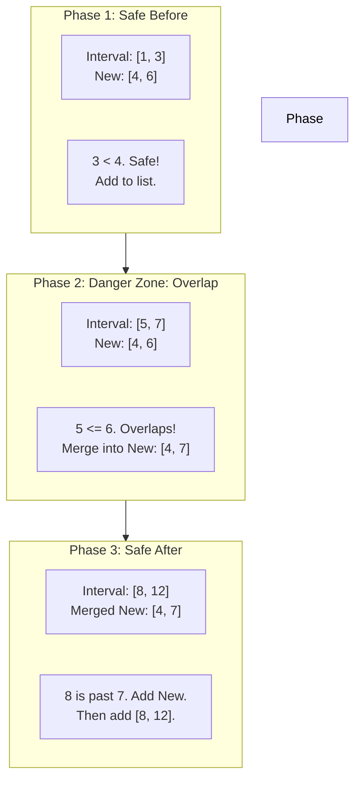

# 🚶‍♂️ Walkthrough: Insert Interval

## 👶 Explain Like I'm 5
Imagine you already have a perfectly sorted, clean list of meeting times where none of them overlap. 
Suddenly, your boss tells you to schedule a brand new meeting right in the middle of the day. This new meeting might overlap with one existing meeting, or maybe five of them! 

Since the list is already sorted, we don't need to dump everything out and sort it again. We can just walk through the list and do three things:
1. Walk past all the meetings that end *before* the new meeting starts. (They are safe).
2. For all the meetings that overlap with the new meeting, swallow them up into one giant meeting! (Merge them).
3. Walk past all the remaining meetings that start *after* the giant new meeting ends. (They are also safe).

## 🎯 Core Strategy
Because the input list is already sorted by start times and has no overlaps, we can solve this in a single pass ($O(N)$ time) without needing to sort again!

1. Initialize a `merged` list and a counter `i = 0`.
2. **Phase 1: Skip Non-Overlapping (Before)**
   - While the current interval ends BEFORE the `new_interval` starts (`intervals[i].end < new_interval.start`), just add it to `merged` and increment `i`.
3. **Phase 2: Merge Overlapping**
   - While the current interval overlaps with the `new_interval` (`intervals[i].start <= new_interval.end`):
     - Update `new_interval.start = min(intervals[i].start, new_interval.start)`.
     - Update `new_interval.end = max(intervals[i].end, new_interval.end)`.
     - Increment `i`.
   - After this loop finishes, the `new_interval` has successfully swallowed all overlapping intervals. Add it to `merged`.
4. **Phase 3: Skip Non-Overlapping (After)**
   - While `i < len(intervals)`, just add the remaining intervals to `merged`.
5. Return the `merged` list.

## 🏃‍♂️ Step-by-Step Execution (Dry Run)
**Example Input**: `intervals = [[1, 3], [5, 7], [8, 12]]`, `new_interval = [4, 6]`
Initialization: `merged = []`, `i = 0`

| Phase | Interval `i` | Logic | Action | `merged` List State |
|-------|--------------|-------|--------|---------------------|
| 1. Skip Before | `[1, 3]` | `3 < 4`? Yes. | Add `[1, 3]`. `i` becomes 1. | `[[1, 3]]` |
| 1. Skip Before | `[5, 7]` | `7 < 4`? No. | Phase 1 ends. | `[[1, 3]]` |
| 2. Merge | `[5, 7]` | `5 <= 6`? Yes. | `new_interval` becomes `[min(5,4), max(7,6)]` = `[4, 7]`. `i` becomes 2. | `[[1, 3]]` |
| 2. Merge | `[8, 12]` | `8 <= 7`? No. | Phase 2 ends. Add `new_interval` `[4, 7]`. | `[[1, 3], [4, 7]]` |
| 3. Skip After | `[8, 12]` | `i < 3`? Yes. | Add `[8, 12]`. `i` becomes 3. | `[[1, 3], [4, 7], [8, 12]]` |

Result: `[[1, 3], [4, 7], [8, 12]]`

## 📊 Visual Diagram
Here is how the 3-Phase single pass works:

## 🛑 Edge Cases & Complexity

### Complexity
- **Time Complexity:** $O(N)$. We iterate through the array of intervals exactly once. We do not need to sort the array, which saves us from the $O(N \log N)$ cost of the standard "Merge Intervals" problem.
- **Space Complexity:** $O(N)$. We create a new `merged` list that will contain up to $N + 1$ intervals.

### Edge Cases Handled Safely
- **New interval is at the very beginning:** The "Skip Before" loop will instantly fail. The "Merge" loop will merge if needed. The "Skip After" loop will copy the rest of the array.
- **New interval is at the very end:** The "Skip Before" loop will run through almost the entire array. The "Merge" and "Skip After" loops will barely do anything.
- **New interval swallows everything:** The "Merge" loop will just aggressively expand the `new_interval.start` and `new_interval.end` while chewing through the entire array. The result will be a single giant interval!
