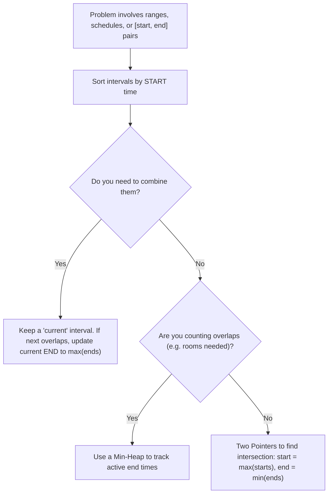
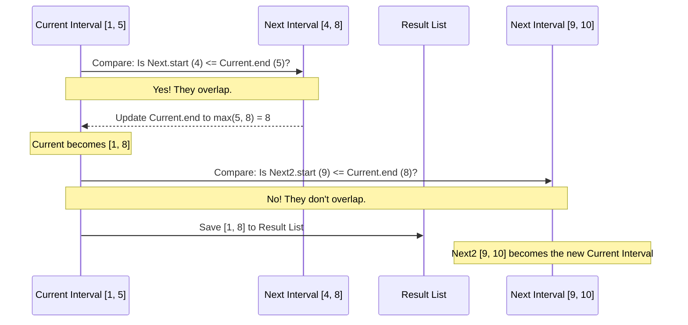

# Pattern 05: Merge Intervals

## 👶 Explain Like I'm 5
Imagine you are drawing lines on a piece of paper. Each line has a starting dot 
and an ending dot. 
If you draw a red line from 1 to 5, and then a blue line from 4 to 8, the two lines 
will overlap between 4 and 5! If someone asked you, "What part of the paper has 
ANY line drawn on it?", you wouldn't say "1 to 5 AND 4 to 8". You would just say 
"1 to 8"!
This pattern is all about taking a bunch of scheduled times (like meetings) or 
drawn lines (intervals) and figuring out how they overlap, merge together, or 
conflict with each other. 
The magic trick to make this easy? **Always sort the lines by their starting dot first!**

---

## 🧩 Core Idea & Pattern Detection

The **Merge Intervals** pattern describes an efficient technique to deal with overlapping intervals. In most problems involving intervals, you either need to find overlapping intervals, merge them if they overlap, or determine if a new interval overlaps with existing ones.

### When to use it:
- The problem involves **intervals**, **ranges**, **meeting times**, or **schedules**.
- You need to detect overlaps, merge overlapping regions, or count intersections.
- The terms "mutually exclusive" or "overlapping" are used.

---

## 🔧 Algorithmic Anatomy

### Recipe: Standard Merge
1. **Sort** the intervals based on their **start** times.
2. Initialize an empty list of merged intervals.
3. Push the first interval into the merged list to act as the `current_interval`.
4. Iterate through the remaining intervals:
   - If the `next_interval` OVERLAPS with `current_interval` (i.e., `next_interval.start <= current_interval.end`), merge them by updating the end of `current_interval` to `max(current_interval.end, next_interval.end)`.
   - If they DO NOT overlap, push `next_interval` into the merged list and make it the new `current_interval`.

---

## 🛑 Per-Variant DOs and DON'Ts

| Variant | DO | DON'T |
|---------|----|-------|
| **Merging** | **DO** remember to update the end to the `max` of both ends. Just because they overlap doesn't mean the second one ends later (e.g., `[1, 10]` and `[2, 5]`). | **DON'T** forget to sort the array first! The algorithm completely falls apart if the array isn't sorted by start time. |
| **Meeting Rooms** | **DO** use a Min-Heap (Priority Queue) to keep track of the *end times* of currently active meetings. | **DON'T** try to solve it with O(N^2) nested loops to check overlaps unless you are okay with a naive brute force. |
| **Intersections** | **DO** realize an intersection only occurs if `max(start1, start2) <= min(end1, end2)`. | **DON'T** write massive `if/else` chains for the 6 different ways intervals can overlap. Use the `max`/`min` trick. |

---

## ⏱️ Complexity Analysis

| Aspect | Complexity | Why |
|--------|-----------|-----|
| **Time** | **O(N log N)** | Sorting the intervals takes O(N log N). The actual merging pass takes O(N). The bottleneck is always sorting. |
| **Space** | **O(N)** | In the worst case (no overlaps), we must store all N intervals in the result list. (Sorting algorithms also take O(N) space in Python). |

---

## ⚠️ Common Pitfalls

1. **Forgetting to save the last interval:** When looping, you often hold the `current_interval` in memory and only push it to the list when you find a non-overlapping one. Don't forget to push the *very last* `current_interval` to the list after the loop finishes!
2. **Inclusive vs Exclusive:** Does `[1, 4]` and `[4, 5]` overlap? Most algorithmic problems consider touching boundaries (4 and 4) as an overlap. Be sure to use `<=`, not `<`.
3. **Sorting by End Time vs Start Time:** 95% of problems require sorting by **Start Time**. However, greedy problems (like "Minimum Number of Arrows to Burst Balloons" or "Non-overlapping Intervals") require sorting by **End Time** to aggressively pack the most items.

---

## 🚀 Advanced Paradigms (Beyond the Basics)

### 1. The Min-Heap Trick (Meeting Rooms II)
When you need to know *how many* intervals overlap at the exact same time (like allocating conference rooms), just merging them isn't enough.
- Sort meetings by start time.
- Keep a Min-Heap of the **end times** of meetings currently happening.
- For each new meeting, check the top of the heap (the meeting ending soonest). If it ends *before* the new meeting starts, pop it off (the room is free!).
- Push the new meeting's end time onto the heap.
- The size of the heap is the number of rooms you need!

### 2. Line Sweep (Events)
If a problem gets too crazy for standard merging, break every interval `[start, end]` into two separate "events": `(start, +1)` and `(end, -1)`.
Sort all events by time. Then just loop through them, adding the `+1` or `-1` to a running `current_overlaps` counter. The maximum value of this counter is your answer!

---

## ✅ Problems in This Pattern

| # | Problem | Difficulty | Key Twist |
|---|---------|------------|-----------|
| 1 | Merge Intervals | Medium | The foundational algorithm |
| 2 | Insert Interval | Medium | Merging a single new interval into an already sorted list |
| 3 | Intervals Intersection | Medium | Finding the overlapping regions of two different lists |
| 4 | Conflicting Appointments | Medium | Simple boolean check for any overlap |
| 5 | Minimum Meeting Rooms | Hard | Min-Heap to track active end times |
| 6 | Maximum CPU Load | Hard | Same as Meeting Rooms, but tracking a sum (load) |
| 7 | Employee Free Time | Hard | Finding the *gaps* between all merged intervals across multiple people |
| 8 | Minimum Arrows to Burst Balloons | Medium | **Advanced**: Sort by END time, greedy |
| 9 | Non-overlapping Intervals | Medium | **Advanced**: Sort by END time to find max non-overlapping |
| 10| Data Stream as Disjoint Intervals | Hard | **Advanced**: Maintaining a sorted list dynamically (BST / bisect) |
