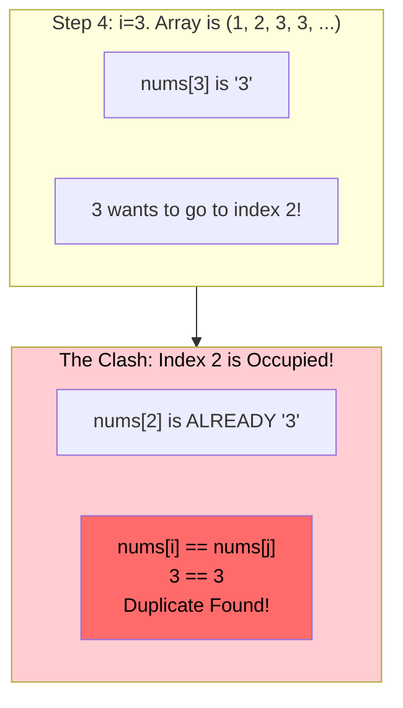

# 🚶‍♂️ Walkthrough: Find the Duplicate Number

## 👶 Explain Like I'm 5
You have N+1 boxes, and exactly N unique toys to put in them. 
Because you have more boxes than unique toys, ONE of the toys must be a duplicate!

We can use our Cyclic Sort trick to put every toy into its correct box. Toy 3 goes into Box 3. Toy 5 goes into Box 5.
If we pick up a Toy 4, we walk over to Box 4 to put it away. But wait! There is ALREADY a Toy 4 sitting right there in Box 4! 
Since we found two of the exact same toy trying to claim the exact same spot, we caught the duplicate red-handed! We don't even need to finish sorting; we can just shout out the answer immediately.

*Note: We solved this same problem in the "Fast & Slow Pointers" chapter using a magical trick that didn't modify the array at all. Cyclic Sort WILL modify the array by swapping elements around, but it is much easier to understand!*

## 🎯 Core Strategy
This is a standard **Cyclic Sort** where we proactively look for a clash.

1. Initialize pointer `i = 0`.
2. Loop through the array using a `while i < n` loop.
3. Check if the current number is happy: `if nums[i] != i + 1`:
   - If it's NOT at its correct index, we look at where it belongs: `j = nums[i] - 1`.
   - Now we check the number currently sitting at index `j`. Is it the EXACT SAME number?
   - **Clash (`nums[i] == nums[j]`)**: Yes! We found two identical numbers fighting for the same spot. It's the duplicate! Return `nums[i]`.
   - **No Clash (`nums[i] != nums[j]`)**: They are different numbers. Swap them, and do not increment `i` so we can process the newly swapped number.
4. If it IS at the correct index (`nums[i] == i + 1`):
   - The number is perfectly happy where it is. Increment `i += 1`.
5. Return -1 if no duplicate is found (though the problem guarantees one).

## 🏃‍♂️ Step-by-Step Execution (Dry Run)
**Example Input**: `nums = [2, 1, 3, 3, 5, 4]`
Initialization: `i = 0`.

| Step | `i` | `nums[i]` | Happy? (`nums[i] == i + 1`) | Target `j` (`nums[i]-1`) | Clash? (`nums[i] == nums[j]`) | Action | Array State |
|------|-----|-----------|-----------------------------|--------------------------|-------------------------------|--------|-------------|
| 1 | `0` | `2` | `2 == 1`? No. | `1` | `2 == 1`? No. | Swap index 0 and 1. | `[1, 2, 3, 3, 5, 4]`|
| 2 | `0` | `1` | `1 == 1`? **YES!** | - | - | Happy. `i += 1`. | `[1, 2, 3, 3, 5, 4]`|
| 3 | `1` | `2` | `2 == 2`? **YES!** | - | - | Happy. `i += 1`. | `[1, 2, 3, 3, 5, 4]`|
| 4 | `2` | `3` | `3 == 3`? **YES!** | - | - | Happy. `i += 1`. | `[1, 2, 3, 3, 5, 4]`|
| 5 | `3` | `3` | `3 == 4`? No. | `2` | `3 == 3`? **YES!** | Found duplicate! Return `3`. | `[1, 2, 3, 3, 5, 4]`|

Result: `3`.

## 📊 Visual Diagram
Here is how the duplicate is caught trying to steal a spot that is already occupied:

## 🛑 Edge Cases & Complexity

### Complexity
- **Time Complexity:** $O(N)$. Every swap places a number permanently in its correct position. The maximum number of swaps is $N$. The function will return as soon as it hits the duplicate, making it highly efficient.
- **Space Complexity:** $O(1)$. All sorting is done in-place.

### Edge Cases Handled Safely
- **Multiple copies of the duplicate:** e.g., `[2, 4, 1, 4, 4]`. The algorithm will still just catch the very first clash between any two `4`s and return `4` immediately. It does not matter how many extra copies exist.
- **Minimum possible array:** `[1, 1]`. `nums[0] = 1`, `i+1 = 1`. Happy, `i` increments. `nums[1] = 1`, `i+1 = 2`. Unhappy. `j = 1-1 = 0`. `nums[0]` is `1`. Clash! Returns `1`. Works perfectly.
