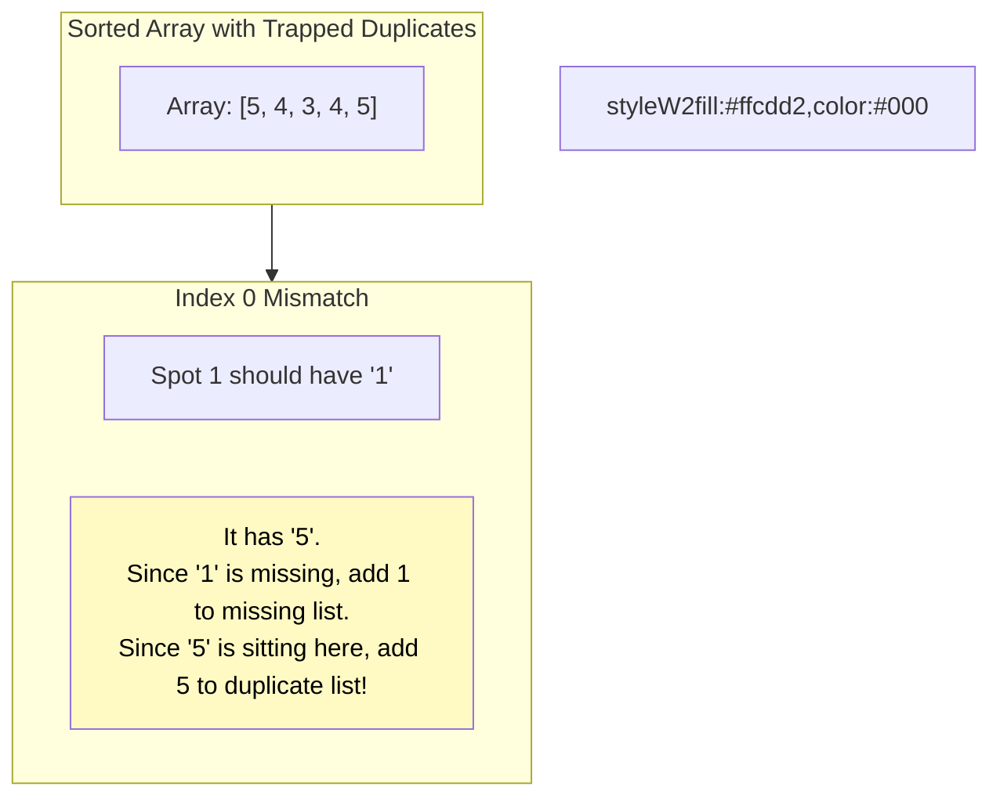

# 🚶‍♂️ Walkthrough: Find all Duplicate Numbers

## 👶 Explain Like I'm 5
This is just like the "Find all Missing Numbers" problem!
You have a box of $N$ puzzle pieces. You try to sort them into their $N$ spots.
If you pick up a Piece 3, and you look at the 3rd spot and see a Piece 3 is already sitting there, you just say, "You're a duplicate!" and leave the extra Piece 3 sitting right where it is.
After you've done this for the whole box, every "correct" piece will be perfectly in its home.
Any piece that is sitting in the WRONG spot MUST be a duplicate!
For example, if you look at the 5th spot, and instead of a Piece 5, you see another Piece 3 sitting there, you just write down "3" on your list of duplicates!

## 🎯 Core Strategy
This uses the exact same **Cyclic Sort** algorithm as "Find all Missing Numbers", but we change *what* we extract during the second pass.

1. **Sort (Cyclic Sort pass):**
   - Initialize pointer `i = 0`.
   - Loop through the array using a `while i < n` loop.
   - The correct index for the number `nums[i]` is `nums[i] - 1`. Let `j = nums[i] - 1`.
   - **Check & Swap**: If `nums[i] != nums[j]`, swap them! This implicitly ignores duplicates because identical twins will evaluate to `nums[i] == nums[j]`.
   - **Ignore / Happy**: If `nums[i] == nums[j]`, just increment `i += 1`.
2. **Find (Second pass):**
   - Iterate through the array `for i in range(n)`.
   - Check if the number matches the spot: `if nums[i] != i + 1`.
   - *In the Missing Numbers problem, we added `i + 1` (the missing index) to our list.*
   - *In this Duplicate Numbers problem, we add `nums[i]` (the number illegally occupying the spot) to our list!*
3. Return the `duplicates` list.

## 🏃‍♂️ Step-by-Step Execution (Dry Run)
**Example Input**: `nums = [3, 4, 4, 5, 5]`
Initialization: `i = 0`.

### Phase 1: Cyclic Sort

| Step | `i` | `nums[i]` | Target `j` (`nums[i]-1`) | Happy or Duplicate? (`nums[i] == nums[j]`) | Action | Array State |
|------|-----|-----------|--------------------------|--------------------------------------------|--------|-------------|
| 1 | `0` | `3` | `2` | No (`3 != 4`) | Swap 0 and 2. | `[4, 4, 3, 5, 5]` |
| 2 | `0` | `4` | `3` | No (`4 != 5`) | Swap 0 and 3. | `[5, 4, 3, 4, 5]` |
| 3 | `0` | `5` | `4` | No (`5 != 5`?) Wait, index 4 is 5. `5 == 5`! | Duplicate trap! `i += 1`. | `[5, 4, 3, 4, 5]` |
| 4 | `1` | `4` | `3` | No (`4 != 4`?) Wait, index 3 is 4. `4 == 4`! | Duplicate trap! `i += 1`. | `[5, 4, 3, 4, 5]` |
| 5 | `2` | `3` | `2` | **YES!** Happy (`3 == 3`) | `i += 1`. | `[5, 4, 3, 4, 5]` |
| 6 | `3` | `4` | `3` | **YES!** Happy (`4 == 4`) | `i += 1`. | `[5, 4, 3, 4, 5]` |
| 7 | `4` | `5` | `4` | **YES!** Happy (`5 == 5`) | `i += 1`. | `[5, 4, 3, 4, 5]` |

### Phase 2: Find Duplicates
Walk through `[5, 4, 3, 4, 5]`:
- Index `0` (Spot 1): `5` (**MISMATCH!**) $\rightarrow$ Spot 1 is occupied by a duplicate `5`. Add `5`.
- Index `1` (Spot 2): `4` (**MISMATCH!**) $\rightarrow$ Spot 2 is occupied by a duplicate `4`. Add `4`.
- Index `2` (Spot 3): `3` (Match)
- Index `3` (Spot 4): `4` (Match)
- Index `4` (Spot 5): `5` (Match)

Result: `[5, 4]`.

## 📊 Visual Diagram
Here is the difference between finding missing numbers and finding duplicates:

## 🛑 Edge Cases & Complexity

### Complexity
- **Time Complexity:** $O(N)$. The cyclic sort takes at most $N-1$ swaps, and the array iteration takes exactly $N$ steps. The second pass takes another $N$ steps. Total is strictly $O(N)$.
- **Space Complexity:** $O(1)$. All operations are done in-place, ignoring the space required for the output array.

### Edge Cases Handled Safely
- **No duplicates:** e.g., `[1, 2, 3]`. The array perfectly sorts. The second pass verifies `1==1, 2==2, 3==3` and returns an empty list `[]`.
- **Only duplicates:** e.g., `[2, 2]`. Array becomes `[2, 2]`. Index 0 has `2` (Mismatch, add `2`). Index 1 has `2` (Match). Returns `[2]`. Perfectly handles edge cases.
