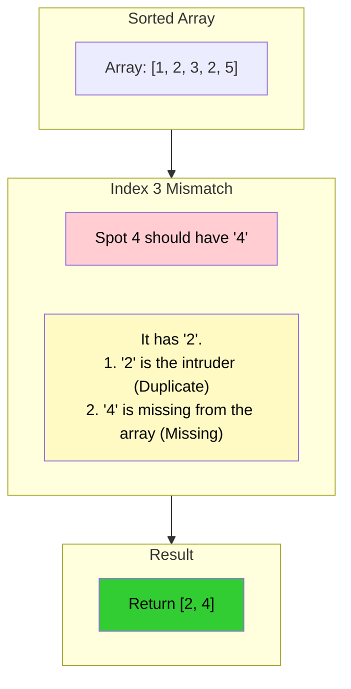

# 🚶‍♂️ Walkthrough: Find the Corrupt Pair

## 👶 Explain Like I'm 5
You have a box of $N$ puzzle pieces that should be numbered 1 to $N$.
But the factory made a mistake (a corruption!). They accidentally put **two copies of one piece** into the box, and entirely **forgot to put another piece in!**
Since the box still has exactly $N$ pieces, this means exactly ONE number is duplicated, and exactly ONE number is missing.

We use our Cyclic Sort trick to put every piece into its correct spot.
After we finish swapping, exactly ONE spot will have the wrong piece in it.
If the 4th spot has a Piece 2 sitting in it, what does that tell us?
1. Piece 2 is the **DUPLICATE** (because the real Piece 2 is already sitting happily in the 2nd spot).
2. Piece 4 is **MISSING** (because its spot was stolen by the duplicate, and it's nowhere to be found in the box!)

## 🎯 Core Strategy
This uses the standard **Cyclic Sort** algorithm to sort the array, followed by a single pass to find the one mismatch. This is effectively combining "Find Missing Number" and "Find Duplicate Number" into a single result!

1. **Sort (Cyclic Sort pass):**
   - Initialize pointer `i = 0`.
   - Loop through the array using a `while i < n` loop.
   - The correct index for the number `nums[i]` is `nums[i] - 1`. Let `j = nums[i] - 1`.
   - **Check & Swap**: If `nums[i] != nums[j]`, swap them! This implicitly ignores the duplicate because identical twins evaluate to `nums[i] == nums[j]`.
   - **Ignore / Happy**: If `nums[i] == nums[j]`, just increment `i += 1`.
2. **Find (Second pass):**
   - Iterate through the array `for i in range(n)`.
   - Find the single index where the number doesn't match the spot: `if nums[i] != i + 1`.
   - When we find this mismatch:
     - `nums[i]` is the number illegally sitting in the spot. It is the **duplicate**.
     - `i + 1` is the spot that was stolen. It is the **missing** number.
3. Return `[nums[i], i + 1]`.

## 🏃‍♂️ Step-by-Step Execution (Dry Run)
**Example Input**: `nums = [3, 1, 2, 5, 2]`. Length $N = 5$.
Initialization: `i = 0`.

### Phase 1: Cyclic Sort

| Step | `i` | `nums[i]` | Target `j` | Happy or Duplicate? (`nums[i] == nums[j]`) | Action | Array State |
|------|-----|-----------|------------|--------------------------------------------|--------|-------------|
| 1 | `0` | `3` | `2` | No (`3 != 2`) | Swap 0 and 2. | `[2, 1, 3, 5, 2]` |
| 2 | `0` | `2` | `1` | No (`2 != 1`) | Swap 0 and 1. | `[1, 2, 3, 5, 2]` |
| 3 | `0` | `1` | `0` | **YES!** Happy (`1 == 1`) | `i += 1`. | `[1, 2, 3, 5, 2]` |
| 4 | `1` | `2` | `1` | **YES!** Happy (`2 == 2`) | `i += 1`. | `[1, 2, 3, 5, 2]` |
| 5 | `2` | `3` | `2` | **YES!** Happy (`3 == 3`) | `i += 1`. | `[1, 2, 3, 5, 2]` |
| 6 | `3` | `5` | `4` | No (`5 != 2`) | Swap 3 and 4. | `[1, 2, 3, 2, 5]` |
| 7 | `3` | `2` | `1` | **YES!** Duplicate Trap! `2 == 2` | `i += 1`. | `[1, 2, 3, 2, 5]` |
| 8 | `4` | `5` | `4` | **YES!** Happy (`5 == 5`) | `i += 1`. | `[1, 2, 3, 2, 5]` |

### Phase 2: Find the Pair
Walk through `[1, 2, 3, 2, 5]`:
- Index `0` (Spot 1): `1` (Match)
- Index `1` (Spot 2): `2` (Match)
- Index `2` (Spot 3): `3` (Match)
- Index `3` (Spot 4): `2` (**MISMATCH!**) $\rightarrow$ Spot 4 is occupied by a duplicate `2`. The number `4` is missing!
- *We return `[2, 4]` immediately.*

Result: `[2, 4]`.

## 📊 Visual Diagram
Here is how one mismatch reveals two pieces of information:

## 🛑 Edge Cases & Complexity

### Complexity
- **Time Complexity:** $O(N)$. The cyclic sort takes at most $N-1$ swaps, and the array iteration takes at most $N$ steps. Total is strictly $O(N)$.
- **Space Complexity:** $O(1)$. All operations are done in-place, and we return a tiny array of exactly two elements.

### Edge Cases Handled Safely
- **Minimum possible array:** e.g., `[2, 2]`. Array is already sorted. Second pass checks index 0 (Spot 1). It sees `2`. `2 != 1`. Returns `[2, 1]` instantly.
- **Missing number is at the end:** e.g., `[1, 2, 2]`. Sort finishes. Array is `[1, 2, 2]`. Index 2 (Spot 3) has `2`. Returns `[2, 3]`. Works perfectly.
