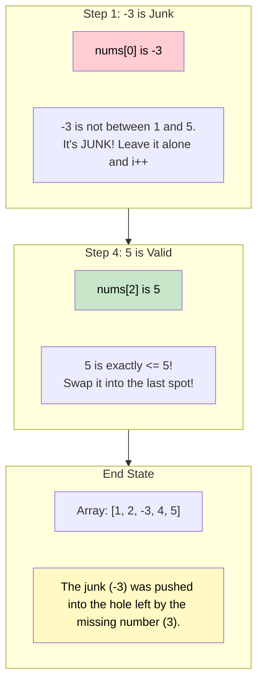

# 🚶‍♂️ Walkthrough: Find the Smallest Missing Positive Number

## 👶 Explain Like I'm 5
You have a really messy room full of toys. Some toys have negative numbers (like -5), some have zero (0), and some have huge numbers (like 1,000,000). 
Your parents tell you to find the **SMALLEST positive toy number** that is missing from your room. Positive numbers start at 1, 2, 3...

Here is a big secret: Because your room can only hold $N$ toys total, the smallest missing positive number MUST be somewhere between 1 and $N+1$.
Why? If your room holds 5 toys, the absolutely best you could possibly do is have toys 1, 2, 3, 4, 5. In that perfect case, the missing one is 6 (which is $N+1$). In literally any other case (like having a -5 or a 1,000,000), one of the spots for 1 through 5 is wasted, meaning the missing number is 1, 2, 3, 4, or 5!

So, we use Cyclic Sort to try and put Toy 1 in Spot 1, Toy 2 in Spot 2, and so on...
If we find a toy like -5 or 1,000,000, we just **IGNORE IT!** It doesn't belong in Spots 1 to $N$, so we just let it sit wherever it lands.
After sorting, we walk through the spots. The first spot that doesn't have the right toy is our answer!

## 🎯 Core Strategy
This is a brilliant application of **Cyclic Sort** that uses the array itself as a hash map, while safely ignoring out-of-bounds values.

1. **Sort (Cyclic Sort pass):**
   - Initialize pointer `i = 0`.
   - Loop through the array using a `while i < n` loop.
   - The correct index for a number `nums[i]` is `j = nums[i] - 1`.
   - **Bounds Check**: We ONLY care about `nums[i]` if it's a valid positive number that fits perfectly inside our array's capacity: `0 < nums[i] <= n`.
   - **Check & Swap**: If it is valid AND not already at its correct spot (`nums[i] != nums[j]`), swap them!
   - **Ignore / Happy**: Else (it's negative, zero, too big, or already perfectly placed), increment `i += 1`. This naturally filters out the "junk".
2. **Find (Second pass):**
   - Iterate through the array `for i in range(n)`.
   - Find the first index where `nums[i] != i + 1`. This means the number `i + 1` was nowhere to be found in the array! Return `i + 1`.
3. If all spots are perfectly filled with 1 to $N$, then the array was `[1, 2, ..., N]`. The missing one is the very next number: `N + 1`. Return `n + 1`.

## 🏃‍♂️ Step-by-Step Execution (Dry Run)
**Example Input**: `nums = [-3, 1, 5, 4, 2]`. Length $N = 5$.
Initialization: `i = 0`.

### Phase 1: Cyclic Sort

| Step | `i` | `nums[i]` | Target `j` | Valid? (`0 < nums <= 5`) | Happy? (`nums[i] == nums[j]`) | Action | Array State |
|------|-----|-----------|------------|--------------------------|-------------------------------|--------|-------------|
| 1 | `0` | `-3` | `-4` | **NO!** | - | Ignore junk. `i += 1`. | `[-3, 1, 5, 4, 2]` |
| 2 | `1` | `1` | `0` | Yes | No (`1 != -3`) | Swap 1 and 0. | `[1, -3, 5, 4, 2]` |
| 3 | `1` | `-3` | `-4` | **NO!** | - | Ignore junk. `i += 1`. | `[1, -3, 5, 4, 2]` |
| 4 | `2` | `5` | `4` | Yes | No (`5 != 2`) | Swap 2 and 4. | `[1, -3, 2, 4, 5]` |
| 5 | `2` | `2` | `1` | Yes | No (`2 != -3`) | Swap 2 and 1. | `[1, 2, -3, 4, 5]` |
| 6 | `2` | `-3` | `-4` | **NO!** | - | Ignore junk. `i += 1`. | `[1, 2, -3, 4, 5]` |
| 7 | `3` | `4` | `3` | Yes | **YES!** Happy (`4 == 4`) | `i += 1`. | `[1, 2, -3, 4, 5]` |
| 8 | `4` | `5` | `4` | Yes | **YES!** Happy (`5 == 5`) | `i += 1`. | `[1, 2, -3, 4, 5]` |

### Phase 2: Find Smallest Missing
Walk through `[1, 2, -3, 4, 5]`:
- Index `0` (Spot 1): `1` (Match)
- Index `1` (Spot 2): `2` (Match)
- Index `2` (Spot 3): `-3` (**MISMATCH!**) $\rightarrow$ Spot 3 is occupied by junk `-3`. The number `3` is missing!
- *We return `3` immediately.*

Result: `3`.

## 📊 Visual Diagram
Here is how the algorithm seamlessly filters out negative numbers and large numbers:

## 🛑 Edge Cases & Complexity

### Complexity
- **Time Complexity:** $O(N)$. The cyclic sort takes at most $N-1$ swaps, ignoring out-of-bounds elements in $O(1)$ time per check. The second pass takes at most $N$ steps. Total is strictly $O(N)$.
- **Space Complexity:** $O(1)$. All operations are done in-place, achieving the strict $O(1)$ space requirement of the problem.

### Edge Cases Handled Safely
- **All negatives:** e.g., `[-1, -2, -3]`. The `while` loop ignores everything. Array remains unchanged. Second pass checks index 0 (Spot 1), sees `-1 != 1`. Returns `1` instantly. Correct!
- **Perfect array:** e.g., `[1, 2, 3]`. The `while` loop verifies everyone is happy. Second pass verifies everyone matches. Loop finishes. Code reaches `return n + 1`, which returns `4`. Correct!
